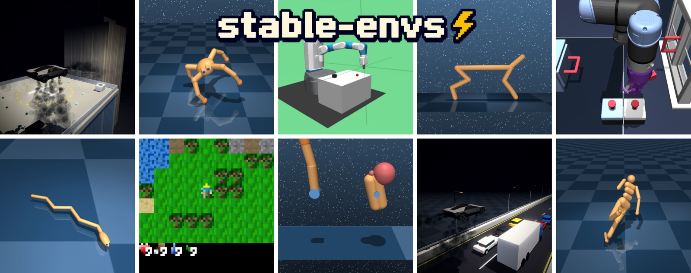

<p align="center"><i>Fast and Reproducible Environments with Controllable Variations</i></p>

<p align="center">
  <a href="https://galilai-group.github.io/stable-envs/"></a>
  <a href="https://pypi.org/project/stable-envs/"></a>
  <a href="https://github.com/galilai-group/stable-envs/actions/workflows/ci.yml"></a>
  <a href="https://github.com/galilai-group/stable-envs/blob/main/pyproject.toml"></a>
  <a href="https://github.com/galilai-group/stable-envs/blob/main/LICENSE"></a>
</p>

<p align="center">
  <a href="#installation"><b>Installation</b></a> ·
  <a href="#quick-start"><b>Quick Start</b></a> ·
  <a href="#environments"><b>Environments</b></a> ·
  <a href="https://galilai-group.github.io/stable-envs/"><b>Documentation</b></a>
</p>

---

stable-envs is a library of batched simulation environments that keep the full simulator state, so you can restore any step exactly and render images from it later, on CPU or GPU.

Store states instead of pixels, replay or branch from any step, and render frames from a stored state as many times as you like. 80 environment classes in 11 families share the same API.

## Installation

```bash
pip install stable-envs                       # or: uv add stable-envs
pip install "stable-envs[pusht]"              # PushT simulation and CPU rendering
pip install "stable-envs[dmcontrol,ogbench]"  # add family extras as needed
stable-envs doctor                            # check what works on this machine
```

Install the `robotics` extra (Fetch) in its own environment, because it needs MuJoCo below 3.12, while `dmcontrol`, `mshuman`, `roadster` and `ogbench-manipulation` need 3.17. [Install](https://galilai-group.github.io/stable-envs/install/) lists every extra and the OpenGL setup.

## Quick Start

```python
import torch
import stable_envs as snv

with snv.CartPole(num_envs=8, device="cpu") as env:
    env.reset(seed=0)
    actions = torch.randint(0, 2, (8, 10, 1))  # (B, T, A): ten steps for each environment
    out = env.step(actions, frames=None)  # step without rendering
    print(out["states"].batch_size)  # torch.Size([8, 10])
    frames = env.render(out["states"][:, 4])  # render the state after five steps
    print(frames.shape, frames.dtype)  # torch.Size([8, 400, 600, 3]) torch.uint8
```

`step` returns the state after every step, and `render` draws a batch of frames from any of them.

The [Quickstart](https://galilai-group.github.io/stable-envs/quickstart/) covers state, frames, steps, save and restore, and variation. For policies, datasets and training, see [stable-worldmodel](https://github.com/galilai-group/stable-worldmodel).

## Environments

| Family | Classes | Extra |
|---|---:|---|
| [`classic_control`](https://galilai-group.github.io/stable-envs/environments/classic-control/) | 5 | none (`classic` for MountainCar, MountainCarContinuous and Pendulum) |
| [`craftax`](https://galilai-group.github.io/stable-envs/environments/craftax/) | 4 | `craftax` |
| [`dmcontrol`](https://galilai-group.github.io/stable-envs/environments/dmcontrol/) | 17 | `dmcontrol` |
| [`fetch`](https://galilai-group.github.io/stable-envs/environments/fetch/) | 12 | `robotics` |
| [`miniworld`](https://galilai-group.github.io/stable-envs/environments/miniworld/) | 1 | `miniworld` |
| [`mshuman`](https://galilai-group.github.io/stable-envs/environments/mshuman/) | 1 | `mshuman` |
| [`navigation`](https://galilai-group.github.io/stable-envs/environments/navigation/) | 5 | none (`navigation` for SimplePointMaze) |
| [`ogbench`](https://galilai-group.github.io/stable-envs/environments/ogbench/) | 27 | `ogbench`, or `ogbench-manipulation` for Cube and Scene |
| [`pusht`](https://galilai-group.github.io/stable-envs/environments/pusht/) | 2 | `pusht` |
| [`pyflyt`](https://galilai-group.github.io/stable-envs/environments/pyflyt/) | 1 | `rocket` |
| [`roadster`](https://galilai-group.github.io/stable-envs/environments/roadster/) | 5 | `roadster` |
| **Total** | **80** | |

## Examples

- [`examples/`](https://github.com/galilai-group/stable-envs/blob/main/examples/README.md): short scripts for rendering, batching, action sequences and domain randomization.
- [`examples/lewm/`](https://github.com/galilai-group/stable-envs/blob/main/examples/lewm/README.md): train and evaluate stable-worldmodel's LeWM world model on PushT, with frames that `env.render` draws on the training device from stored states.

## Documentation

The full documentation is at [galilai-group.github.io/stable-envs](https://galilai-group.github.io/stable-envs/).

## Questions

Open an [issue](https://github.com/galilai-group/stable-envs/issues) on GitHub.

## License

MIT, except the three PushT rasterizer files that port pygame's drawing routines, which are LGPL-2.1-or-later. See [LICENSE](https://github.com/galilai-group/stable-envs/blob/main/LICENSE) and [THIRD_PARTY_NOTICES.md](https://github.com/galilai-group/stable-envs/blob/main/THIRD_PARTY_NOTICES.md).
