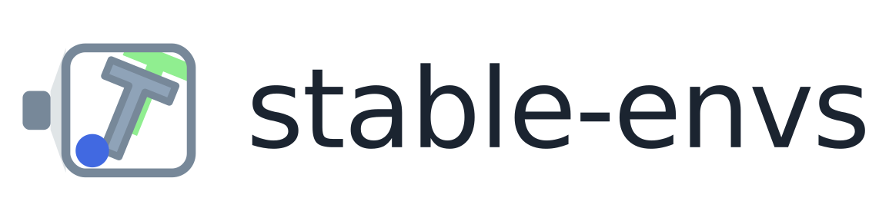

<picture>
  <source media="(prefers-color-scheme: dark)" srcset="docs/assets/brand/logo-dark.png">
  
</picture>

**A batched environment library for research: explicit state, dynamics, and variation, with fast state-driven rendering across CPU and GPU.**

[](LICENSE)
[](pyproject.toml)

Keep exhaustive State for replay and branching. Render frames from State when needed. Compact RenderState is a private renderer projection and does not replace a simulator checkpoint.

Authors: **Randall Balestriero**, **Sami BuGhanem**.

## Install

```bash
pip install stable-envs
pip install "stable-envs[pusht]"              # source-aligned PushT simulation and CPU rendering
pip install "stable-envs[dmcontrol,ogbench]"  # add family extras as needed
```

A missing optional extra costs **that family**, not the package. `snv.import_errors()` names the modules that did not load.

CUDA is required for the 3-D and most MuJoCo families. PushT, classic control, navigation and several 2-D families run on CPU.

The Fetch MuJoCo pin and the nvdiffrast source build: [Install](docs/install.md).

Editable install (from a clone) lives under [Contributing](CONTRIBUTING.md).

## Quickstart

```python
import stable_envs as snv

with snv.CartPole(num_envs=64) as env:          # device="auto" → CUDA if available, else CPU
    state = env.reset(seed=0)                # State
    pixels = env.render(state)               # Frame: (64, H, W, 3) uint8
    action = env.action_spec.sample(64, env.rng)
    out = env.step(action)                   # stateful
    state = out["state"]
    env.set_state(state)                    # restores full State; returns None
```

Concrete classes are canonical. Strings are those class names:

```python
env = snv.make("CartPole", num_envs=64)
print(snv.list_envs())
print(snv.info("CartPole"))
snv.set(verbose="INFO", default_device="auto")
```

`step(actions, states=slice(None), frames=slice(-1, None))` advances live environments. Actions are `[B,A]` for one step or `[B,T,A]` for a sequence. Independent slices select State history and rendered frames; `None` disables either history. The final State is always returned. See [selection semantics](docs/concepts/dynamics.md). There is no `env.rollout(policy=...)`. Planning, datasets and training belong to sibling [stable-*](https://github.com/galilai-group) projects.

Full walkthrough: [Quickstart](docs/quickstart.md).

## What the public API is

```text
snv.Env, snv.State, snv.StepResult, snv.VariationLike
snv.Spec, snv.CompositeSpec
snv.make, snv.info, snv.list_envs, snv.list_families, snv.import_errors
snv.set, snv.get_config, snv.__version__
snv.CartPole / snv.Pendulum / …                  concrete env classes
```

`stable_envs.testing` is a public measurement library; it is not advertised at `snv.*`. There is no runtime interop contract with other stable-* packages.

| topic | page |
|---|---|
| Environment listing | [docs/environments.md](docs/environments.md) |
| State, Action, Variation, Frame | [docs/concepts/state.md](docs/concepts/state.md) |
| Stepping, action sequences and capture | [docs/concepts/dynamics.md](docs/concepts/dynamics.md) |
| `close()` / context manager | [docs/concepts/lifecycle.md](docs/concepts/lifecycle.md) |
| Sibling projects | [docs/concepts/worldmodel.md](docs/concepts/worldmodel.md) |
| Backend and device limitations | [docs/concepts/limitations.md](docs/concepts/limitations.md) |
| How throughput numbers were taken | [docs/benchmarks.md](docs/benchmarks.md) |

## Examples

These three scripts use only the public `snv` surface and degrade honestly when an extra is missing:

```bash
python examples/render.py --help
python examples/batched_env.py --help
python examples/functional_dynamics.py --help
```

## Keep your training loop. Delete your image dataset.

`render(full_state)` produces frames without advancing simulation. Learner-visible
observation selection and dataset filtering belong to stable-worldmodel. Renderer
parity and exact simulation/restoration are separate acceptance gates.

For contributor-only compact corpus handling, see the
[renderer guide](docs/adding/renderer.md). Public applications keep full State
snapshots; compact rows cannot be used to restore omitted simulator fields.

Frames at native resolution: [Gallery](docs/gallery.md).

## Environments

With every extra installed, `snv.list_envs()` returns 76 environments:

| family | environments |
|---|---:|
| `classic_control` | 5 |
| `craftax` | 6 |
| `dmcontrol` | 18 |
| `fetch` | 12 |
| `navigation` | 5 |
| `ogbench` | 27 |
| `pusht` | 2 |
| `pyflyt` | 1 |

Every registered environment simulates except `CraftaxClassic` and `CraftaxFull`, which are
renderer-only: `reset` and `step` raise, and `CraftaxClassicPixels` and `CraftaxPixels` carry the
simulation. The waivers are listed in [`tests/exemptions.toml`](tests/exemptions.toml).

`len(snv.list_envs())` is the answer **on this interpreter**. A family registers only when its
dependencies import, so a machine without `mujoco` does not register DM Control, Fetch or OGBench
manipulation, and without PyFlyt the count is 75.

```python
snv.import_errors()  # {module: "ModuleNotFoundError: ..."}
snv.list_families()  # stable family ids that registered
```

Device honesty is part of the contract: OGBCube, OGBScene and PyFlytRocketLanding refuse CPU rather than silently falling back; Fetch has no CPU backend. Details: [limitations](docs/concepts/limitations.md).

Renderer-only ports of other families (MiniGrid, Highway, RoboCasa, …) are kept in the repository under [`contrib/`](contrib/README.md). They are not checked against their upstream State and are not part of the released package.

## Testing

`uvx nox -s "test(<profile>)"` builds one family's pinned environment from `uv.lock` and runs its
tests; `ci/families.toml` says which paths and test files each profile owns. Every registered class
is held to the generic contract in `tests/unit/test_registry_conformance.py`, and
`tests/unit/test_registry_coverage.py` requires it to have one owning family, a source comparison
and, where stable-worldmodel has a variation space, a variation map. A waiver of either rule lives
only in `tests/exemptions.toml`, which has a code owner. Profiles whose gates compare against
stable-worldmodel run it live at the commit pinned in `ci/families.toml`. See
[Contributing](CONTRIBUTING.md).

## Documentation

```bash
pip install "stable-envs[docs]"
mkdocs serve
```

| | |
|---|---|
| [Home](docs/index.md) | claim, quickstart, where to go |
| [Install](docs/install.md) | extras, pins, nvdiffrast |
| [Adding a component](docs/adding/index.md) | environment, task and renderer guides |
| [Testing](docs/testing.md) | what each check rules out |

## License

MIT. See [LICENSE](LICENSE).
