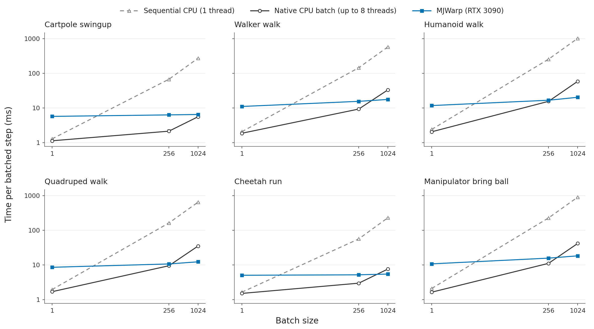
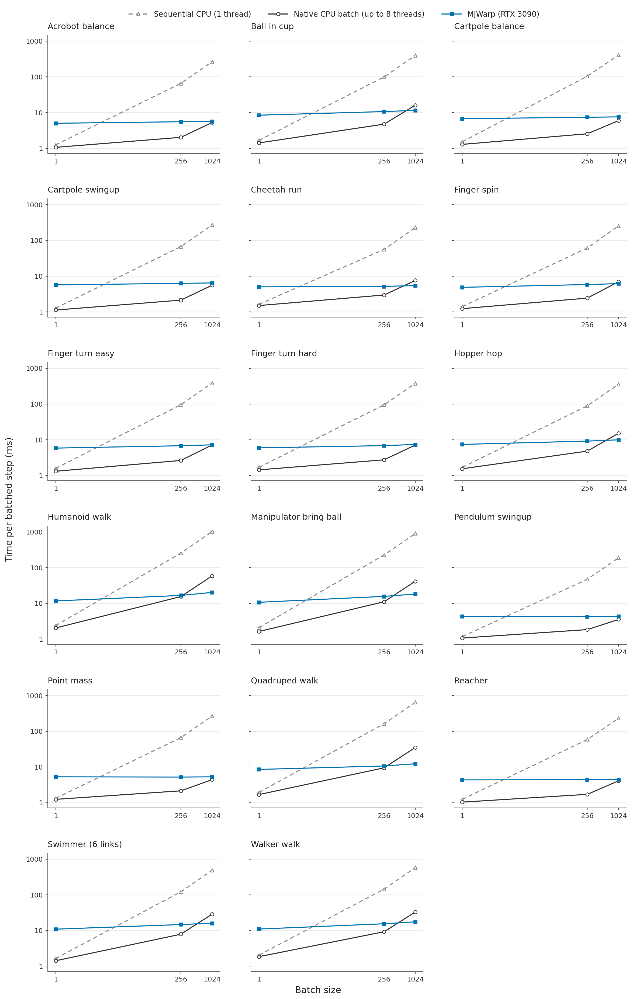
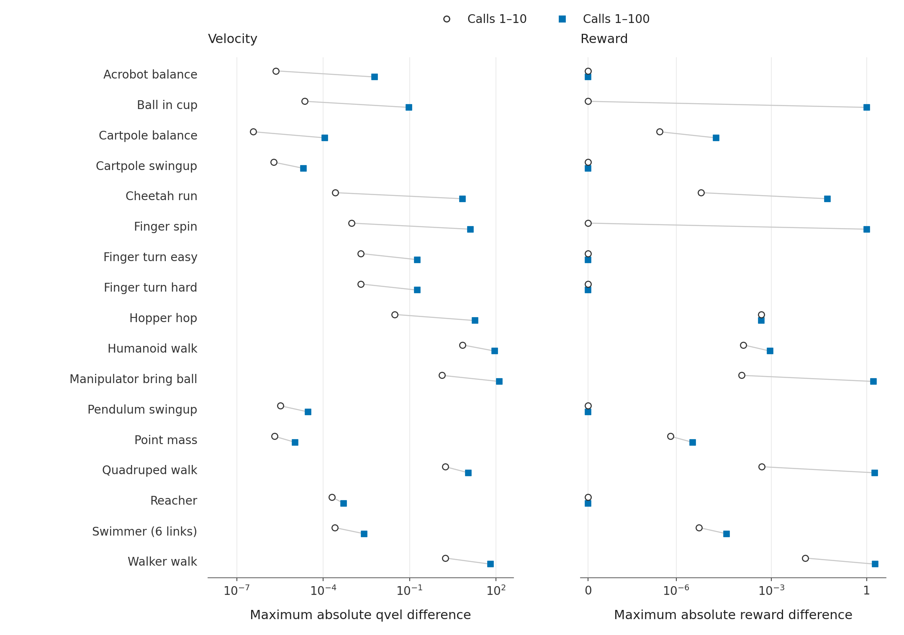
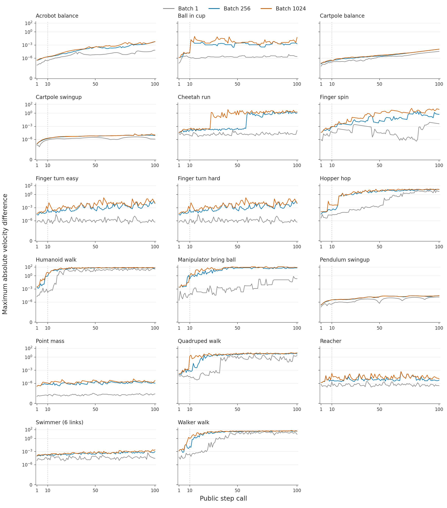
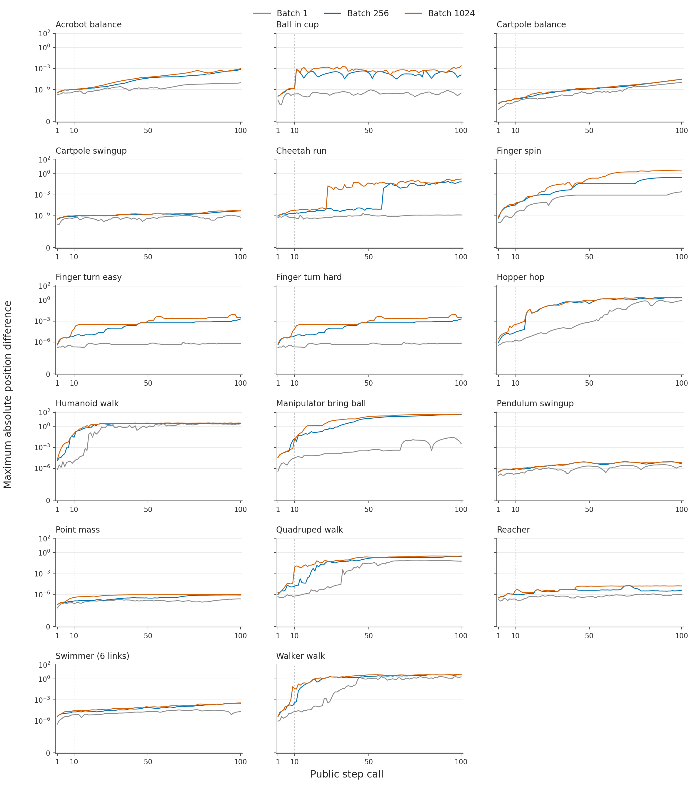
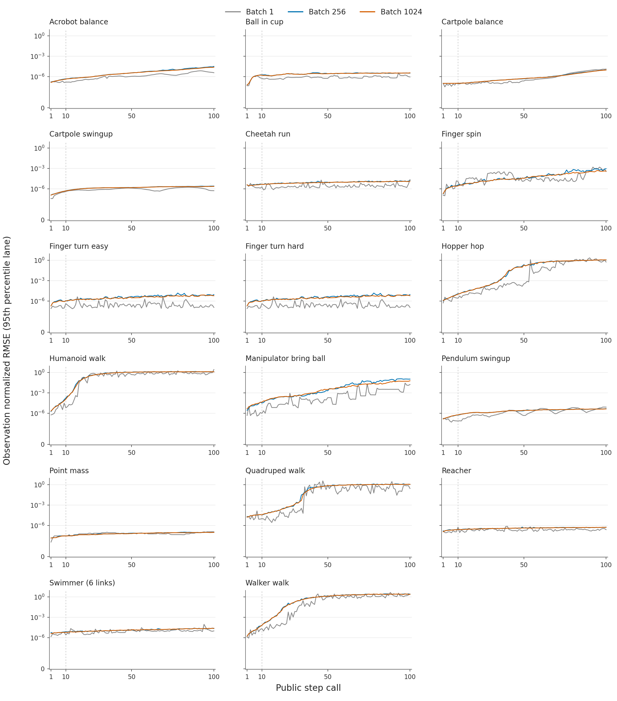
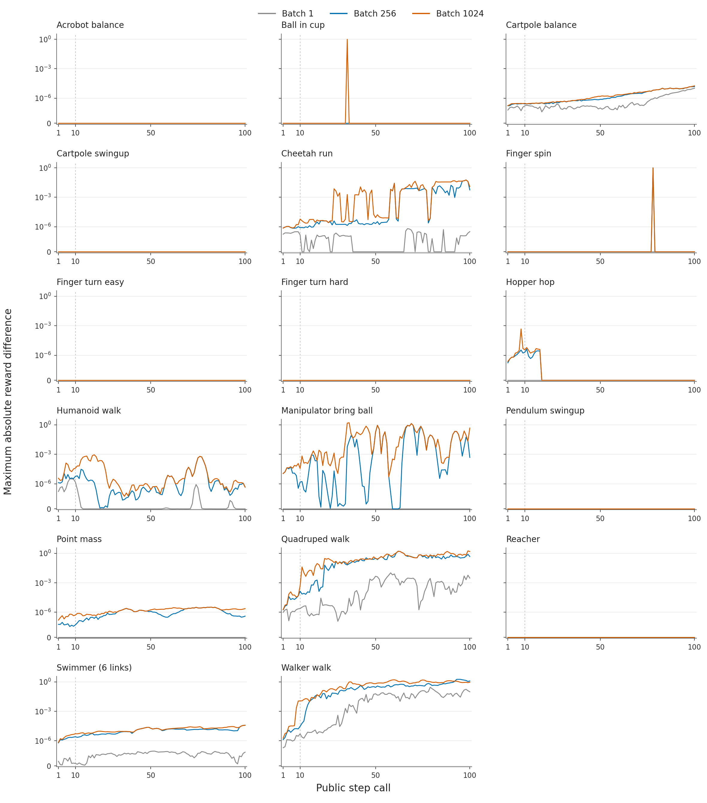
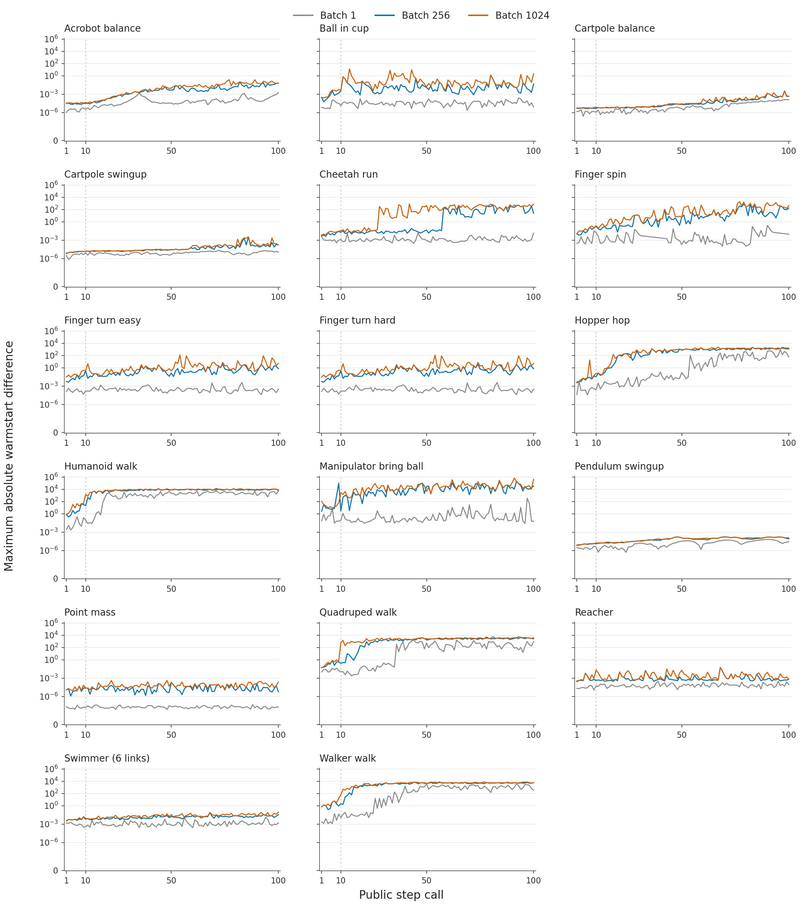

# DMC MJWarp 3.17 measurements

Figures and validation summaries for [PR #28](https://github.com/galilai-group/stable-envs/pull/28).
Measurements use revision `2858b2478f5db5c5f57c7b5c4fc89e9cf2e81da9`.
Tests after integration with main use `abd33499a54a26d6ce5cc89991af99431fad3d8a`;
the benchmarks were not rerun after that merge.

## Timing

Each point is the geometric mean of three seed median latencies; whiskers span
those medians. Each run uses 20 warmup calls followed by 100 synchronized public
step calls. Only batches 1, 256 and 1024 were measured; lines connect measurements.
Each public call advances two DMC control rounds, with task-specific physics
substeps. Timing includes wrappers, full State/task outputs on CUDA, and
input/output transfers. Construction, reset, warmup, frames and history are excluded.

Native batch uses up to eight EPYC 7532 threads and MJWarp uses an RTX 3090,
measured in the same allocation. Sequential CPU uses one EPYC 7413 core in a
separate allocation. The six-panel selection matches Ahi's DMC figure. Vertical
scales are shared within each figure.

[SVG](timing-six.svg)

### All 17 environments

[SVG](timing-all.svg)

## Divergence summary

MJWarp versus native CPU. Points show the largest absolute error across lanes,
components, batches 1/256/1024 and three seeds, over calls 1–10 or 1–100. Each
paired run starts from the same native checkpoint and uses the same seeded
uniform random actions without resynchronization. Velocity differences are in
each task's native coordinate units. Reward values are public step outputs.
The reward axis is linear close to zero and logarithmic beyond 1e-8; zero values
are plotted at zero. These are descriptive maxima, not acceptance thresholds.
Larger batches also sample more trajectories.

[SVG](divergence-summary.svg)

## Full rollout curves

All 100 calls are shown. Each color is a batch size; each point is the maximum
across three seeds. Position, velocity, reward and warmstart plots show maximum
absolute error across lanes/components. Observation plots show the 95th percentile
across lanes of RMSE / max(1, native CPU RMS), then the maximum across seeds.
Each figure uses one common vertical scale across all environments. Axes are
linear near zero and logarithmic above 1e-10 (reward: 1e-8), without clipping or
flooring data. The dashed vertical line marks call 10. No numerical acceptance
line is drawn. Cartpole Swingup has no positive rewards in these random rollouts.

### Velocity error

[SVG](velocity-all.svg)

### Position error

[SVG](position-all.svg)

### Observation error

[SVG](observation-all.svg)

### Reward error

[SVG](reward-all.svg)

### Warmstart error

[SVG](warmstart-all.svg)

## Data and validation

[Figure data](figure-data.json) contains the timing measurements, divergence
summary values, aggregation definitions, source hashes and figure hashes.
[Captions](captions.txt) are also available as plain text.

- After the main merge (`abd33499`): [report](validation/after-merge/REPORT.txt)
  and [counts and archive hashes](validation/after-merge/summary.json).
- Before the main merge (`2858b247`): [broader regression report](validation/before-merge/REPORT.txt)
  and [test groups, baseline failures, skips and archive hashes](validation/before-merge/summary.json).

The broader GPU run includes failures reproduced on its main baseline and
hardware-specific skips. The two source-visibility failures now pass after the
main merge. H200/software-profile checks remain unverified on the RTX 3090.
Raw XML, inventories, logs and rollout arrays are retained in the experiment
archives; this directory contains the figures and summaries.
