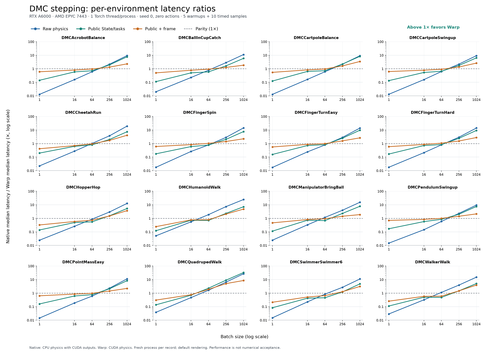

# DM Control

These 17 classes port tasks of the [DeepMind Control Suite](https://github.com/google-deepmind/dm_control)
([Tassa et al., 2018](https://arxiv.org/abs/1801.00690)).

The renderers come in two groups:

- The fixed-camera tasks (Acrobot, Ball in cup, Cartpole, Finger, Manipulator, Pendulum, Point mass and
  Reacher) use the analytic ray caster `raycast3d`. The tests compare their frames with MuJoCo's
  frames pixel by pixel.
- The body-tracking tasks (Cheetah, Hopper, Humanoid, Quadruped, Swimmer and Walker) use `cpu3d` on CPU
  and MJWarp on CUDA. Their frames differ from MuJoCo's frames. `env.describe()["visual_fidelity"]`
  gives the measured agreement.

Each action dimension drives one actuator of the model, in the order of the MuJoCo model. The bounds
come from the actuator control range.

```python
import stable_envs as snv

env = snv.DMCReacher(num_envs=8)
state = env.reset(seed=0)
out = env.step(env.action_spec.sample(8))
```

The reward of each source control step is in [0, 1]. Each public action repeats twice and returns
the sum of both rewards. The suite does not define a success criterion. Ball
in cup is the exception: its `success` value is 1 when the ball is in the cup.

## Direct MuJoCo Warp physics

The 16 classes other than Reacher accept `simulation_backend="mjwarp"` for direct batched physics on
CUDA. Install `stable-envs[dmcontrol-gpu]`; this backend uses MuJoCo/MuJoCo Warp 3.12. Explicit selection
raises an error if CUDA or the dependencies are unavailable. `backend` still selects rendering.
Automatic routing is unchanged, including Reacher's existing native/MJX selection.

```python
with snv.DMCFingerTurnHard(num_envs=256, device="cuda", simulation_backend="mjwarp") as env:
    state = env.reset(seed=7)
    result = env.step(env.action_spec.sample(256))
    checkpoint = env.get_state()
    env.set_state(checkpoint)
```

The shared adapter owns lifecycle, the two action repetitions, native reset sampling and checkpoints.
A private runtime owns Warp buffers, CUDA stream ordering, graph capture and physics substeps. Bound
domain tasks compute observations, rewards and info on device; Cartpole and Finger variants share
formulas. Existing model factories, State schemas and physical-variation calculations are reused.

Warp physics uses float32; public State retains its existing shapes and dtypes, including float64
physical columns. `set_state(s); get_state()` preserves the supplied checkpoint exactly, including
warmstart, activation, lifecycle, cumulative reward, complete RNG, episode targets and variation.
Snapshots own their memory. This does not guarantee bitwise identical future GPU trajectories.
Rendering continues to consume State, independently of the stepping backend.

Source physics substeps, RK4 and acceleration-stage sensor timing are retained. Native environments
remain authoritative for resets and RNG. A pending reset consumes a control round with zero reward;
continuing lanes use a compact scratch runtime. A changed active-lane count requires a new scratch
allocation, so mixed resets can cost more than steady-state stepping.

For Warp 3.12 the runtime corrects plane–capsule friction frames and capsule–capsule geometry to
follow native MuJoCo's [primitive collisions](https://github.com/google-deepmind/mujoco/blob/3.12.0/src/engine/engine_collision_primitive.c).
The capsule correction uses float64 local arithmetic for closest points and intersecting-axis normals.
This avoids choosing the wrong endpoint or creating a duplicate constraint for nearly parallel
capsules, as observed in Hopper. Genuinely parallel pairs retain upstream handling; stored dynamics
and integration remain float32. Focused tests compare contact geometry, impulses and touch sensors
against native MuJoCo. Acceleration-stage readings are cleared before stepping so touch forces do
not accumulate from checkpoint reconstruction.
Cheetah also orders joint-limit and contact constraints consistently before each solve, including
after checkpoint restoration and mixed resets. This removes replay variation caused by parallel
constraint allocation; the solver equations, contacts and iteration settings stay unchanged.
Manipulator accumulates elliptic contact curvature in constraint-row order, with one writer per
world and Hessian entry. This removes a source of floating-point atomic-sum variation while keeping
worlds parallel. Its DMC-local dense Newton loop reuses MuJoCo Warp 3.12's line search, convergence
and factorization kernels, with the original warmstart and iteration settings.

### Validation status

This backend is experimental. The implementation has passed CUDA integration for all 16 classes,
including checkpoint ownership/restoration and rendering captured States. Full numerical source and
resumed-rollout acceptance remains unfinished. Earlier Cheetah and Manipulator checks each passed 60 repeated CUDA
replay comparisons (including 30 on fresh seeds), 100 independent CPU-reference comparisons and
checks that reject missing action repetition, wrong controls and disabled contacts. Their measured
eight-step replays were exactly equal; this is not a guarantee for arbitrary horizons or different
devices. Manipulator also passed mixed resets, strided actions and nondefault-stream replay.
On Hopper's recorded near-parallel contact case, the capsule correction reduced maximum eight-step
velocity error from 2.42 to 0.0000243 and position error from 0.0090 to 0.00000127 against native MuJoCo.
The subsequent Titan RTX run passed 100 source comparisons each for Hopper, Humanoid, Cheetah and
Manipulator; FingerSpin retained one known warmstart failure in 80 trials. All 140 replay comparisons
met unchanged bounds, including 60 exact Hopper replays. Some Humanoid and Manipulator replays had
bounded differences, so the earlier exact results do not establish universal determinism.
Follow-up covers FingerSpin contact warmstart, PointMass near-target reward coverage, and fresh
calibration and fault-sensitivity checks for contact-heavy trajectories. Hopper's historical
eight-step bounds are too broad to certify correctness. Exact State restoration and identical-State
rendering are separate from numerical agreement after advancing physics. Existing thresholds and frozen fixtures
have not been loosened.

Run the focused CUDA checks with `python scripts/ci/run_dmc_mjwarp.py`; missing CUDA or skipped
required cases fail this runner. These are core regression checks, not a numerical certification.

### Measured performance

All 16 environments were measured with native and Warp at batches 1, 16, 64, 256 and 1024: 160 runs,
80 matched pairs. Measurements used an RTX A6000 on a shared AMD EPYC 7443 host, eight visible CPUs,
one Torch thread per process, seed 0, zero normalized actions, five warmups and ten synchronized
samples. Each case used a fresh process. Both backends returned CUDA tensors; native physics ran on
CPU. `python benchmarks/dmc_mjwarp.py --help` describes how to repeat the measurements.
The all-environment sweep below predates the Cheetah, Manipulator and Hopper fixes. A matched RTX A6000
check at the same five batch sizes, with ten warmups and 40 synchronized samples, measured 4–11%
additional raw-physics latency and at most 1.4% additional median public-step latency for Cheetah.
The ordering scratch buffers use 56 MiB at batch 1024. Other environments do not enable this ordering.
For Manipulator, the same matched protocol measured 0–7% lower raw-physics latency; median public-step
latency changed by between -1.3% and +1.6%. These checks used zero actions and exclude warm-up/capture.
Hopper's matched follow-up used a Titan RTX with the same five batches, ten warmups and 40 samples.
Raw-physics median latency changed by -28.1% to +4.2%; public-step medians changed by -0.3% to +10.3%.
These measurements compare the contact correction with its parent implementation; they do not
refresh the all-environment native/Warp curves below.

The geometric mean of native median latency divided by Warp median latency is below. Values above
1 favor Warp. Public stepping includes final owned State and task outputs; the frame column adds
one frame. State/frame history is omitted.

| Batch | Raw physics | Public step | Public step + frame |
|---:|---:|---:|---:|
| 1 | 0.020× | 0.137× | 0.442× |
| 16 | 0.241× | 0.592× | 0.747× |
| 64 | 0.857× | 0.732× | 0.925× |
| 256 | 3.101× | 2.111× | 1.591× |
| 1024 | 13.343× | 7.734× | 2.982× |



All 16 environments had faster public stepping at batches 256 and 1024. Small batches generally
favored native. Raw native physics uses sequential local CPU lanes; public native stepping retains
its existing worker routing. Raw Warp includes runtime guards and stream interop, not just kernels.

At batch 1024, median constructor costs across tasks were 25.34 s native versus 86.74 s Warp; reset
costs were 74.41 versus 936.15 ms, and restore costs were 39.70 versus 914.65 ms. Construction excludes
imports and CUDA context setup; disk kernel caches can survive between processes. These single-seed,
single-machine timings do not establish numerical correctness or training performance.

## Acrobot

### DMCAcrobotBalance

Acrobot is a chain of two links with one actuator at the elbow. The task is to keep the free end above
the base. The episode starts near the upright pose.

<!-- env: DMCAcrobotBalance -->

## Ball in cup

### DMCBallInCupCatch

A cup on a planar arm holds a ball on a string. The agent swings the ball up and catches it in the cup.

<!-- env: DMCBallInCupCatch -->

## Cartpole

### DMCCartpoleBalance

The pole starts near the upright pose. The agent moves the cart to keep it upright.

<!-- env: DMCCartpoleBalance -->

### DMCCartpoleSwingup

The pole starts pointing down. The agent swings it up and keeps it upright.

<!-- env: DMCCartpoleSwingup -->

## Cheetah

### DMCCheetahRun

A planar biped runs forward. The reward increases with the forward speed, up to 10 m/s.

<!-- env: DMCCheetahRun -->

## Finger

### DMCFingerSpin

A planar finger with two joints spins a hinged body as fast as possible.

<!-- env: DMCFingerSpin -->

### DMCFingerTurnEasy

The finger turns the body until its tip points at a target. The target is large.

<!-- env: DMCFingerTurnEasy -->

### DMCFingerTurnHard

This task is the same as DMCFingerTurnEasy with a smaller target.

<!-- env: DMCFingerTurnHard -->

## Hopper

### DMCHopperHop

A planar one-legged body hops forward. The reward needs an upright torso and forward speed.

<!-- env: DMCHopperHop -->

## Humanoid

### DMCHumanoidWalk

A humanoid with 21 joints walks forward at 1 m/s.

<!-- env: DMCHumanoidWalk -->

## Manipulator

### DMCManipulatorBringBall

A planar arm with a gripper picks up a ball and brings it to a target position.

<!-- env: DMCManipulatorBringBall -->

## Pendulum

### DMCPendulumSwingup

The pendulum starts at a random angle. The agent swings it up and holds it upright with a limited
torque.

<!-- env: DMCPendulumSwingup -->

## Point mass

### DMCPointMassEasy

A point mass moves on a plane. The agent drives it to a target at the centre.

<!-- env: DMCPointMassEasy -->

## Quadruped

### DMCQuadrupedWalk

A body with four legs walks forward.

<!-- env: DMCQuadrupedWalk -->

## Reacher

### DMCReacher

A planar arm with two links moves its fingertip to a random target.

`simulation_backend="auto"` chooses physics when you construct the environment:

| Output device | Number of environments | Physics |
|---|---:|---|
| CPU | Any | Native MuJoCo on CPU |
| CUDA | Fewer than 32 | Native MuJoCo on CPU |
| CUDA | 32 or more | JAX/MJX on CUDA |

Previously, every CUDA batch used MJX, including one environment. Small CUDA batches now run
physics on CPU and return State and observations on CUDA. Rendering still uses the requested device.

```python
with snv.DMCReacher(num_envs=1, device="cuda") as env:
    print(env.simulation_backend)  # "native"

with snv.DMCReacher(num_envs=1024, device="cuda") as env:
    print(env.simulation_backend)  # "mjx"
```

Set `simulation_backend="native"` or `"mjx"` to choose explicitly. MJX requires CUDA and
`stable-envs[dmcontrol-gpu]`. Set `mjx_min_envs` to change the automatic cutoff.

The default cutoff of 32 is provisional. Earlier A40 measurements compared native physics with
CPU outputs against MJX with CUDA outputs. The comparison with both implementations returning
CUDA tensors remains unmeasured, so the cutoff does not guarantee the fastest choice.

Native physics uses float64. MJX uses float32 and can produce different trajectories and rewards.
Select the same backend when comparing experiments.

<!-- env: DMCReacher -->

## Swimmer

### DMCSwimmerSwimmer6

A planar swimmer with six links swims to a target in a viscous fluid.

<!-- env: DMCSwimmerSwimmer6 -->

## Walker

### DMCWalkerWalk

A planar biped walks forward at 1 m/s and keeps its torso upright.

<!-- env: DMCWalkerWalk -->
