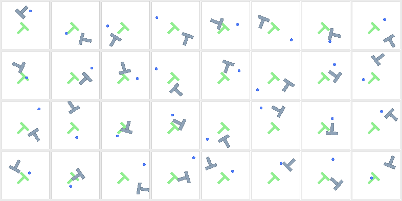
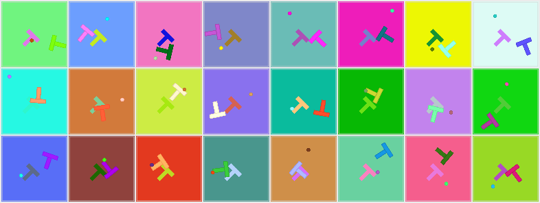

# PushT

PushT is a 2D manipulation task with contact. The agent is a disc. It pushes a T-shaped block into a
target pose. The source simulates the contact physics with [Pymunk](https://www.pymunk.org/). The task comes from
Diffusion Policy ([Chi et al., 2023](https://arxiv.org/abs/2303.04137)). stable-envs follows the
stable-worldmodel version of [gym-pusht](https://github.com/huggingface/gym-pusht).

The block must match the target **position** and **orientation**. The agent must plan a sequence of
pushes. A single move to a point does not solve the task.

**Success:** the episode succeeds when two conditions are true:

- The L2 norm of the agent and block position error is less than 20 pixels. The error vector has four
  values: agent x, agent y, block x and block y.
- The block orientation error is less than π/9 rad (20°). The check uses the rotational symmetry of the
  block shape.

This criterion comes from [DINO-WM](https://arxiv.org/abs/2411.04983).

```python
import stable_envs as snv

env = snv.PushT(num_envs=8)
state = env.reset(seed=0)
frames = env.render()          # (8, 224, 224, 3) uint8
```

A PushT frame is the source's pygame frame for the same State. `device="cuda"` puts the output tensors
on the GPU.

## Physics backends

stable-envs steps PushT with a port of the Pymunk contact solver. One call steps all environments. The port
has three implementations of the same math:

| `simulation_backend` | Device of the physics | Implementation |
|---|---|---|
| `"numba"` | CPU | Numba, `float64`, in parallel over environments. The default on CPU. |
| `"triton"` | CUDA | One Triton kernel launch per step, `float32`, one GPU thread per environment. The default on CUDA. |
| `"jax"` | the env device | JAX `vmap`, `float64`. The default on CUDA when Triton is not installed. |
| `"auto"` | CPU or CUDA | On CUDA, `"numba"` below `triton_min_envs` environments and the CUDA default at or above it. On CPU, `"numba"`. |

On CPU, the `"numba"` step does its Torch operations on one thread, and the physics runs on the Numba
threads. The render uses the Torch and Numba thread counts. Idle Torch threads keep cores busy while the Numba
threads work, and a parallel region waits for all of its threads, so one busy core makes a step slow. The frames and the State do not change with the thread count.

With `"numba"` on CUDA, the physics runs on the CPU and the State and outputs are CUDA tensors. On an
L40S with 8 CPU cores, `"triton"` was faster than `"numba"` at every batch size, so `triton_min_envs`
defaults to 1. A JAX step on CUDA takes about 45 ms with 8 environments and 60 ms with 1024, because each
substep runs the broadphase on the CPU through a host callback. A Triton step takes about 0.3 to 0.5 ms. The
first Triton step in a process compiles the kernel (about 50 s, or 80 s for agent shapes other than the
disc) unless Triton has it in its cache.

The port follows Munk2D, the Chipmunk2D fork that pymunk 7.2.0 builds. It uses the same integration,
PD control, damping and sequential impulse solver, and these Munk2D details:

- The walls are segments with a radius of 2, and their contacts are the Munk2D segment-polygon contacts.
  A block pushed hard into a wall can pass through it, as in the source.
- The PD control of the agent is in `float32` for `float32` actions, as stable-worldmodel computes it.
- The collision slop and bias come from the Munk2D defaults, which are `float` literals.
- An arbiter keeps its contacts for 3 steps after its shapes separate, as Munk2D keeps them.
- The solver visits the shape pairs in the order that the Munk2D bounding-box tree reports them. With
  10 solver iterations, this order changes the result, so the port replays the tree.
- A reset copies the bias velocities, the cached impulses and the tree from the Pymunk reset.

The State keeps the solver cache and the tree (`current/jax`), so a restored State steps the same as the
original on the same backend. The Numba and JAX backends compute in `float64` and agree with Pymunk to
rounding. Over 200 steps of two scripted policies from 256 source resets each, the block position gap
stays below 0.001 px in 511 of the 512 episodes. In the other episode, the agent pushes the block
through a wall at high speed, and the rounding grows to a different trajectory. The Triton backend
computes in `float32`. Its median gap at step 200 is 0.0004 px, but in more episodes where the block is
pressed hard into or through a wall, the `float32` rounding grows to a different trajectory.

Pymunk on the CPU resets the environments, with the source reset distribution. On Linux, a batch of at least
`worker_min_lanes` lanes resets in up to `workers` processes. The worker processes do not change the
State, the frames or the task outputs.

On CPU with Numba installed, `render` draws with a Numba rasterizer. It builds the same primitive
records as the GPU path, in parallel over States. It paints and resizes the background, goal and walls
once for each distinct goal and colour set in the batch, then redraws only the region that the bodies
cover in each frame. Its frames are byte-identical to the pygame frames. The first render in a process
loads the compiled kernels, and compiles them if Numba has no cache yet. Without Numba, or with
`backend="source"`, CPU frames are drawn with pygame.

With `device="cuda"` and Triton, PushT draws the frames on the GPU. The GPU frames are byte-identical
to the pygame frames. Frames with action markers, and the few frames that the GPU path cannot draw
exactly, use pygame.

On Linux, `render` draws a batch of at least `worker_min_lanes` States in up to `workers` processes.
Step frames come from the running scenes, so a step does not export a State only to draw it. Worker
processes do not change frames. See [Performance tuning](../performance-tuning.md).

The State is a full checkpoint. It holds the bodies, the contact-solver cache, the goal, the action
history and the reset recipe. See [State](../concepts/state.md#pusht-checkpoints).

## PushT

The action is a relative control for each axis. It is not an absolute pixel target. The action space is [-1, 1], but PushT also accepts actions outside it and moves the target further, as stable-worldmodel does.

<!-- env: PushT -->

## PushTDiscrete

The action has two discrete indices in [0, 16). They select a polar action.

<!-- env: PushTDiscrete -->

## Reset states and colour Variation

This image shows 24 lanes after `reset(seed=0)`, at 96 px:



This image shows the same 24 lanes after `set_variation` samples the colour leaves (`agent`,
`background`, `block`, `goal`) for each lane:



The code below makes the two images:

```python
import numpy as np
import stable_envs as snv

env = snv.PushT(num_envs=24, device="cpu", size=96)
env.reset(seed=0)
grid = env.render()
colors = [p for p in env.variation_names if p.endswith(".color")]
env.set_variation(env.sample_variation(paths=colors, rng=np.random.default_rng(0)))
env.reset(seed=0)
varied = env.render()
env.close()
```
