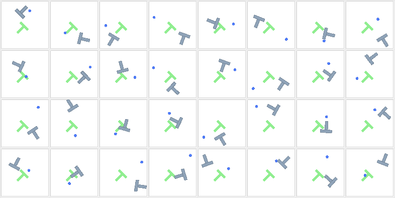
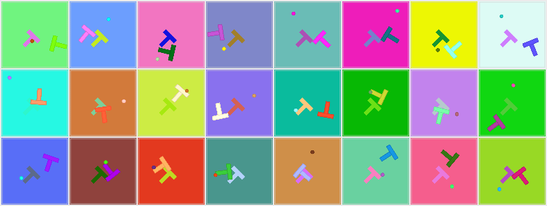

# PushT

In PushT, a 2D manipulation task with contact, a disc agent pushes a T-shaped block into a target pose. `PushT` and `PushTDiscrete` follow the stable-worldmodel version of [gym-pusht](https://github.com/huggingface/gym-pusht), which comes from Diffusion Policy ([Chi et al., 2023](https://arxiv.org/abs/2303.04137)). A batched port of the [Pymunk](https://www.pymunk.org/) contact solver steps the physics, in Numba on CPU and in Triton on CUDA, and Numba or Triton draw [frames](../terms.md#frame) that match the pygame frames byte for byte.

```python
# needs the pusht extra
import stable_envs as snv

with snv.PushT(num_envs=8, device="cpu") as env:
    state = env.reset(seed=0)
    print(env.render().shape)      # torch.Size([8, 224, 224, 3])
```

## Install

The classes need the `pusht` extra. On CUDA, the physics and the frames use Triton, which comes with the CUDA builds of torch on Linux. The `pusht-gpu` extra adds JAX, which only `simulation_backend="jax"` needs. When a JAX PushT is built, stable-envs turns off JAX's GPU memory preallocation, so that Torch keeps its GPU memory. See [JAX GPU memory](../environment-variables.md#jax-gpu-memory). See [what each family needs](../install.md#what-each-family-needs).

## Task

The block has to match the target position and orientation, which takes a sequence of pushes.

The episode succeeds when both of these are true:

- The L2 norm of the agent and block position error is less than 20 pixels. The error vector has four values: agent x, agent y, block x and block y.
- The block orientation error is less than π/9 rad (20°). The check uses the rotational symmetry of the block shape.

This criterion comes from [DINO-WM](https://arxiv.org/abs/2411.04983).

## Simulation

stable-envs steps PushT with a port of the Pymunk contact solver, and one call steps all environments. `simulation_backend` picks one of three implementations of the same math:

| Value | Physics device | Implementation |
|---|---|---|
| `"auto"` (default) | CPU or CUDA | on CPU, `"numba"`. On CUDA, `"numba"` for small batches and `"triton"` (`"jax"` without Triton) for large ones. |
| `"numba"` | CPU | Numba in float64, in parallel over environments. |
| `"triton"` | CUDA | one Triton kernel launch per step in float32, one GPU thread per environment. |
| `"jax"` | the environment device | JAX `vmap` in float64. |

With `"numba"` on CUDA, the physics and the live state stay on the CPU, and each call copies its outputs and the exported state to CUDA. With `"auto"` on CUDA, a batch of `large_backend_min_envs` or more environments steps on the GPU. When the knob is not set, the switch point comes from the tuning cache that `stable-envs tune` writes, else from the value the class ships, so without tuning the same batch size selects the same backend on every machine ([Physics backends](../performance-tuning.md#physics-backends)). Numba computes in float64 and Triton in float32, so the two backends can give different trajectories. A JAX step on CUDA is much slower than a Triton step, because each substep runs the broadphase on the CPU through a host callback. The first Triton step in a process compiles the kernel, unless Triton has it in its cache. The compile takes longer for agent shapes other than the disc. On CUDA, a batch of fewer than `large_renderer_min_rows` frames draws with the Numba rasterizer on the CPU, and the frames move to CUDA in one copy. Both rasterizers draw the same bytes as pygame ([Renderers](../performance-tuning.md#renderers)).

The port follows Munk2D, the Chipmunk2D fork that pymunk 7.2.0 builds. It uses the same integration, PD control, damping and sequential impulse solver, and these Munk2D details:

- The walls are segments with a radius of 2, and their contacts are Munk2D's segment-polygon contacts. A block pushed hard into a wall can pass through it, as in the source.
- The PD control of the agent is in float32 for float32 actions, as stable-worldmodel computes it.
- The collision slop and bias come from the Munk2D defaults, which are `float` literals.
- An arbiter keeps its contacts for 3 steps after its shapes separate, as Munk2D keeps them.
- The solver visits the shape pairs in the order that Munk2D's bounding-box tree reports them. With 10 solver iterations this order changes the result, so the port replays the tree.
- A reset copies the bias velocities, the cached impulses and the tree from the Pymunk reset.

The Numba and JAX backends compute in float64 and agree with Pymunk to rounding. Over 200 steps of two scripted policies from 256 source resets each, the block position gap stayed below 0.001 px in 511 of the 512 episodes. In the other episode, the agent pushes the block through a wall at high speed, and the rounding grows into a different trajectory. The Triton backend computes in float32. Its median gap at step 200 is 0.0004 px, but in more of the episodes where the block is pressed hard into or through a wall, the float32 rounding grows into a different trajectory.

On CPU, the `"numba"` step does its Torch operations on one thread, and the physics runs on the Numba threads. The render uses the Torch and Numba thread counts. Idle Torch threads keep cores busy while the Numba threads work, and a parallel region waits for all of its threads, so one busy core makes a step slow. The frames and the state do not change with the thread count.

Pymunk on the CPU resets the environments with the source reset distribution. On Linux, a batch of at least `worker_min_lanes` environments resets in up to `workers` [worker processes](../performance-tuning.md#worker-processes), which give the same state, frames and task outputs as one process.

### Checkpoints

The [state](../terms.md#state) is a full checkpoint. It holds the bodies, the contact solver's cache and bounding-box tree (`current/jax`), the goal, the reset recipe, the RNGs, the action history and the [variation](../terms.md#variation). Positions alone can't reconstruct the contact history, so `set_state` restores the solver cache, and a restored state steps the same as the original on the same backend. Neither `set_state` nor `step` replays the history. A state saved before the batched port (`recipe/version` 2) has no solver cache, and `set_state` replays its action history in Pymunk. The history axis grows during an episode, and `state_spec` describes the shape of the current checkpoint without imposing an episode limit. A five-coordinate render row isn't a checkpoint.

The state is folded: it has one `(N, size)` leaf for each group and dtype. The `static` groups, such as `static/int64`, hold the fields that only a reset, a restore or a variation change, such as the reset recipe, the RNGs, the goal and the variation. The `current` groups hold the fields that a step changes, and `current/solver/float64` and `current/solver/int64` hold the solver cache. The action history keeps the leaves `history/actions`, `history/dtypes`, `history/lengths` and `history/valid`. Each named field is a slice of its group. Read or write a field with [`snv.get_field`](../api/index.md#read-a-state-field), for example `snv.get_field(state, "current/body/block/position")`. The state leaves out the goal image, which a restore draws again from the goal pose, so a step doesn't copy 150 kB for each environment. `set_state` also accepts a state with one leaf for each field.

```python
# needs the pusht extra
import numpy as np
import stable_envs as snv

with snv.PushT(num_envs=2, device="cpu", size=96) as env:
    checkpoint = env.reset(seed=17)
    actions = np.zeros((2, 8, 2), dtype=np.float32)
    first = env.step(actions, frames=None)
    env.set_state(checkpoint)
    repeated = env.step(actions, frames=None)
    print(bool((first["state"] == repeated["state"]).all()))  # True
```

## Rendering

Every PushT frame is byte-identical to gym-pusht's pygame frame for the same state, whichever path draws it:

| Device | Draws with | Falls back to pygame |
|---|---|---|
| CPU | a Numba rasterizer, when Numba is installed | with `backend="source"`, or at a size the rasterizer doesn't support |
| CUDA | a Triton rasterizer on the GPU, when Triton is installed | for frames with action markers, the few frames the GPU path can't draw exactly, at an unsupported size, or without Triton |

One Numba call draws all the frames of a batch. Each thread builds the primitive records of a frame, the same records as the GPU path, and draws them. The renderer keeps the frames of the background, goal and walls alone between calls: one for each set of goal pose, goal color and background color, and at most 64. A frame copies its kept frame and then draws again only the boxes of the agent, of each block part and of the contact lines. A frame without a kept frame is drawn completely. Action markers are drawn with the OpenCV call of the source. The first render in a process loads the compiled kernels, and compiles them if Numba has no cache yet.

The frames that `step` returns come from the live simulation, so a step doesn't export a state only to draw it. On Linux, pygame draws a batch of at least `worker_min_lanes` states in up to `workers` [worker processes](../performance-tuning.md#worker-processes), with the same frames as one process. Rendering a saved state leaves the live physics untouched. The constructor keywords `with_target=True` and `render_action=False` are the defaults: `with_target=False` hides the goal in every frame whatever `rendering.render_goal` says, and `render_action=True` draws action markers and needs a size of at least 96.

## Variation

Each class has leaves for the colors, shapes, scales and start poses of the agent and the block, the goal pose and color, and `rendering.render_goal`.

This image shows 24 environments after `reset(seed=0)`, at 96 px:



This image shows the same 24 environments after `set_variation` samples the color leaves (`agent`, `background`, `block`, `goal`) for each one:



The code below makes the two images. To sample the shape and start-pose leaves as well, see [Randomize appearance and physics](../tutorials/variation.md).

```python
# needs the pusht extra
import numpy as np
import stable_envs as snv

with snv.PushT(num_envs=24, device="cpu", size=96) as env:
    env.reset(seed=0)
    grid = env.render()
    colors = [p for p in env.variation_names if p.endswith(".color")]
    env.set_variation(env.sample_variation(paths=colors, rng=np.random.default_rng(0)))
    env.reset(seed=0)
    varied = env.render()
print(grid.shape, varied.shape)    # torch.Size([24, 96, 96, 3]) torch.Size([24, 96, 96, 3])
```

## Classes

### PushT

The action is a relative control for each axis, not an absolute pixel target. The action space is [-1, 1], but PushT also accepts actions outside it and moves the target further, as stable-worldmodel does.

<!-- env: PushT -->

### PushTDiscrete

The action has two discrete indices in [0, 16) that select a polar action. Actions have shape `(B, 2)` or `(B, T, 2)`.

<!-- env: PushTDiscrete -->

## Limitations

- The Triton physics computes in float32, so a CPU and a CUDA run from the same reset can follow different trajectories where the block is pressed hard into a wall; compare runs on the same backend.
- Some resets start with the agent overlapping the block. Reset draws the two start positions independently, as stable-worldmodel does. The agent is a kinematic body, and the one physics substep of a reset leaves the overlap in place.
- For clear starts, pick the positions yourself with `options={"variation_values": {"agent.start_position": ..., "block.start_position": ...}}`, passing each value as a NumPy array.
