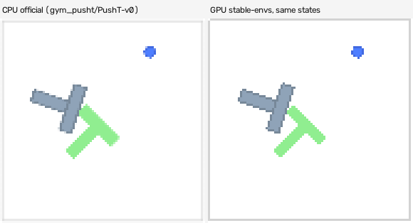
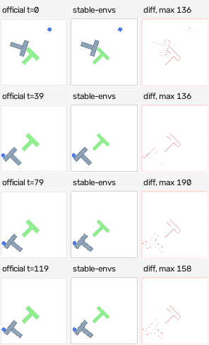
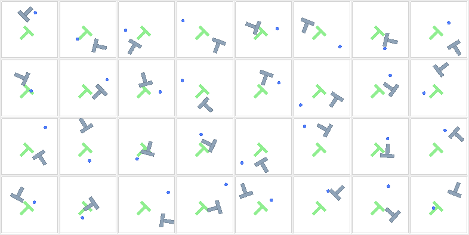
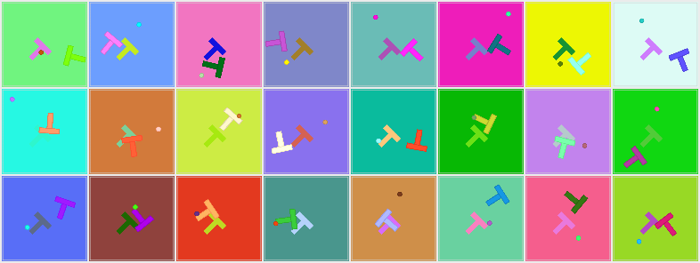
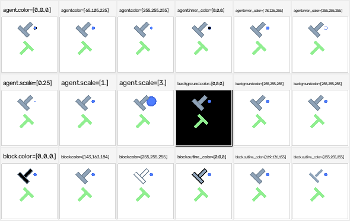

# Gallery

Produced by [`examples/gallery.py`](https://github.com/galilai-group/stable-envs/blob/main/examples/gallery.py),
which walks `snv.list_envs()` and writes one directory of media per env. Nothing here is upscaled
except the videos, and those use nearest-neighbour so the pixels on screen are the pixels the renderer
produced.

The repo is under active development and the registry grows between runs; this page is a snapshot of the
envs that were registered when the media was generated. Parity numbers, file sizes and the probed video
codec for every env are in
[`docs/assets/media/manifest.json`](https://github.com/galilai-group/stable-envs/blob/main/docs/assets/media/manifest.json).

## PushT

State: 5 floats — `agent_x, agent_y, block_x, block_y, block_angle`. Reference: `gym_pusht/PushT-v0`.

### The official renderer and this one, on the same states

120 states from a real `gym_pusht` rollout (the agent is scripted to push the T toward the goal), written
to disk as 2,528 bytes of `states.npy`, then rendered twice: once by the official CPU renderer, once by
the GPU kernel. Left is official, right is ours, 3× nearest-neighbour.

<video controls loop muted playsinline width="580" style="max-width:100%">
  <source src="../assets/media/PushT/sidebyside.mp4" type="video/mp4">
  Your browser does not play H.264 mp4; the GIF below shows the same clip.
</video>



Over those 120 frames: **100.00%** of interior pixels exact, 90.61% of all pixels exact, mean absolute
difference 2.56/255. The residual is the anti-aliased outline, which the third column below isolates.

The mp4 is H.264 baseline in an mp4 container — `ffprobe` reports
`Video: h264 (Constrained Baseline) (avc1 / 0x31637661), yuv420p, 580x314`. That is not a formality:
`cv2.VideoWriter` with the `mp4v` fourcc writes MPEG-4 Part 2, which desktop players open and no browser
plays, so the page renders as an empty box with controls and looks like a broken build.

### Per-frame comparison

Official, ours, and the absolute difference (red where they differ), at four points in the same rollout:



### States from the reset distribution

32 states drawn from `sample_states`, rendered in one launch at native 96px:



### Appearance variation

One state, 32 environments, four colour leaves sampled independently per environment — **one kernel
launch**. This is what "domain randomisation is a tensor, not a loop" means concretely:



The scale and toggle knobs are read per call rather than per environment, so they are swept across
separate renders:



Which leaves vary per environment and which do not is measured, not assumed; the split is
a property of `PushT.scene` and the static-prefix bake, not of the `Scene2D` layout.

## The tile-atlas family

MiniGrid and BabyAI do not go through `Scene2D` at all. A frame there is a gather from a precomputed
atlas of tile images, which makes it exact by construction rather than by matching a rasterizer — and the
measurement says so: **every pixel of every frame is identical to the official renderer, max absolute
difference 0**, not merely the interior ones.

`MiniGrid-DoorKey-8x8-v0`, 120 states, official against ours, with the difference column empty:


<video controls loop muted playsinline width="516" style="max-width:100%">
  <source src="../assets/media/MiniGridDoorKey/sidebyside.mp4" type="video/mp4">
  Your browser does not play H.264 mp4.
</video>

Measured over 120 states each:

| env | state | native size | reference | all-pixel exact | max diff | media |
|---|---|---|---|---|---|---|
| BabyAIGoToLocal | 67 | 256 | `BabyAI-GoToLocal-v0` | **100%** | 0 | [grid](assets/media/BabyAIGoToLocal/grid.png) · [parity](assets/media/BabyAIGoToLocal/parity.png) · [mp4](assets/media/BabyAIGoToLocal/sidebyside.mp4) |
| MiniGridDoorKey | 67 | 256 | `MiniGrid-DoorKey-8x8-v0` | **100%** | 0 | [grid](assets/media/MiniGridDoorKey/grid.png) · [parity](assets/media/MiniGridDoorKey/parity.png) · [mp4](assets/media/MiniGridDoorKey/sidebyside.mp4) |
| MiniGridEmpty | 67 | 256 | `MiniGrid-Empty-8x8-v0` | **100%** | 0 | [grid](assets/media/MiniGridEmpty/grid.png) · [parity](assets/media/MiniGridEmpty/parity.png) · [mp4](assets/media/MiniGridEmpty/sidebyside.mp4) |
| MiniGridFourRooms | 364 | 608 | `MiniGrid-FourRooms-v0` | **100%** | 0 | [grid](assets/media/MiniGridFourRooms/grid.png) · [parity](assets/media/MiniGridFourRooms/parity.png) · [mp4](assets/media/MiniGridFourRooms/sidebyside.mp4) |
| MiniGridKeyCorridor | 103 | 320 | `MiniGrid-KeyCorridorS4R3-v0` | **100%** | 0 | [grid](assets/media/MiniGridKeyCorridor/grid.png) · [parity](assets/media/MiniGridKeyCorridor/parity.png) · [mp4](assets/media/MiniGridKeyCorridor/sidebyside.mp4) |
| MiniGridLavaCrossing | 84 | 288 | `MiniGrid-LavaCrossingS9N2-v0` | **100%** | 0 | [grid](assets/media/MiniGridLavaCrossing/grid.png) · [parity](assets/media/MiniGridLavaCrossing/parity.png) · [mp4](assets/media/MiniGridLavaCrossing/sidebyside.mp4) |
| MiniGridPOVFetch | 49 | 224 | `MiniGrid-Fetch-8x8-N3-v0` | **100%** | 0 | [grid](assets/media/MiniGridPOVFetch/grid.png) · [parity](assets/media/MiniGridPOVFetch/parity.png) · [mp4](assets/media/MiniGridPOVFetch/sidebyside.mp4) |

Two things these videos do *not* show, and both are stated rather than hidden. The states are independent
draws from the env's own distribution rather than a trajectory: the reference's observation is a dict, so
there is no way to read the compact state back out of a rollout, and interpolating between integer cell
codes would put impossible frames on screen. And no batched variation sheet is generated for them,
because the measurement that decides what goes in one found that
no leaf varies per environment on this path — the palette is baked into an atlas per call.

## MiniHack

A 1,659-float glyph grid rendered at 16 px per tile into a 1264×336 frame. `minihack` is not installed on
the machine that generated this page, so there is no official comparison and none is faked — the video is
the GPU render alone.


## Reproducing

```bash
python examples/gallery.py --out docs/assets/media          # the whole registry
python examples/gallery.py --out docs/assets/media --envs PushT   # or one env
```

Each env directory gets `grid.png`, `variation_sweep.png`, `states.npy`, `sidebyside.mp4`,
`sidebyside.gif`, plus `parity.png` when the env has a reference renderer and `variation_batch.png` when
at least one variation leaf was measured to vary per environment. Regenerating a single env merges into
the existing `manifest.json` rather than replacing it.
