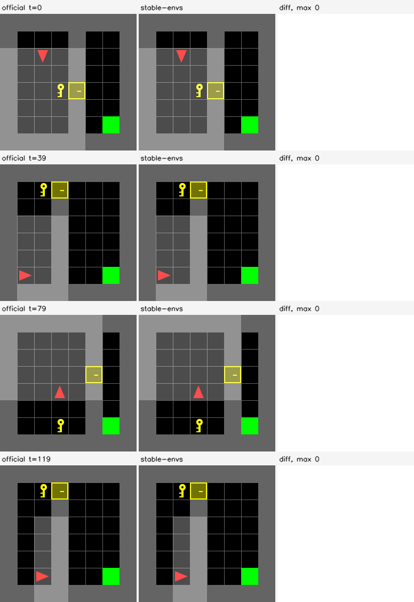
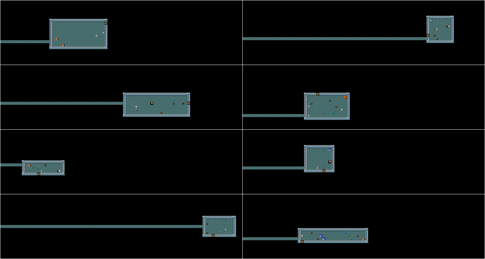

# Gallery

Frames straight from the renderers, at native resolution. Nothing here is upscaled except the videos, and
those use nearest-neighbour, so the pixels on screen are the pixels the renderer produced. Parity numbers,
file sizes and the probed video codec for the tile-atlas and MiniHack media are in
[`docs/assets/media/manifest.json`](https://github.com/galilai-group/stable-envs/blob/main/docs/assets/media/manifest.json).

## PushT

State: a complete replay State (234 numeric leaves: the current bodies and goal, the action history
and the Variation it replays from), not a pose vector. See [State](concepts/state.md#pusht-checkpoints).
Reference: `gym_pusht/PushT-v0`.

The released PushT draws its frames with the source's own pygame code on CPU, so there is no second
renderer to put beside it: a frame is the source frame for the same State. `device="cuda"` places the
returned tensors on the GPU and leaves the drawing on CPU. `contrib/pusht_torch/` holds an unreleased
batched torch renderer; see [Benchmarks](benchmarks.md#pusht) for its agreement and throughput.

### States from the reset distribution

24 lanes after `reset(seed=0)`, rendered at 96 px:


### Appearance variation

The same 24 lanes with the four colour leaves (`agent`, `background`, `block`, `goal`) sampled
independently per lane through `set_variation` before the reset:


## The tile-atlas family

MiniGrid, BabyAI and MiniHack (below) are renderer-only ports kept in the repository's `contrib/`
directory; they are not part of the released package and `snv.list_envs()` does not list them. Their
media were generated while the package still registered them.

MiniGrid and BabyAI do not go through `Scene2D` at all. A frame there is a gather from a precomputed
atlas of tile images, which makes it exact by construction rather than by matching a rasterizer — and the
measurement says so: **every pixel of every frame is identical to the official renderer, max absolute
difference 0**, not merely the interior ones.

`MiniGrid-DoorKey-8x8-v0`, 120 states, official against ours, with the difference column empty:



<video controls loop muted playsinline width="516" style="max-width:100%">
  <source src="../assets/media/MiniGridDoorKey/sidebyside.mp4" type="video/mp4">
  Your browser does not play H.264 mp4.
</video>

Measured over 120 states each:

| env | state | native size | reference | all-pixel exact | max diff | media |
|---|---|---|---|---|---|---|
| BabyAIGoToLocal | 67 | 256 | `BabyAI-GoToLocal-v0` | **100%** | 0 | [grid](assets/media/BabyAIGoToLocal/grid.png) · [parity](assets/media/BabyAIGoToLocal/parity.png) · [mp4](assets/media/BabyAIGoToLocal/sidebyside.mp4) |
| MiniGridDoorKey | 67 | 256 | `MiniGrid-DoorKey-8x8-v0` | **100%** | 0 | [grid](assets/media/MiniGridDoorKey/grid.png) · [parity](assets/media/MiniGridDoorKey/parity.png) · [mp4](assets/media/MiniGridDoorKey/sidebyside.mp4) |
| MiniGridEmpty | 67 | 256 | `MiniGrid-Empty-8x8-v0` | **100%** | 0 | [grid](assets/media/MiniGridEmpty/grid.png) · [parity](assets/media/MiniGridEmpty/parity.png) · [mp4](assets/media/MiniGridEmpty/sidebyside.mp4) |
| MiniGridFourRooms | 364 | 608 | `MiniGrid-FourRooms-v0` | **100%** | 0 | [grid](assets/media/MiniGridFourRooms/grid.png) · [parity](assets/media/MiniGridFourRooms/parity.png) · [mp4](assets/media/MiniGridFourRooms/sidebyside.mp4) |
| MiniGridKeyCorridor | 103 | 320 | `MiniGrid-KeyCorridorS4R3-v0` | **100%** | 0 | [grid](assets/media/MiniGridKeyCorridor/grid.png) · [parity](assets/media/MiniGridKeyCorridor/parity.png) · [mp4](assets/media/MiniGridKeyCorridor/sidebyside.mp4) |
| MiniGridLavaCrossing | 84 | 288 | `MiniGrid-LavaCrossingS9N2-v0` | **100%** | 0 | [grid](assets/media/MiniGridLavaCrossing/grid.png) · [parity](assets/media/MiniGridLavaCrossing/parity.png) · [mp4](assets/media/MiniGridLavaCrossing/sidebyside.mp4) |
| MiniGridPOVFetch | 49 | 224 | `MiniGrid-Fetch-8x8-N3-v0` | **100%** | 0 | [grid](assets/media/MiniGridPOVFetch/grid.png) · [parity](assets/media/MiniGridPOVFetch/parity.png) · [mp4](assets/media/MiniGridPOVFetch/sidebyside.mp4) |

Two things these videos do *not* show, and both are stated rather than hidden. The states are independent
draws from the env's own distribution rather than a trajectory: the reference's observation is a dict, so
there is no way to read the compact state back out of a rollout, and interpolating between integer cell
codes would put impossible frames on screen. And no batched variation sheet is generated for them,
because the measurement that decides what goes in one found that
no leaf varies per environment on this path — the palette is baked into an atlas per call.

## MiniHack

A 1,659-float glyph grid rendered at 16 px per tile into a 1264×336 frame. `minihack` is not installed on
the machine that generated this page, so there is no official comparison and none is faked — the video is
the GPU render alone.



## Reproducing

The PushT images come from the released env, on CPU:

```python
import numpy as np
import stable_envs as snv

with snv.PushT(num_envs=24, device="cpu", size=96) as env:
    env.reset(seed=0)
    grid = env.render()
    colors = [p for p in env.variation_names if p.endswith(".color")]
    env.set_variation(env.sample_variation(paths=colors, rng=np.random.default_rng(0)))
    env.reset(seed=0)
    varied = env.render()
```

The tile-atlas and MiniHack media were written by
[`examples/gallery.py`](https://github.com/galilai-group/stable-envs/blob/main/examples/gallery.py)
while those envs were registered; it walks `snv.list_envs()` and writes `grid.png`, `sidebyside.mp4`,
`parity.png` and the variation sheets for each env.
