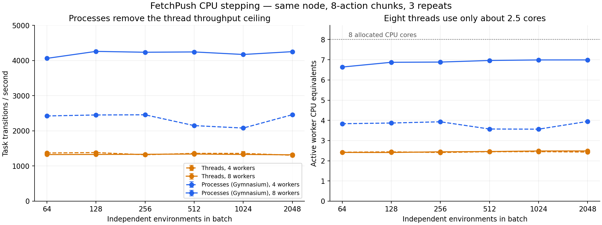

# Fetch CPU scaling diagnosis and slice-only output selection

Starting commit: `3f8a30f7e372391c38f791c72df0d55301523372`, branch
`repair/render-config-fixes`. No semantic registrations are promoted: the matrix
remains **39 VERIFIED / 3 INCOMPLETE**. Earlier evidence directories are untouched.

## Finding

Fetch's source task does not scale well with Python threads even though MuJoCo's
native physics can execute concurrently. **The evidence points to Python/GIL
contention in task/observation work, not disk I/O or our GPU State transfer.**
Switching to Gymnasium's process executor largely removes this ceiling.

Batch 256, eight allocated CPU cores, five repeats on Oscar node1956:

| Executor | Workers | Task transitions/s, mean ± sample SD | Active worker CPU equivalents |
| --- | ---: | ---: | ---: |
| Threads | 1 | 610.4 ± 5.7 | 0.99 |
| Threads | 2 | 1052.2 ± 10.3 | 1.89 |
| Threads | 4 | 1305.6 ± 18.8 | 2.42 |
| Threads | 8 | 1374.8 ± 11.0 | 2.49 |
| AsyncVectorEnv, shared observations | 4 | 2478.6 ± 2.5 | 3.91 |
| AsyncVectorEnv, shared observations | 8 | 4782.5 ± 36.1 | 7.64 |
| AsyncVectorEnv, pipe observations | 8 | 4552.9 ± 45.8 | 7.56 |

CPU equivalents are summed worker thread CPU time divided by end-to-end wall
clock time. They exclude coordinator work and are not sampled per-core traces.

The eight-thread task run incurs about **88,889 voluntary context switches per
2,048 transitions** inside worker task execution, versus zero there for eight
processes. Eight threads running native physics without task/controller logic
incur about 222. The engine-only diagnostic scales about 7.5× from one to eight
threads, while the complete task scales about 2.25×. Engine-only trajectories
are different and must not be compared as equivalent task simulations.

A serial function profile attributes approximately 56% of its instrumented wall
time to `mujoco.mj_step`; `_get_obs` accounts for approximately 29% inclusively.
Observation construction repeatedly calls `get_joint_qpos`, `get_joint_qvel`,
`mj_name2id`, array copies and rotation conversion. These percentages are
illustrative profile timings, not uninstrumented hardware utilization.
Concurrent-thread cProfile output aggregates events confusingly on this runtime;
it is retained but not used for percentage attribution. Serial and isolated
process profiles supply the function-level evidence. We did not directly sample
GIL ownership, so the diagnosis combines these profiles with controlled
thread/process interventions, CPU time and context-switch counts.

All measured worker task regions report **zero disk block input/output**. They
contain no CUDA transfers or our full State export. Shared observations improve
the eight-process rate by about **5%** over pipes, whereas processes improve it
by **3.48×** over eight threads. Shared buffers help transport, but transport is
not the primary reason threads plateau.

## Batch sweep

The independent sweep ran on node1907 with eight CPU cores and three repeats per
configuration. Do not merge its absolute rates with node1956's diagnostic rates.

| Batch | 4 threads | 8 threads | 4 processes | 8 processes |
| ---: | ---: | ---: | ---: | ---: |
| 64 | 1370 ± 8 | 1326 ± 4 | 2424 ± 1 | 4063 ± 24 |
| 128 | 1383 ± 27 | 1329 ± 4 | 2452 ± 0.3 | 4261 ± 4 |
| 256 | 1320 ± 38 | 1333 ± 2 | 2457 ± 7 | 4237 ± 18 |
| 512 | 1359 ± 25 | 1341 ± 6 | 2149 ± 2 | 4246 ± 16 |
| 1024 | 1359 ± 52 | 1329 ± 2 | 2080 ± 4 | 4173 ± 9 |
| 2048 | 1306 ± 46 | 1319 ± 4 | 2460 ± 8 | 4254 ± 3 |

Rates are aggregate transitions/s, not batched API calls/s or rendered images/s.
The sweep's peak resident memory was 76,244,564 KiB (about 72.7 GiB). Larger
batches do not materially raise CPU stepping throughput here; they increase call
latency and resident simulator memory. No claim about GPU renderer saturation is
made by this CPU-only sweep.



The [CSV](scaling.csv) retains full-precision means/SD, worker CPU equivalents,
context switches, elapsed call time, host identity and diagnostic workload labels.

## What was actually compared

Each configuration runs eight known actions per independent FetchPush instance,
with identical per-lane seeds and actions. Reset, construction and warmup are
excluded from timed regions. Timings include task execution, collection and
transport of observations, reward/termination/truncation/success, qpos and qvel.
They do **not** include exhaustive State export, GPU transfer or rendering.

Gymnasium `AsyncVectorEnv` owns the existing process lifecycle, dispatch, pipes
and optional preallocated observation buffers. Normally it creates one process
per environment factory. A benchmark-only Gym facade gives each factory a shard
of scalar environments, so eight processes can serve 2,048 environments without
launching 2,048 processes. Real per-lane rewards/flags are transported as arrays;
the facade itself returns a nonterminal outer flag. This bounded eight-step
experiment does not reach TimeLimit and is not a production lifecycle adapter.
Shared-memory mode uses `copy=True` so returned observations remain owned.

Every complete-task executor configuration exactly matches the reference
observations, rewards, flags, success, qpos and qvel after each action. This is a
useful task-execution proof, **not** exhaustive State restoration, RNG replay,
Variation propagation or terminal-lane acceptance for a process implementation.
The production Fetch executor consequently remains the previously validated
bounded thread pool. The next implementation target is a facade around the
upstream process executor with complete State and lifecycle handling, followed
by the existing family acceptance gates. No new process pool scheduler is needed.

Native simulation routes remain family-specific: MuJoCo supports threaded engine
execution, but raw rollouts omit task callbacks; Craftax supports JAX vectorized
CPU/GPU execution; the three Navigation implementations already batch Torch
stepping. Gymnasium's vector executor supplies processes around scalar tasks.
The existing [capability catalogue](../../online_execution_api_catalog.md) records
which route applies and which wrappers require isolation.

## Slice API shipped in this checkpoint

```python
env.step(actions, states=slice(None), frames=slice(-1, None))
```

Independent selectors accept slices or `None`. `[B,A]` is treated as length one
for selection; `[B,T,A]` selects among T post-action outputs. All selected outputs
keep their time axis. The final State is always returned. Sparse/reverse/empty
selections, early termination, held endpoints and matching validity masks are
covered. Integer selectors and zero strides are rejected before mutation.
Symbolic environments require `frames=None` because they have no image shape.
See the [full API contract](../../../concepts/dynamics.md).

The former `capture` keyword and singular `frame` output are removed. No new
thread/process/buffer knobs are exposed to users. Fetch skips unselected full
State exports where possible; other backends may still export State internally.
Single-action execution avoids unnecessary GPU-to-host terminal-mask checks.

## Acceptance, provenance and limitations

- 278 targeted local tests passed, with four CUDA-only skips. After the final
  symbolic-selector guard, its focused suite passed 84 tests with those four
  CUDA skips; the final GPU stage passed the skipped GPU cases.
- 20 frozen-oracle/reference-harness tests passed, covering DMC/Reacher and the
  semantic comparison helper. A freshly built wheel passed an unpacked-wheel
  API smoke test using existing dependencies.
- GPU stages each passed 114 tests with one optional Matplotlib skip. All 12
  Fetch registrations independently passed source State/task/thread/endpoint
  gates on CPU and CUDA output paths at B64 (RTX A5500). The final source,
  adding pre-mutation rejection of empty frame selectors for symbolic tasks,
  was revalidated across all 12 at B3 (A40). Final production hashes match that
  final GPU stage exactly.
- Fetch frame selection matches repeated single-step frames exactly, and its
  final-only selection exports one snapshot. Four native GPU families also pass
  full, final, sparse, reverse and empty frame/State selection checks. These are
  capture consistency checks, **not new upstream renderer MSE measurements**.
- No all-suite-green claim: baseline renderer-State failures documented in the
  preceding checkpoint remain outside these targeted checks.

The first profile job (6916221) failed when this runtime rejected simultaneous
cProfile sessions. Its partial output is archived but excluded from the summary
CSV. Corrected diagnostic 6916606 and sweep 6916898 completed successfully.
Pending gate 6916672 was cancelled before running and replaced with fresh stages
on the general GPU partition. Gates 6916954 and 6917357 completed successfully.
No job or mutable result from earlier accepted checkpoints was overwritten.

Raw reports, scripts, manifests and terminal logs are retained in this directory.
`dependencies.json` records exact versions and upstream source hashes;
`job_status.txt` records scheduler terminal evidence. `collect.py` regenerates
this checkpoint's CSV/summary and verifies final production hashes. `plot.py`
regenerates the figure; `sha256.json` inventories this evidence directory.
