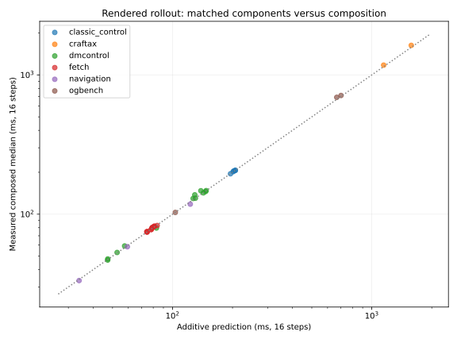

# Matched rendered State-operation results

All 37 accepted renderable registrations have actual composed GPU/backend coverage at B1; both pixel Craftax registrations also have CPU coverage. Every result uses a sixteen-step horizon, ten warmups and fifty samples. Symbolic Craftax has no renderer. GPU/backend labels identify CUDA device requests on Oscar; dynamics may still execute on the CPU according to each adapter. No semantic acceptance gate was rerun.

Component ratios below use one matched host/profile and count projection exactly once. The old cross-host derived arithmetic is retained separately and is not used as a latency prediction. `render(RenderState)` follows explicit public projection where supported; other public render calls include their private projection.

## Matched component ratios

| Registration / device | Get/step | Set/step | Get/rendered | Set/rendered | Get slowdown | Set slowdown | Next step after set / reset-prefix | Next project+render after set / warm |
|---|---:|---:|---:|---:|---:|---:|---:|---:|
| swm/CraftaxClassicPixels-v1 / cpu | 0.082 | 1.077 | 0.035 | 0.464 | 1.035 | 1.464 | 1.037 | 1.000 |
| swm/CraftaxPixels-v1 / cpu | 0.097 | 1.025 | 0.035 | 0.366 | 1.035 | 1.366 | 1.001 | 0.994 |
| swm/AcrobotControl-v1 / gpu | 0.638 | 0.728 | 0.056 | 0.064 | 1.056 | 1.064 | 1.008 | 0.988 |
| swm/AcrobotDMControl-v0 / gpu | 0.677 | 0.952 | 0.107 | 0.151 | 1.107 | 1.151 | 1.002 | 1.016 |
| swm/BallInCupDMControl-v0 / gpu | 0.581 | 0.831 | 0.107 | 0.153 | 1.107 | 1.153 | 1.016 | 1.002 |
| swm/CartPoleControl-v1 / gpu | 0.717 | 0.720 | 0.072 | 0.072 | 1.072 | 1.072 | 1.014 | 1.001 |
| swm/CartpoleDMControl-v0 / gpu | 0.664 | 0.955 | 0.095 | 0.137 | 1.095 | 1.137 | 1.016 | 1.003 |
| swm/CheetahDMControl-v0 / gpu | 0.576 | 0.857 | 0.286 | 0.425 | 1.286 | 1.425 | 1.005 | 1.011 |
| swm/CraftaxClassicPixels-v1 / gpu | 0.280 | 1.016 | 0.111 | 0.403 | 1.111 | 1.403 | 0.995 | 1.008 |
| swm/CraftaxPixels-v1 / gpu | 0.377 | 1.064 | 0.148 | 0.417 | 1.148 | 1.417 | 0.996 | 1.009 |
| swm/FetchPickAndPlace-v3 / gpu | 0.406 | 0.729 | 0.197 | 0.354 | 1.197 | 1.354 | 1.026 | 1.008 |
| swm/FetchPickAndPlaceDense-v3 / gpu | 0.410 | 0.723 | 0.197 | 0.347 | 1.197 | 1.347 | 1.007 | 1.006 |
| swm/FetchPickAndPlaceDict-v3 / gpu | 0.405 | 0.723 | 0.194 | 0.346 | 1.194 | 1.346 | 1.005 | 1.005 |
| swm/FetchPush-v3 / gpu | 0.395 | 0.700 | 0.192 | 0.341 | 1.192 | 1.341 | 1.008 | 1.011 |
| swm/FetchPushDense-v3 / gpu | 0.400 | 0.700 | 0.195 | 0.340 | 1.195 | 1.340 | 1.006 | 1.004 |
| swm/FetchPushDict-v3 / gpu | 0.404 | 0.711 | 0.196 | 0.345 | 1.196 | 1.345 | 1.004 | 1.009 |
| swm/FetchReach-v3 / gpu | 0.444 | 0.775 | 0.205 | 0.359 | 1.205 | 1.359 | 1.011 | 1.006 |
| swm/FetchReachDense-v3 / gpu | 0.435 | 0.760 | 0.203 | 0.355 | 1.203 | 1.355 | 1.024 | 1.004 |
| swm/FetchReachDict-v3 / gpu | 0.447 | 0.783 | 0.206 | 0.359 | 1.206 | 1.359 | 1.006 | 1.007 |
| swm/FetchSlide-v3 / gpu | 0.375 | 0.668 | 0.188 | 0.334 | 1.188 | 1.334 | 1.007 | 1.009 |
| swm/FetchSlideDense-v3 / gpu | 0.374 | 0.662 | 0.188 | 0.332 | 1.188 | 1.332 | 1.007 | 1.005 |
| swm/FetchSlideDict-v3 / gpu | 0.376 | 0.660 | 0.188 | 0.331 | 1.188 | 1.331 | 1.008 | 1.013 |
| swm/FingerDMControl-v0 / gpu | 0.572 | 0.818 | 0.122 | 0.174 | 1.122 | 1.174 | 1.010 | 1.002 |
| swm/HopperDMControl-v0 / gpu | 0.578 | 0.840 | 0.288 | 0.418 | 1.288 | 1.418 | 1.004 | 1.010 |
| swm/HumanoidDMControl-v0 / gpu | 0.426 | 0.638 | 0.237 | 0.354 | 1.237 | 1.354 | 1.020 | 1.013 |
| swm/ManipulatorDMControl-v0 / gpu | 0.506 | 0.732 | 0.120 | 0.174 | 1.120 | 1.174 | 1.000 | 1.000 |
| swm/MountainCarContinuousControl-v0 / gpu | 0.686 | 0.663 | 0.054 | 0.052 | 1.054 | 1.052 | 1.018 | 1.001 |
| swm/MountainCarControl-v0 / gpu | 0.644 | 0.671 | 0.049 | 0.051 | 1.049 | 1.051 | 1.007 | 0.999 |
| swm/OGBCube-v0 / gpu | 0.818 | 58.686 | 0.202 | 14.481 | 1.202 | 15.481 | 1.063 | 1.052 |
| swm/OGBMaze-v0 / gpu | 0.606 | 1.081 | 0.159 | 0.283 | 1.159 | 1.283 | 1.013 | 1.003 |
| swm/OGBScene-v0 / gpu | 0.720 | 69.899 | 0.177 | 17.154 | 1.177 | 18.154 | 1.037 | 1.035 |
| swm/PendulumControl-v1 / gpu | 0.681 | 0.697 | 0.060 | 0.061 | 1.060 | 1.061 | 1.008 | 1.003 |
| swm/PendulumDMControl-v0 / gpu | 0.711 | 0.996 | 0.098 | 0.137 | 1.098 | 1.137 | 1.006 | 0.998 |
| swm/Piecewise-v0 / gpu | 0.308 | 0.387 | 0.152 | 0.191 | 1.152 | 1.191 | 1.001 | 0.991 |
| swm/QuadrupedDMControl-v0 / gpu | 0.501 | 0.739 | 0.178 | 0.262 | 1.178 | 1.262 | 1.018 | 1.012 |
| swm/ReacherDMControl-v0 / gpu | 0.690 | 1.004 | 0.100 | 0.146 | 1.100 | 1.146 | 1.022 | 1.001 |
| swm/SimplePointMaze-v0 / gpu | 0.318 | 10.047 | 0.085 | 2.695 | 1.085 | 3.695 | 1.167 | 1.050 |
| swm/TwoRoom-v1 / gpu | 0.166 | 0.209 | 0.087 | 0.110 | 1.087 | 1.110 | 1.003 | 1.001 |
| swm/WalkerDMControl-v0 / gpu | 0.479 | 0.696 | 0.259 | 0.376 | 1.259 | 1.376 | 1.013 | 1.019 |

## Sixteen-step rollout: every

Get workload adds get_state after each step. Set workload adds one initial restore. Branch includes snapshot, eight divergent steps, restore and sixteen continuation steps. Preparation is outside timing. Slowdowns compare actual composed medians with the actual baseline; additive comparisons use component medians and may differ because trajectory states, transfers, synchronization and cache reuse differ.

| Registration / device | Baseline median / p95 ms | Additive ms | Measured/additive | Get slowdown | Set slowdown | Branch median / p95 ms | Branch/additive |
|---|---:|---:|---:|---:|---:|---:|---:|
| swm/CraftaxClassicPixels-v1 / cpu | 201.315 / 213.818 | 199.135 | 1.011 | 1.049 | 1.028 | 251.039 / 268.430 | 1.011 |
| swm/CraftaxPixels-v1 / cpu | 266.296 / 290.635 | 296.996 | 0.897 | 1.032 | 1.016 | 324.929 / 340.542 | 0.909 |
| swm/AcrobotControl-v1 / gpu | 206.621 / 207.722 | 206.562 | 1.000 | 1.055 | 1.004 | 217.133 / 218.369 | 1.000 |
| swm/AcrobotDMControl-v0 / gpu | 130.280 / 131.751 | 130.274 | 1.000 | 1.106 | 1.010 | 142.905 / 144.139 | 1.001 |
| swm/BallInCupDMControl-v0 / gpu | 137.692 / 138.539 | 129.336 | 1.065 | 1.096 | 1.011 | 151.341 / 152.054 | 1.056 |
| swm/CartPoleControl-v1 / gpu | 195.150 / 196.238 | 195.431 | 0.999 | 1.070 | 1.004 | 206.277 / 207.730 | 0.997 |
| swm/CartpoleDMControl-v0 / gpu | 145.406 / 146.737 | 146.420 | 0.993 | 1.091 | 1.007 | 157.322 / 158.348 | 0.989 |
| swm/CheetahDMControl-v0 / gpu | 46.838 / 47.046 | 47.273 | 0.991 | 1.282 | 1.025 | 60.244 / 60.463 | 0.986 |
| swm/CraftaxClassicPixels-v1 / gpu | 1175.747 / 1233.005 | 1147.226 | 1.025 | 1.068 | 1.045 | 1471.084 / 1502.374 | 1.042 |
| swm/CraftaxPixels-v1 / gpu | 1630.276 / 1722.285 | 1577.922 | 1.033 | 1.072 | 1.058 | 2098.110 / 2200.899 | 1.080 |
| swm/FetchPickAndPlace-v3 / gpu | 82.938 / 88.547 | 83.746 | 0.990 | 1.201 | 1.023 | 105.342 / 112.273 | 0.985 |
| swm/FetchPickAndPlaceDense-v3 / gpu | 77.539 / 78.122 | 78.135 | 0.992 | 1.190 | 1.021 | 98.527 / 100.059 | 0.989 |
| swm/FetchPickAndPlaceDict-v3 / gpu | 77.656 / 77.891 | 78.127 | 0.994 | 1.189 | 1.021 | 98.410 / 98.842 | 0.989 |
| swm/FetchPush-v3 / gpu | 79.936 / 80.332 | 79.031 | 1.011 | 1.182 | 1.016 | 101.398 / 101.595 | 1.005 |
| swm/FetchPushDense-v3 / gpu | 79.723 / 80.494 | 78.932 | 1.010 | 1.182 | 1.020 | 101.168 / 101.468 | 1.004 |
| swm/FetchPushDict-v3 / gpu | 80.315 / 81.620 | 79.278 | 1.013 | 1.183 | 1.019 | 101.673 / 102.043 | 1.005 |
| swm/FetchReach-v3 / gpu | 75.129 / 76.573 | 74.726 | 1.005 | 1.195 | 1.022 | 95.074 / 95.352 | 1.004 |
| swm/FetchReachDense-v3 / gpu | 74.237 / 74.622 | 74.527 | 0.996 | 1.195 | 1.023 | 94.037 / 94.237 | 0.995 |
| swm/FetchReachDict-v3 / gpu | 74.860 / 77.035 | 74.214 | 1.009 | 1.194 | 1.021 | 94.645 / 94.852 | 1.008 |
| swm/FetchSlide-v3 / gpu | 81.654 / 82.198 | 80.838 | 1.010 | 1.175 | 1.019 | 104.771 / 105.954 | 1.010 |
| swm/FetchSlideDense-v3 / gpu | 81.801 / 83.258 | 80.824 | 1.012 | 1.177 | 1.019 | 104.348 / 104.584 | 1.006 |
| swm/FetchSlideDict-v3 / gpu | 81.964 / 82.218 | 81.271 | 1.009 | 1.179 | 1.020 | 103.954 / 109.859 | 0.997 |
| swm/FingerDMControl-v0 / gpu | 129.661 / 133.125 | 126.901 | 1.022 | 1.118 | 1.009 | 145.059 / 145.439 | 1.016 |
| swm/HopperDMControl-v0 / gpu | 47.719 / 48.363 | 47.313 | 1.009 | 1.277 | 1.023 | 61.510 / 61.903 | 1.005 |
| swm/HumanoidDMControl-v0 / gpu | 59.143 / 61.497 | 57.473 | 1.029 | 1.214 | 1.016 | 76.923 / 77.367 | 1.018 |
| swm/ManipulatorDMControl-v0 / gpu | 147.305 / 150.600 | 138.707 | 1.062 | 1.113 | 1.009 | 166.432 / 167.477 | 1.055 |
| swm/MountainCarContinuousControl-v0 / gpu | 206.281 / 208.922 | 206.566 | 0.999 | 1.053 | 1.003 | 215.375 / 216.893 | 0.997 |
| swm/MountainCarControl-v0 / gpu | 204.109 / 205.358 | 202.748 | 1.007 | 1.047 | 1.002 | 212.573 / 213.755 | 1.004 |
| swm/OGBCube-v0 / gpu | 690.617 / 724.168 | 667.082 | 1.035 | 1.174 | 1.867 | 1384.158 / 1737.209 | 1.017 |
| swm/OGBMaze-v0 / gpu | 102.952 / 103.950 | 103.259 | 0.997 | 1.153 | 1.015 | 118.843 / 119.311 | 0.993 |
| swm/OGBScene-v0 / gpu | 711.757 / 742.730 | 700.861 | 1.016 | 1.143 | 2.049 | 1546.506 / 1595.138 | 1.000 |
| swm/PendulumControl-v1 / gpu | 202.044 / 204.185 | 201.591 | 1.002 | 1.059 | 1.003 | 210.239 / 214.318 | 0.992 |
| swm/PendulumDMControl-v0 / gpu | 142.247 / 144.253 | 142.823 | 0.996 | 1.095 | 1.007 | 153.859 / 154.441 | 0.994 |
| swm/Piecewise-v0 / gpu | 33.371 / 33.630 | 33.973 | 0.982 | 1.152 | 1.010 | 42.186 / 42.356 | 0.979 |
| swm/QuadrupedDMControl-v0 / gpu | 79.575 / 81.175 | 83.017 | 0.959 | 1.203 | 1.030 | 98.299 / 98.541 | 0.983 |
| swm/ReacherDMControl-v0 / gpu | 147.693 / 150.139 | 147.519 | 1.001 | 1.097 | 1.008 | 159.735 / 161.328 | 0.995 |
| swm/SimplePointMaze-v0 / gpu | 118.084 / 118.725 | 122.786 | 0.962 | 1.066 | 1.178 | 153.717 / 155.483 | 0.957 |
| swm/TwoRoom-v1 / gpu | 58.383 / 58.928 | 59.336 | 0.984 | 1.087 | 1.006 | 74.318 / 74.997 | 0.983 |
| swm/WalkerDMControl-v0 / gpu | 53.103 / 53.440 | 52.703 | 1.008 | 1.242 | 1.016 | 69.327 / 69.657 | 1.004 |

## Sixteen-step rollout: four

Get workload adds get_state after each step. Set workload adds one initial restore. Branch includes snapshot, eight divergent steps, restore and sixteen continuation steps. Preparation is outside timing. Slowdowns compare actual composed medians with the actual baseline; additive comparisons use component medians and may differ because trajectory states, transfers, synchronization and cache reuse differ.

| Registration / device | Baseline median / p95 ms | Additive ms | Measured/additive | Get slowdown | Set slowdown | Branch median / p95 ms | Branch/additive |
|---|---:|---:|---:|---:|---:|---:|---:|
| swm/CraftaxClassicPixels-v1 / cpu | 113.572 / 115.668 | 114.183 | 0.995 | 1.057 | 1.054 | 162.065 / 174.565 | 0.992 |
| swm/CraftaxPixels-v1 / cpu | 145.291 / 168.560 | 153.865 | 0.944 | 1.060 | 1.046 | 204.015 / 216.966 | 0.952 |
| swm/AcrobotControl-v1 / gpu | 65.055 / 65.616 | 65.281 | 0.997 | 1.171 | 1.011 | 75.554 / 76.085 | 0.995 |
| swm/AcrobotDMControl-v0 / gpu | 47.767 / 48.528 | 48.055 | 0.994 | 1.295 | 1.029 | 60.232 / 60.931 | 0.996 |
| swm/BallInCupDMControl-v0 / gpu | 52.209 / 53.061 | 50.140 | 1.041 | 1.265 | 1.028 | 66.288 / 67.314 | 1.034 |
| swm/CartPoleControl-v1 / gpu | 63.084 / 63.793 | 63.488 | 0.994 | 1.216 | 1.014 | 74.292 / 75.055 | 0.991 |
| swm/CartpoleDMControl-v0 / gpu | 51.748 / 51.903 | 52.313 | 0.989 | 1.261 | 1.028 | 64.335 / 64.617 | 0.991 |
| swm/CheetahDMControl-v0 / gpu | 28.877 / 29.037 | 29.409 | 0.982 | 1.460 | 1.042 | 42.357 / 42.733 | 0.980 |
| swm/CraftaxClassicPixels-v1 / gpu | 648.432 / 701.757 | 627.689 | 1.033 | 1.058 | 1.049 | 920.027 / 958.775 | 1.032 |
| swm/CraftaxPixels-v1 / gpu | 887.017 / 928.237 | 858.643 | 1.033 | 1.060 | 1.043 | 1310.572 / 1333.647 | 1.071 |
| swm/FetchPickAndPlace-v3 / gpu | 50.279 / 52.921 | 51.427 | 0.978 | 1.359 | 1.078 | 74.916 / 80.761 | 1.004 |
| swm/FetchPickAndPlaceDense-v3 / gpu | 46.959 / 47.161 | 47.703 | 0.984 | 1.316 | 1.045 | 67.336 / 70.401 | 0.974 |
| swm/FetchPickAndPlaceDict-v3 / gpu | 46.950 / 47.094 | 47.584 | 0.987 | 1.314 | 1.035 | 67.854 / 67.998 | 0.984 |
| swm/FetchPush-v3 / gpu | 49.184 / 49.384 | 48.626 | 1.011 | 1.300 | 1.033 | 70.822 / 71.131 | 1.005 |
| swm/FetchPushDense-v3 / gpu | 48.651 / 49.091 | 48.536 | 1.002 | 1.312 | 1.042 | 70.021 / 70.685 | 0.995 |
| swm/FetchPushDict-v3 / gpu | 49.193 / 49.435 | 48.641 | 1.011 | 1.303 | 1.035 | 73.834 / 80.227 | 1.047 |
| swm/FetchReach-v3 / gpu | 45.017 / 45.567 | 44.628 | 1.009 | 1.324 | 1.034 | 65.005 / 65.186 | 1.007 |
| swm/FetchReachDense-v3 / gpu | 46.219 / 47.299 | 44.711 | 1.034 | 1.275 | 0.995 | 64.241 / 64.404 | 0.993 |
| swm/FetchReachDict-v3 / gpu | 44.326 / 44.819 | 44.121 | 1.005 | 1.327 | 1.046 | 64.169 / 64.331 | 1.006 |
| swm/FetchSlide-v3 / gpu | 51.058 / 51.463 | 50.564 | 1.010 | 1.286 | 1.034 | 73.848 / 74.346 | 1.006 |
| swm/FetchSlideDense-v3 / gpu | 51.246 / 51.400 | 50.623 | 1.012 | 1.286 | 1.032 | 74.114 / 75.102 | 1.008 |
| swm/FetchSlideDict-v3 / gpu | 51.027 / 51.254 | 50.844 | 1.004 | 1.287 | 1.038 | 74.245 / 74.511 | 1.006 |
| swm/FingerDMControl-v0 / gpu | 52.305 / 52.660 | 51.967 | 1.007 | 1.292 | 1.026 | 67.852 / 68.090 | 1.001 |
| swm/HopperDMControl-v0 / gpu | 29.850 / 30.266 | 29.506 | 1.012 | 1.444 | 1.041 | 43.685 / 44.350 | 1.007 |
| swm/HumanoidDMControl-v0 / gpu | 39.333 / 39.522 | 38.309 | 1.027 | 1.339 | 1.032 | 57.363 / 57.693 | 1.017 |
| swm/ManipulatorDMControl-v0 / gpu | 61.909 / 62.262 | 59.414 | 1.042 | 1.266 | 1.024 | 81.094 / 81.333 | 1.034 |
| swm/MountainCarContinuousControl-v0 / gpu | 63.485 / 63.803 | 63.883 | 0.994 | 1.171 | 1.010 | 72.716 / 72.980 | 0.990 |
| swm/MountainCarControl-v0 / gpu | 62.334 / 63.099 | 62.148 | 1.003 | 1.153 | 1.009 | 70.908 / 71.457 | 0.998 |
| swm/OGBCube-v0 / gpu | 294.850 / 311.673 | 290.226 | 1.016 | 1.414 | 2.982 | 969.863 / 1359.789 | 0.985 |
| swm/OGBMaze-v0 / gpu | 45.789 / 46.095 | 46.097 | 0.993 | 1.348 | 1.041 | 62.048 / 62.311 | 0.993 |
| swm/OGBScene-v0 / gpu | 301.169 / 312.504 | 304.214 | 0.990 | 1.381 | 3.450 | 1140.575 / 1501.986 | 0.992 |
| swm/PendulumControl-v1 / gpu | 63.670 / 63.933 | 63.618 | 1.001 | 1.183 | 1.011 | 73.630 / 74.043 | 0.996 |
| swm/PendulumDMControl-v0 / gpu | 50.121 / 50.328 | 50.448 | 0.994 | 1.269 | 1.024 | 61.787 / 62.103 | 0.991 |
| swm/Piecewise-v0 / gpu | 20.690 / 20.918 | 21.090 | 0.981 | 1.255 | 1.019 | 29.575 / 29.845 | 0.979 |
| swm/QuadrupedDMControl-v0 / gpu | 41.604 / 41.951 | 42.840 | 0.971 | 1.349 | 1.031 | 58.235 / 58.428 | 0.973 |
| swm/ReacherDMControl-v0 / gpu | 52.466 / 53.065 | 52.983 | 0.990 | 1.289 | 1.034 | 65.638 / 65.810 | 0.995 |
| swm/SimplePointMaze-v0 / gpu | 50.785 / 51.072 | 55.397 | 0.917 | 1.161 | 1.411 | 86.379 / 88.327 | 0.927 |
| swm/TwoRoom-v1 / gpu | 37.608 / 37.853 | 38.140 | 0.986 | 1.135 | 1.020 | 54.047 / 54.457 | 0.993 |
| swm/WalkerDMControl-v0 / gpu | 34.573 / 35.243 | 34.538 | 1.001 | 1.378 | 1.041 | 50.559 / 51.210 | 0.994 |

## Sixteen-step rollout: final

Get workload adds get_state after each step. Set workload adds one initial restore. Branch includes snapshot, eight divergent steps, restore and sixteen continuation steps. Preparation is outside timing. Slowdowns compare actual composed medians with the actual baseline; additive comparisons use component medians and may differ because trajectory states, transfers, synchronization and cache reuse differ.

| Registration / device | Baseline median / p95 ms | Additive ms | Measured/additive | Get slowdown | Set slowdown | Branch median / p95 ms | Branch/additive |
|---|---:|---:|---:|---:|---:|---:|---:|
| swm/CraftaxClassicPixels-v1 / cpu | 90.889 / 94.825 | 92.945 | 0.978 | 1.072 | 1.064 | 138.565 / 152.701 | 0.975 |
| swm/CraftaxPixels-v1 / cpu | 115.345 / 159.128 | 118.082 | 0.977 | 1.079 | 1.043 | 172.956 / 182.942 | 0.968 |
| swm/AcrobotControl-v1 / gpu | 29.551 / 29.826 | 29.961 | 0.986 | 1.378 | 1.025 | 39.940 / 40.383 | 0.984 |
| swm/AcrobotDMControl-v0 / gpu | 27.098 / 27.595 | 27.500 | 0.985 | 1.502 | 1.046 | 39.141 / 39.686 | 0.980 |
| swm/BallInCupDMControl-v0 / gpu | 30.780 / 31.169 | 30.341 | 1.014 | 1.430 | 1.044 | 44.627 / 45.254 | 1.007 |
| swm/CartPoleControl-v1 / gpu | 30.005 / 30.287 | 30.502 | 0.984 | 1.448 | 1.027 | 41.136 / 41.539 | 0.979 |
| swm/CartpoleDMControl-v0 / gpu | 28.477 / 28.655 | 28.786 | 0.989 | 1.475 | 1.043 | 40.804 / 41.047 | 0.986 |
| swm/CheetahDMControl-v0 / gpu | 24.370 / 24.521 | 24.943 | 0.977 | 1.542 | 1.049 | 37.865 / 38.023 | 0.977 |
| swm/CraftaxClassicPixels-v1 / gpu | 508.317 / 519.122 | 497.804 | 1.021 | 1.040 | 1.074 | 805.872 / 896.370 | 1.058 |
| swm/CraftaxPixels-v1 / gpu | 722.066 / 777.598 | 678.823 | 1.064 | 1.107 | 1.062 | 1111.009 / 1182.286 | 1.064 |
| swm/FetchPickAndPlace-v3 / gpu | 43.663 / 45.717 | 43.347 | 1.007 | 1.361 | 1.005 | 65.974 / 67.165 | 0.991 |
| swm/FetchPickAndPlaceDense-v3 / gpu | 38.966 / 39.075 | 40.095 | 0.972 | 1.374 | 1.041 | 59.822 / 60.336 | 0.972 |
| swm/FetchPickAndPlaceDict-v3 / gpu | 39.236 / 39.435 | 39.948 | 0.982 | 1.375 | 1.047 | 60.144 / 60.287 | 0.981 |
| swm/FetchPush-v3 / gpu | 41.334 / 41.657 | 41.024 | 1.008 | 1.360 | 1.042 | 62.785 / 63.272 | 0.998 |
| swm/FetchPushDense-v3 / gpu | 40.964 / 41.101 | 40.937 | 1.001 | 1.355 | 1.040 | 62.340 / 62.564 | 0.993 |
| swm/FetchPushDict-v3 / gpu | 42.361 / 44.035 | 40.981 | 1.034 | 1.314 | 1.008 | 62.445 / 62.630 | 0.993 |
| swm/FetchReach-v3 / gpu | 37.293 / 37.527 | 37.103 | 1.005 | 1.394 | 1.044 | 57.403 / 57.592 | 1.006 |
| swm/FetchReachDense-v3 / gpu | 36.826 / 36.984 | 37.257 | 0.988 | 1.394 | 1.045 | 56.778 / 57.557 | 0.992 |
| swm/FetchReachDict-v3 / gpu | 37.029 / 37.616 | 36.598 | 1.012 | 1.384 | 1.039 | 56.728 / 57.012 | 1.008 |
| swm/FetchSlide-v3 / gpu | 43.478 / 43.857 | 42.995 | 1.011 | 1.334 | 1.038 | 66.175 / 66.681 | 1.005 |
| swm/FetchSlideDense-v3 / gpu | 43.593 / 43.677 | 43.073 | 1.012 | 1.336 | 1.038 | 66.372 / 66.525 | 1.006 |
| swm/FetchSlideDict-v3 / gpu | 43.706 / 43.921 | 43.237 | 1.011 | 1.337 | 1.038 | 66.626 / 67.047 | 1.006 |
| swm/FingerDMControl-v0 / gpu | 32.862 / 33.256 | 33.233 | 0.989 | 1.503 | 1.079 | 49.901 / 50.412 | 1.017 |
| swm/HopperDMControl-v0 / gpu | 25.384 / 25.469 | 25.054 | 1.013 | 1.520 | 1.048 | 39.221 / 39.366 | 1.008 |
| swm/HumanoidDMControl-v0 / gpu | 34.428 / 34.597 | 33.518 | 1.027 | 1.388 | 1.036 | 52.555 / 53.078 | 1.018 |
| swm/ManipulatorDMControl-v0 / gpu | 40.009 / 40.188 | 39.591 | 1.011 | 1.411 | 1.037 | 59.114 / 59.464 | 1.008 |
| swm/MountainCarContinuousControl-v0 / gpu | 27.801 / 28.006 | 28.213 | 0.985 | 1.385 | 1.021 | 36.947 / 37.533 | 0.979 |
| swm/MountainCarControl-v0 / gpu | 26.739 / 27.120 | 26.998 | 0.990 | 1.354 | 1.024 | 35.354 / 35.852 | 0.985 |
| swm/OGBCube-v0 / gpu | 191.079 / 205.043 | 196.013 | 0.975 | 1.710 | 4.115 | 885.301 / 1319.434 | 0.994 |
| swm/OGBMaze-v0 / gpu | 31.514 / 31.681 | 31.806 | 0.991 | 1.500 | 1.059 | 47.481 / 47.689 | 0.986 |
| swm/OGBScene-v0 / gpu | 199.569 / 205.220 | 205.053 | 0.973 | 1.592 | 4.708 | 1028.286 / 1393.911 | 0.979 |
| swm/PendulumControl-v1 / gpu | 28.829 / 29.112 | 29.124 | 0.990 | 1.406 | 1.026 | 38.913 / 39.052 | 0.986 |
| swm/PendulumDMControl-v0 / gpu | 27.057 / 27.209 | 27.354 | 0.989 | 1.501 | 1.044 | 38.720 / 38.921 | 0.986 |
| swm/Piecewise-v0 / gpu | 17.481 / 17.680 | 17.869 | 0.978 | 1.292 | 1.023 | 26.354 / 26.556 | 0.976 |
| swm/QuadrupedDMControl-v0 / gpu | 31.482 / 31.827 | 32.796 | 0.960 | 1.443 | 1.040 | 47.615 / 48.132 | 0.956 |
| swm/ReacherDMControl-v0 / gpu | 29.007 / 29.197 | 29.349 | 0.988 | 1.504 | 1.047 | 41.676 / 41.872 | 0.984 |
| swm/SimplePointMaze-v0 / gpu | 33.923 / 34.233 | 38.549 | 0.880 | 1.235 | 1.612 | 69.341 / 71.396 | 0.908 |
| swm/TwoRoom-v1 / gpu | 32.665 / 32.892 | 32.841 | 0.995 | 1.149 | 1.008 | 48.743 / 49.026 | 0.993 |
| swm/WalkerDMControl-v0 / gpu | 30.129 / 30.433 | 29.997 | 1.004 | 1.428 | 1.036 | 45.957 / 46.319 | 0.992 |

## Sixteen-step rollout: none

Get workload adds get_state after each step. Set workload adds one initial restore. Branch includes snapshot, eight divergent steps, restore and sixteen continuation steps. Preparation is outside timing. Slowdowns compare actual composed medians with the actual baseline; additive comparisons use component medians and may differ because trajectory states, transfers, synchronization and cache reuse differ.

| Registration / device | Baseline median / p95 ms | Additive ms | Measured/additive | Get slowdown | Set slowdown | Branch median / p95 ms | Branch/additive |
|---|---:|---:|---:|---:|---:|---:|---:|
| swm/CraftaxClassicPixels-v1 / cpu | 83.324 / 85.034 | 85.866 | 0.970 | 1.081 | 1.066 | 130.528 / 136.865 | 0.967 |
| swm/CraftaxPixels-v1 / cpu | 104.624 / 110.182 | 106.154 | 0.986 | 1.128 | 1.062 | 165.067 / 182.516 | 0.990 |
| swm/AcrobotControl-v1 / gpu | 17.654 / 18.144 | 18.187 | 0.971 | 1.632 | 1.047 | 28.047 / 28.344 | 0.973 |
| swm/AcrobotDMControl-v0 / gpu | 20.155 / 20.473 | 20.649 | 0.976 | 1.661 | 1.062 | 32.369 / 32.690 | 0.979 |
| swm/BallInCupDMControl-v0 / gpu | 23.482 / 23.786 | 23.741 | 0.989 | 1.557 | 1.052 | 36.947 / 37.590 | 0.980 |
| swm/CartPoleControl-v1 / gpu | 18.782 / 19.295 | 19.507 | 0.963 | 1.721 | 1.049 | 29.984 / 30.093 | 0.967 |
| swm/CartpoleDMControl-v0 / gpu | 20.456 / 20.697 | 20.944 | 0.977 | 1.654 | 1.060 | 32.854 / 33.338 | 0.980 |
| swm/CheetahDMControl-v0 / gpu | 22.836 / 22.996 | 23.455 | 0.974 | 1.583 | 1.055 | 36.380 / 36.483 | 0.976 |
| swm/CraftaxClassicPixels-v1 / gpu | 507.861 / 542.944 | 454.510 | 1.117 | 1.058 | 1.023 | 735.801 / 781.394 | 1.024 |
| swm/CraftaxPixels-v1 / gpu | 656.413 / 699.103 | 618.884 | 1.061 | 1.070 | 1.075 | 1029.486 / 1080.382 | 1.046 |
| swm/FetchPickAndPlace-v3 / gpu | 40.265 / 42.154 | 40.654 | 0.990 | 1.395 | 1.038 | 62.974 / 66.776 | 0.986 |
| swm/FetchPickAndPlaceDense-v3 / gpu | 36.719 / 36.867 | 37.559 | 0.978 | 1.404 | 1.052 | 57.652 / 57.803 | 0.977 |
| swm/FetchPickAndPlaceDict-v3 / gpu | 36.651 / 36.789 | 37.403 | 0.980 | 1.400 | 1.046 | 57.561 / 57.724 | 0.980 |
| swm/FetchPush-v3 / gpu | 38.838 / 39.005 | 38.491 | 1.009 | 1.378 | 1.042 | 60.443 / 60.757 | 1.001 |
| swm/FetchPushDense-v3 / gpu | 38.554 / 38.982 | 38.404 | 1.004 | 1.373 | 1.039 | 59.697 / 59.815 | 0.991 |
| swm/FetchPushDict-v3 / gpu | 38.431 / 38.617 | 38.428 | 1.000 | 1.381 | 1.044 | 59.864 / 60.063 | 0.992 |
| swm/FetchReach-v3 / gpu | 34.739 / 34.869 | 34.595 | 1.004 | 1.420 | 1.046 | 54.885 / 55.670 | 1.007 |
| swm/FetchReachDense-v3 / gpu | 34.339 / 34.606 | 34.773 | 0.988 | 1.421 | 1.046 | 54.213 / 54.741 | 0.990 |
| swm/FetchReachDict-v3 / gpu | 34.362 / 34.494 | 34.090 | 1.008 | 1.419 | 1.046 | 54.191 / 54.338 | 1.008 |
| swm/FetchSlide-v3 / gpu | 40.889 / 41.062 | 40.472 | 1.010 | 1.357 | 1.041 | 63.587 / 64.061 | 1.004 |
| swm/FetchSlideDense-v3 / gpu | 40.998 / 41.184 | 40.556 | 1.011 | 1.357 | 1.040 | 63.747 / 63.937 | 1.005 |
| swm/FetchSlideDict-v3 / gpu | 41.103 / 41.254 | 40.701 | 1.010 | 1.358 | 1.040 | 63.948 / 64.167 | 1.004 |
| swm/FingerDMControl-v0 / gpu | 26.775 / 27.541 | 26.989 | 0.992 | 1.568 | 1.048 | 42.591 / 43.698 | 0.994 |
| swm/HopperDMControl-v0 / gpu | 23.896 / 23.996 | 23.570 | 1.014 | 1.555 | 1.051 | 37.781 / 38.100 | 1.009 |
| swm/HumanoidDMControl-v0 / gpu | 32.773 / 32.917 | 31.921 | 1.027 | 1.408 | 1.040 | 50.938 / 51.084 | 1.019 |
| swm/ManipulatorDMControl-v0 / gpu | 33.378 / 34.177 | 32.983 | 1.012 | 1.487 | 1.041 | 52.418 / 52.606 | 1.007 |
| swm/MountainCarContinuousControl-v0 / gpu | 15.837 / 16.164 | 16.322 | 0.970 | 1.676 | 1.040 | 25.008 / 25.163 | 0.967 |
| swm/MountainCarControl-v0 / gpu | 14.821 / 15.203 | 15.282 | 0.970 | 1.640 | 1.044 | 23.523 / 23.659 | 0.973 |
| swm/OGBCube-v0 / gpu | 159.221 / 167.200 | 164.608 | 0.967 | 1.783 | 4.694 | 839.546 / 1239.291 | 0.977 |
| swm/OGBMaze-v0 / gpu | 26.571 / 26.920 | 27.043 | 0.983 | 1.596 | 1.068 | 42.683 / 42.768 | 0.983 |
| swm/OGBScene-v0 / gpu | 160.189 / 167.937 | 171.999 | 0.931 | 1.742 | 5.642 | 989.989 / 1024.884 | 0.973 |
| swm/PendulumControl-v1 / gpu | 17.206 / 17.351 | 17.626 | 0.976 | 1.676 | 1.043 | 27.435 / 28.008 | 0.981 |
| swm/PendulumDMControl-v0 / gpu | 19.276 / 19.544 | 19.656 | 0.981 | 1.700 | 1.062 | 30.898 / 31.070 | 0.978 |
| swm/Piecewise-v0 / gpu | 16.416 / 16.577 | 16.795 | 0.977 | 1.307 | 1.021 | 25.238 / 25.444 | 0.974 |
| swm/QuadrupedDMControl-v0 / gpu | 28.381 / 28.469 | 29.447 | 0.964 | 1.503 | 1.048 | 44.519 / 45.023 | 0.958 |
| swm/ReacherDMControl-v0 / gpu | 20.952 / 21.071 | 21.471 | 0.976 | 1.671 | 1.063 | 33.626 / 33.974 | 0.975 |
| swm/SimplePointMaze-v0 / gpu | 28.017 / 28.527 | 32.933 | 0.851 | 1.291 | 1.741 | 63.559 / 65.781 | 0.899 |
| swm/TwoRoom-v1 / gpu | 30.817 / 30.974 | 31.075 | 0.992 | 1.167 | 1.007 | 46.982 / 47.671 | 0.992 |
| swm/WalkerDMControl-v0 / gpu | 28.682 / 29.044 | 28.484 | 1.007 | 1.445 | 1.036 | 44.607 / 45.124 | 0.995 |

## Post-restore effects and limitations

The following observed ratios exceed 1.25 in the paired component check. This is a descriptive attention flag, not an acceptance threshold or a causal attribution. Per-operation p95, variance and raw samples remain in the linked-by-path artifacts. The full table retains smaller effects too.
No paired component effect exceeds that attention flag in this run.

A sum of medians is an additive estimate, not the median of an actual rollout. Absolute CPU/GPU comparisons span different hardware and are not speedup claims. B1 composed coverage is additional to prior genuine larger-batch State measurements; no larger composed batch is claimed. First-call timings and construction/preparation durations are retained in raw results. The collector has already constructed the environment, stepped a prefix and warmed rendering, so these are not fresh-process cold-start measurements. The separate prior Craftax cold-start study remains unchanged.

The plot compares measured and additive every-step-rendered baseline latency, using GPU/backend results only. Full per-cadence data, source hashes and profiles are in `summary.json`; raw samples are retained once in the source artifacts.

