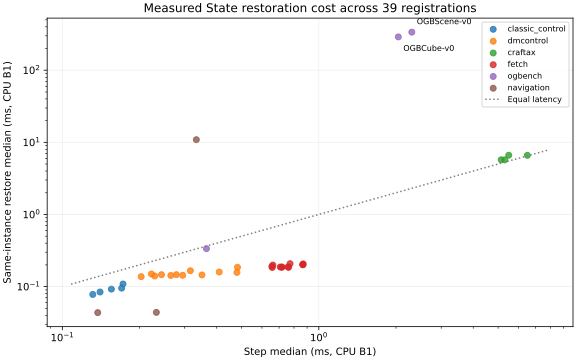

# State-operation performance results

All 39 accepted registrations are measured separately on CPU at B1 and a genuine larger public batch. GPU rendering uses Oscar; Craftax also has GPU dynamics/State measurements. No production optimization or promotion follows from these descriptive timings.

Times below are warm medians. Raw result JSON includes p95, calls/s, every sample, variance, first-call and construction times, exact commands, versions and hardware. Calls/s count whole batch calls; they are not rendered FPS. NPZ sizes are uncompressed named numeric serialization, not Python heap size.

CPU: Apple M5, family-specific accepted environments. GPU: RTX 3090, Linux x86_64, profile details in each artifact. Original GPU job 6693308 leaked normal-profile site-packages into child profiles; its Craftax/Fetch/Cube/Scene results are superseded by the isolated-profile retry. Both runs are retained. No duplicate jobs were submitted.

## CPU per-registration State costs

| Registration | B1 payload / NPZ bytes | Step µs | Get µs | Same set µs | Independent set µs | Get/step | Set/step | Branch ms |
|---|---:|---:|---:|---:|---:|---:|---:|---:|
| swm/AcrobotControl-v1 | 120 / 2526 | 170.334 | 95.417 | 95.125 | 96.645 | 0.560 | 0.558 | 1.811 |
| swm/AcrobotDMControl-v0 | 5082 / 8066 | 229.167 | 124.645 | 140.167 | 139.270 | 0.544 | 0.612 | 2.485 |
| swm/BallInCupDMControl-v0 | 5130 / 8114 | 278.292 | 124.875 | 146.375 | 143.042 | 0.449 | 0.526 | 3.025 |
| swm/CartPoleControl-v1 | 129 / 3135 | 172.417 | 121.250 | 108.562 | 107.854 | 0.703 | 0.630 | 1.808 |
| swm/CartpoleDMControl-v0 | 5082 / 8066 | 294.666 | 144.688 | 143.562 | 146.062 | 0.491 | 0.487 | 2.570 |
| swm/CheetahDMControl-v0 | 5250 / 8234 | 243.542 | 125.167 | 146.270 | 146.042 | 0.514 | 0.601 | 2.642 |
| swm/CraftaxClassicPixels-v1 | 21151 / 42179 | 5311.229 | 442.625 | 5720.208 | 5898.896 | 0.083 | 1.077 | 59.048 |
| swm/CraftaxClassicSymbolic-v1 | 21151 / 42179 | 5138.542 | 438.125 | 5732.458 | 5708.855 | 0.085 | 1.116 | 57.777 |
| swm/CraftaxPixels-v1 | 273444 / 304120 | 6502.730 | 627.209 | 6608.042 | 6688.333 | 0.096 | 1.016 | 72.191 |
| swm/CraftaxSymbolic-v1 | 306516 / 337490 | 5500.292 | 786.708 | 6629.229 | 6784.271 | 0.143 | 1.205 | 61.292 |
| swm/FetchPickAndPlace-v3 | 712 / 4248 | 718.875 | 131.667 | 186.500 | 186.645 | 0.183 | 0.259 | 7.553 |
| swm/FetchPickAndPlaceDense-v3 | 712 / 4248 | 716.542 | 133.667 | 185.792 | 184.958 | 0.187 | 0.259 | 7.532 |
| swm/FetchPickAndPlaceDict-v3 | 712 / 4248 | 707.145 | 129.480 | 186.645 | 186.355 | 0.183 | 0.264 | 7.499 |
| swm/FetchPush-v3 | 712 / 4248 | 762.271 | 130.250 | 184.750 | 187.145 | 0.171 | 0.242 | 7.966 |
| swm/FetchPushDense-v3 | 712 / 4248 | 759.208 | 131.250 | 187.688 | 193.854 | 0.173 | 0.247 | 8.059 |
| swm/FetchPushDict-v3 | 712 / 4248 | 772.458 | 137.084 | 207.791 | 216.750 | 0.177 | 0.269 | 8.063 |
| swm/FetchReach-v3 | 560 / 4096 | 658.375 | 133.188 | 184.125 | 193.688 | 0.202 | 0.280 | 7.381 |
| swm/FetchReachDense-v3 | 560 / 4096 | 661.750 | 132.292 | 198.875 | 190.395 | 0.200 | 0.301 | 7.489 |
| swm/FetchReachDict-v3 | 560 / 4096 | 655.959 | 133.584 | 190.375 | 189.958 | 0.204 | 0.290 | 7.290 |
| swm/FetchSlide-v3 | 712 / 4248 | 867.292 | 130.791 | 200.208 | 201.708 | 0.151 | 0.231 | 9.180 |
| swm/FetchSlideDense-v3 | 712 / 4248 | 864.875 | 137.605 | 202.250 | 208.250 | 0.159 | 0.234 | 9.173 |
| swm/FetchSlideDict-v3 | 712 / 4248 | 868.958 | 132.000 | 206.333 | 203.104 | 0.152 | 0.237 | 12.664 |
| swm/FingerDMControl-v0 | 5122 / 8392 | 315.625 | 147.209 | 165.895 | 166.145 | 0.466 | 0.526 | 3.441 |
| swm/HopperDMControl-v0 | 5202 / 8186 | 264.896 | 125.334 | 142.542 | 141.958 | 0.473 | 0.538 | 2.913 |
| swm/HumanoidDMControl-v0 | 5690 / 8674 | 479.542 | 124.750 | 157.209 | 159.708 | 0.260 | 0.328 | 5.208 |
| swm/ManipulatorDMControl-v0 | 5330 / 8890 | 481.834 | 159.541 | 185.333 | 181.416 | 0.331 | 0.385 | 5.144 |
| swm/MountainCarContinuousControl-v0 | 105 / 2299 | 140.292 | 100.166 | 84.083 | 83.959 | 0.714 | 0.599 | 1.510 |
| swm/MountainCarControl-v0 | 104 / 2010 | 131.458 | 83.083 | 77.792 | 77.520 | 0.632 | 0.592 | 1.463 |
| swm/OGBCube-v0 | 9397 / 52363 | 2041.688 | 1242.229 | 289755.188 | 291483.730 | 0.608 | 141.919 | 310.715 |
| swm/OGBMaze-v0 | 5145 / 9045 | 364.625 | 139.312 | 335.459 | 336.771 | 0.382 | 0.920 | 3.982 |
| swm/OGBScene-v0 | 10485 / 50861 | 2304.041 | 1174.167 | 337373.270 | 338226.541 | 0.510 | 146.427 | 405.181 |
| swm/PendulumControl-v1 | 113 / 2543 | 155.292 | 103.542 | 92.209 | 92.167 | 0.667 | 0.594 | 1.669 |
| swm/PendulumDMControl-v0 | 5058 / 8042 | 202.938 | 122.334 | 137.417 | 137.708 | 0.603 | 0.677 | 2.202 |
| swm/Piecewise-v0 | 16 / 588 | 137.417 | 49.375 | 43.542 | 42.625 | 0.359 | 0.317 | 1.421 |
| swm/QuadrupedDMControl-v0 | 5666 / 8910 | 408.854 | 129.230 | 159.250 | 158.375 | 0.316 | 0.390 | 4.252 |
| swm/ReacherDMControl-v0 | 5106 / 8366 | 222.500 | 130.542 | 149.542 | 148.438 | 0.587 | 0.672 | 2.399 |
| swm/SimplePointMaze-v0 | 33 / 1197 | 332.958 | 141.458 | 10881.104 | 10939.896 | 0.425 | 32.680 | 13.438 |
| swm/TwoRoom-v1 | 16 / 588 | 232.542 | 48.833 | 43.875 | 43.875 | 0.210 | 0.189 | 2.380 |
| swm/WalkerDMControl-v0 | 5250 / 8234 | 350.292 | 123.562 | 144.980 | 143.417 | 0.353 | 0.414 | 3.856 |

## Larger public CPU batches

B16 is used except B4 for reconstruction-heavy Cube/Scene. B64 is explicitly deferred for runtime; it was not emulated or claimed unsupported. These times include the whole batch.

| Registration | Batch | Payload / NPZ bytes | Step ms | Get ms | Set ms | Branch ms |
|---|---:|---:|---:|---:|---:|---:|
| swm/AcrobotControl-v1 | 16 | 1920 / 4326 | 1.393 | 0.957 | 0.548 | 15.099 |
| swm/AcrobotDMControl-v0 | 16 | 81312 / 84296 | 2.365 | 1.336 | 1.086 | 26.146 |
| swm/BallInCupDMControl-v0 | 16 | 82080 / 85064 | 3.005 | 1.346 | 1.139 | 33.175 |
| swm/CartPoleControl-v1 | 16 | 2064 / 5070 | 1.364 | 1.200 | 0.655 | 17.011 |
| swm/CartpoleDMControl-v0 | 16 | 81312 / 84296 | 2.421 | 1.557 | 1.133 | 26.849 |
| swm/CheetahDMControl-v0 | 16 | 84000 / 86984 | 2.201 | 1.352 | 1.158 | 24.229 |
| swm/CraftaxClassicPixels-v1 | 16 | 338416 / 359444 | 13.301 | 1.753 | 20.438 | 152.893 |
| swm/CraftaxClassicSymbolic-v1 | 16 | 338416 / 359444 | 11.054 | 1.703 | 20.371 | 130.881 |
| swm/CraftaxPixels-v1 | 16 | 4375104 / 4405780 | 29.656 | 3.045 | 32.606 | 330.340 |
| swm/CraftaxSymbolic-v1 | 16 | 4904256 / 4935230 | 16.262 | 3.155 | 31.916 | 196.108 |
| swm/FetchPickAndPlace-v3 | 16 | 11392 / 14928 | 10.105 | 1.286 | 1.303 | 105.538 |
| swm/FetchPickAndPlaceDense-v3 | 16 | 11392 / 14928 | 10.091 | 1.282 | 1.327 | 108.581 |
| swm/FetchPickAndPlaceDict-v3 | 16 | 11392 / 14928 | 10.063 | 1.280 | 1.323 | 106.182 |
| swm/FetchPush-v3 | 16 | 11392 / 14928 | 11.515 | 1.293 | 1.452 | 117.428 |
| swm/FetchPushDense-v3 | 16 | 11392 / 14928 | 13.800 | 1.308 | 1.444 | 120.199 |
| swm/FetchPushDict-v3 | 16 | 11392 / 14928 | 11.990 | 1.292 | 1.480 | 119.599 |
| swm/FetchReach-v3 | 16 | 8960 / 12496 | 9.356 | 1.326 | 1.365 | 98.568 |
| swm/FetchReachDense-v3 | 16 | 8960 / 12496 | 9.324 | 1.289 | 1.354 | 98.395 |
| swm/FetchReachDict-v3 | 16 | 8960 / 12496 | 9.438 | 1.340 | 1.370 | 98.510 |
| swm/FetchSlide-v3 | 16 | 11392 / 14928 | 13.572 | 1.297 | 1.707 | 136.281 |
| swm/FetchSlideDense-v3 | 16 | 11392 / 14928 | 13.344 | 1.307 | 1.672 | 135.010 |
| swm/FetchSlideDict-v3 | 16 | 11392 / 14928 | 13.471 | 1.296 | 1.582 | 132.290 |
| swm/FingerDMControl-v0 | 16 | 81952 / 85222 | 3.252 | 1.560 | 1.288 | 34.975 |
| swm/HopperDMControl-v0 | 16 | 83232 / 86216 | 2.635 | 1.327 | 1.103 | 29.451 |
| swm/HumanoidDMControl-v0 | 16 | 91040 / 94024 | 5.981 | 1.331 | 1.325 | 67.072 |
| swm/ManipulatorDMControl-v0 | 16 | 85280 / 88840 | 5.886 | 1.718 | 1.475 | 64.152 |
| swm/MountainCarContinuousControl-v0 | 16 | 1680 / 3874 | 1.062 | 0.960 | 0.544 | 11.471 |
| swm/MountainCarControl-v0 | 16 | 1664 / 3570 | 0.953 | 0.810 | 0.482 | 10.426 |
| swm/OGBCube-v0 | 4 | 37588 / 80554 | 6.755 | 3.733 | 1230.360 | 1297.357 |
| swm/OGBMaze-v0 | 16 | 82320 / 86220 | 4.222 | 1.352 | 3.084 | 45.985 |
| swm/OGBScene-v0 | 4 | 41940 / 82316 | 7.590 | 3.528 | 1449.029 | 1520.591 |
| swm/PendulumControl-v1 | 16 | 1808 / 4238 | 1.185 | 1.017 | 0.579 | 13.110 |
| swm/PendulumDMControl-v0 | 16 | 80928 / 83912 | 1.971 | 1.324 | 1.048 | 21.419 |
| swm/Piecewise-v0 | 16 | 256 / 828 | 0.172 | 0.049 | 0.043 | 1.761 |
| swm/QuadrupedDMControl-v0 | 16 | 90656 / 93900 | 4.606 | 1.398 | 1.330 | 50.283 |
| swm/ReacherDMControl-v0 | 16 | 81696 / 84956 | 2.248 | 1.404 | 1.117 | 24.595 |
| swm/SimplePointMaze-v0 | 16 | 528 / 1692 | 0.824 | 0.252 | 172.788 | 179.157 |
| swm/TwoRoom-v1 | 16 | 256 / 828 | 0.266 | 0.051 | 0.044 | 2.709 |
| swm/WalkerDMControl-v0 | 16 | 84000 / 86984 | 3.973 | 1.320 | 1.121 | 43.115 |

## Oracle and closest native baseline (CPU B1)

Every native comparison is a strict subset and is **not like-for-like exhaustive State**. NONE means no comparable native interface. DMC uses Physics get/set with the explicit integration signature; its original default-signature lower bound is also retained in raw results. Fetch/OGBench use MuJoCo integration state; Craftax copies/installs its engine pytree. Pixel Craftax intrinsically generates observations in both upstream and delegated public steps; the public API then exports State rather than returning the Gym observation. No extra standalone render call is timed inside step.

| Registration | Oracle reset µs | Oracle step µs | Native class | Native get / set µs | Public/native get / set |
|---|---:|---:|---|---:|---:|
| swm/AcrobotControl-v1 | 162.667 | 23.500 | NONE | — / — | — / — |
| swm/AcrobotDMControl-v0 | 406.666 | 61.959 | NATIVE_PARTIAL | 2.166 / 1.459 | 57.546 / 96.071 |
| swm/BallInCupDMControl-v0 | 517.542 | 97.000 | NATIVE_PARTIAL | 2.125 / 1.459 | 58.765 / 100.326 |
| swm/CartPoleControl-v1 | 156.833 | 4.459 | NONE | — / — | — / — |
| swm/CartpoleDMControl-v0 | 362.459 | 61.292 | NATIVE_PARTIAL | 2.166 / 1.459 | 66.799 / 98.398 |
| swm/CheetahDMControl-v0 | 1317.625 | 47.833 | NATIVE_PARTIAL | 2.166 / 1.458 | 57.787 / 100.323 |
| swm/CraftaxClassicPixels-v1 | 738.188 | 471.292 | NATIVE_PARTIAL | 624.500 / 624.542 | 0.709 / 9.159 |
| swm/CraftaxClassicSymbolic-v1 | 687.938 | 342.417 | NATIVE_PARTIAL | 626.959 / 627.188 | 0.699 / 9.140 |
| swm/CraftaxPixels-v1 | 3525.333 | 1477.125 | NATIVE_PARTIAL | 1701.062 / 1202.500 | 0.369 / 5.495 |
| swm/CraftaxSymbolic-v1 | 2699.125 | 649.770 | NATIVE_PARTIAL | 1068.624 / 1059.688 | 0.736 / 6.256 |
| swm/FetchPickAndPlace-v3 | 632.916 | 545.541 | NATIVE_PARTIAL | 1.500 / 1.333 | 87.778 / 139.910 |
| swm/FetchPickAndPlaceDense-v3 | 627.062 | 546.500 | NATIVE_PARTIAL | 1.625 / 1.375 | 82.256 / 135.121 |
| swm/FetchPickAndPlaceDict-v3 | 625.834 | 548.771 | NATIVE_PARTIAL | 1.500 / 1.292 | 86.320 / 144.462 |
| swm/FetchPush-v3 | 653.042 | 597.000 | NATIVE_PARTIAL | 1.500 / 1.292 | 86.833 / 142.995 |
| swm/FetchPushDense-v3 | 654.208 | 593.167 | NATIVE_PARTIAL | 1.500 / 1.292 | 87.500 / 145.269 |
| swm/FetchPushDict-v3 | 647.458 | 591.709 | NATIVE_PARTIAL | 1.459 / 1.292 | 93.958 / 160.829 |
| swm/FetchReach-v3 | 539.520 | 482.583 | NATIVE_PARTIAL | 1.500 / 1.291 | 88.792 / 142.622 |
| swm/FetchReachDense-v3 | 537.625 | 483.917 | NATIVE_PARTIAL | 1.520 / 1.292 | 87.006 / 153.928 |
| swm/FetchReachDict-v3 | 559.583 | 484.125 | NATIVE_PARTIAL | 1.458 / 1.291 | 91.621 / 147.463 |
| swm/FetchSlide-v3 | 667.417 | 695.937 | NATIVE_PARTIAL | 1.500 / 1.291 | 87.194 / 155.080 |
| swm/FetchSlideDense-v3 | 672.459 | 693.250 | NATIVE_PARTIAL | 1.500 / 1.292 | 91.736 / 156.541 |
| swm/FetchSlideDict-v3 | 672.375 | 694.645 | NATIVE_PARTIAL | 1.500 / 1.333 | 88.000 / 154.789 |
| swm/FingerDMControl-v0 | 529.917 | 98.875 | NATIVE_PARTIAL | 2.166 / 1.458 | 67.964 / 113.783 |
| swm/HopperDMControl-v0 | 426.167 | 72.125 | NATIVE_PARTIAL | 2.125 / 1.459 | 58.980 / 97.698 |
| swm/HumanoidDMControl-v0 | 532.750 | 276.917 | NATIVE_PARTIAL | 2.167 / 1.500 | 57.568 / 104.806 |
| swm/ManipulatorDMControl-v0 | 625.333 | 254.709 | NATIVE_PARTIAL | 2.166 / 1.459 | 73.657 / 127.027 |
| swm/MountainCarContinuousControl-v0 | 87.042 | 2.333 | NONE | — / — | — / — |
| swm/MountainCarControl-v0 | 96.708 | 5.584 | NONE | — / — | — / — |
| swm/OGBCube-v0 | 156374.167 | 592.229 | NATIVE_PARTIAL | 1.458 / 1.250 | 852.009 / 231804.150 |
| swm/OGBMaze-v0 | 474.250 | 40.792 | NATIVE_PARTIAL | 1.333 / 1.167 | 104.511 / 287.454 |
| swm/OGBScene-v0 | 173243.500 | 902.833 | NATIVE_PARTIAL | 1.417 / 1.208 | 828.629 / 279282.509 |
| swm/PendulumControl-v1 | 143.959 | 7.167 | NONE | — / — | — / — |
| swm/PendulumDMControl-v0 | 353.250 | 38.375 | NATIVE_PARTIAL | 2.125 / 1.458 | 57.569 / 94.250 |
| swm/Piecewise-v0 | 740.083 | 23.959 | NONE | — / — | — / — |
| swm/QuadrupedDMControl-v0 | 5561.855 | 215.417 | NATIVE_PARTIAL | 2.167 / 1.500 | 59.635 / 106.167 |
| swm/ReacherDMControl-v0 | 385.875 | 53.292 | NATIVE_PARTIAL | 2.125 / 1.458 | 61.432 / 102.567 |
| swm/SimplePointMaze-v0 | 23954.480 | 46.541 | NONE | — / — | — / — |
| swm/TwoRoom-v1 | 932.709 | 22.250 | NONE | — / — | — / — |
| swm/WalkerDMControl-v0 | 455.354 | 147.625 | NATIVE_PARTIAL | 2.125 / 1.500 | 58.147 / 96.653 |

## GPU operations (B1)

Dashes mean the operation is unsupported or was intentionally covered by CPU dynamics. Exact refusal reasons are retained in JSON. Explicit public State → RenderState is timed where exposed. Rendering is a separate call on a full snapshot.

| Registration | Projection ms | Render ms | Get ms | Set ms | Branch ms |
|---|---:|---:|---:|---:|---:|
| swm/AcrobotControl-v1 | — | 8.680 | — | — | — |
| swm/AcrobotDMControl-v0 | — | 5.338 | — | — | — |
| swm/BallInCupDMControl-v0 | — | 5.338 | — | — | — |
| swm/CartPoleControl-v1 | — | 8.138 | — | — | — |
| swm/CartpoleDMControl-v0 | — | 6.180 | — | — | — |
| swm/CheetahDMControl-v0 | — | 1.371 | — | — | — |
| swm/CraftaxClassicPixels-v1 | 34.387 | 48.695 | 8.023 | 34.070 | 383.693 |
| swm/CraftaxClassicSymbolic-v1 | — | — | 7.880 | 33.398 | 370.761 |
| swm/CraftaxPixels-v1 | 44.636 | 69.788 | 12.422 | 44.297 | 479.085 |
| swm/CraftaxSymbolic-v1 | — | — | 12.558 | 44.422 | 472.082 |
| swm/FetchPickAndPlace-v3 | — | 3.318 | — | — | — |
| swm/FetchPickAndPlaceDense-v3 | — | 3.283 | — | — | — |
| swm/FetchPickAndPlaceDict-v3 | — | 3.313 | — | — | — |
| swm/FetchPush-v3 | — | 3.287 | — | — | — |
| swm/FetchPushDense-v3 | — | 3.318 | — | — | — |
| swm/FetchPushDict-v3 | — | 3.291 | — | — | — |
| swm/FetchReach-v3 | — | 3.276 | — | — | — |
| swm/FetchReachDense-v3 | — | 3.274 | — | — | — |
| swm/FetchReachDict-v3 | — | 3.259 | — | — | — |
| swm/FetchSlide-v3 | — | 3.269 | — | — | — |
| swm/FetchSlideDense-v3 | — | 3.315 | — | — | — |
| swm/FetchSlideDict-v3 | — | 3.319 | — | — | — |
| swm/FingerDMControl-v0 | — | 5.040 | — | — | — |
| swm/HopperDMControl-v0 | — | 1.319 | — | — | — |
| swm/HumanoidDMControl-v0 | — | 1.459 | — | — | — |
| swm/ManipulatorDMControl-v0 | — | 5.292 | — | — | — |
| swm/MountainCarContinuousControl-v0 | — | 8.695 | — | — | — |
| swm/MountainCarControl-v0 | — | 8.698 | — | — | — |
| swm/OGBCube-v0 | 20.911 | 37.615 | — | — | — |
| swm/OGBMaze-v0 | — | 3.849 | — | — | — |
| swm/OGBScene-v0 | 20.638 | 38.451 | — | — | — |
| swm/PendulumControl-v1 | — | 8.640 | — | — | — |
| swm/PendulumDMControl-v0 | — | 6.027 | — | — | — |
| swm/Piecewise-v0 | — | 0.885 | — | — | — |
| swm/QuadrupedDMControl-v0 | — | 3.196 | — | — | — |
| swm/ReacherDMControl-v0 | — | 6.164 | — | — | — |
| swm/SimplePointMaze-v0 | — | 4.406 | — | — | — |
| swm/TwoRoom-v1 | — | 1.387 | — | — | — |
| swm/WalkerDMControl-v0 | — | 1.357 | — | — | — |

## Fresh-process Craftax initialization

One fresh process per registration/device/API kind, with a separate compilation-cache path. Seconds below include compilation when first triggered; interpreter startup and hardware probing are excluded. Call order is constructor → reset → step → public get/set → second step. Constructor/reset can internally invoke other operations. The second step can still incur initialization work after restoration (visible for Classic CPU); it is not labelled steady-state. Oracle cold steps use action 0; public cold steps use the recorded script's fixed action seed. Warm benchmark oracle/public actions are matched separately. These are individual cold observations, not p95 estimates; the repeated warm measurements above provide distributions.

| Registration | Device | API | Constructor s | First reset s | First step s | Second step s | First set s |
|---|---|---|---:|---:|---:|---:|---:|
| swm/CraftaxClassicPixels-v1 | cpu | oracle | 2.074 | 0.809 | 1.573 | 0.001 | — |
| swm/CraftaxClassicPixels-v1 | cpu | public | 3.599 | 0.029 | 1.594 | 1.494 | 0.082 |
| swm/CraftaxClassicSymbolic-v1 | cpu | oracle | 1.985 | 0.650 | 1.178 | 0.000 | — |
| swm/CraftaxClassicSymbolic-v1 | cpu | public | 2.481 | 0.029 | 1.203 | 1.085 | 0.084 |
| swm/CraftaxPixels-v1 | cpu | oracle | 3.607 | 2.532 | 4.419 | 0.002 | — |
| swm/CraftaxPixels-v1 | cpu | public | 5.960 | 0.029 | 4.334 | 0.008 | 0.119 |
| swm/CraftaxSymbolic-v1 | cpu | oracle | 3.677 | 2.270 | 3.331 | 0.001 | — |
| swm/CraftaxSymbolic-v1 | cpu | public | 6.160 | 0.034 | 3.567 | 0.009 | 0.117 |
| swm/CraftaxClassicPixels-v1 | cuda | oracle | 4.841 | 6.493 | 15.165 | 0.007 | — |
| swm/CraftaxClassicPixels-v1 | cuda | public | 23.124 | 0.037 | 15.072 | 14.893 | 0.266 |
| swm/CraftaxClassicSymbolic-v1 | cuda | oracle | 4.906 | 4.665 | 9.845 | 0.007 | — |
| swm/CraftaxClassicSymbolic-v1 | cuda | public | 9.260 | 0.022 | 9.949 | 9.186 | 0.252 |
| swm/CraftaxPixels-v1 | cuda | oracle | 7.866 | 15.443 | 26.647 | 0.014 | — |
| swm/CraftaxPixels-v1 | cuda | public | 24.049 | 0.041 | 26.485 | 0.036 | 0.405 |
| swm/CraftaxSymbolic-v1 | cuda | oracle | 8.353 | 14.144 | 22.773 | 0.013 | — |
| swm/CraftaxSymbolic-v1 | cuda | public | 22.106 | 0.033 | 22.952 | 0.035 | 0.386 |

## Family ranges (CPU B1)

Ranges span registrations, including shared adapters. They are not independent backend counts.

| Family | Registrations | Payload bytes range | Get/step range | Same set/step range | Native class |
|---|---:|---:|---:|---:|---|
| classic_control | 5 | 104.000–129.000 | 0.560–0.714 | 0.558–0.630 | NONE |
| dmcontrol | 12 | 5058.000–5690.000 | 0.260–0.603 | 0.328–0.677 | NATIVE_PARTIAL |
| craftax | 4 | 21151.000–306516.000 | 0.083–0.143 | 1.016–1.205 | NATIVE_PARTIAL |
| fetch | 12 | 560.000–712.000 | 0.151–0.204 | 0.231–0.301 | NATIVE_PARTIAL |
| ogbench | 3 | 5145.000–10485.000 | 0.382–0.608 | 0.920–146.427 | NATIVE_PARTIAL |
| navigation | 3 | 16.000–33.000 | 0.210–0.425 | 0.189–32.680 | NONE |

## Outliers and limits

- swm/OGBScene-v0: same-instance restore is 146.43× step; branch median 405.181 ms.
- swm/OGBCube-v0: same-instance restore is 141.92× step; branch median 310.715 ms.
- swm/SimplePointMaze-v0: same-instance restore is 32.68× step; branch median 13.438 ms.
- swm/CraftaxSymbolic-v1: same-instance restore is 1.21× step; branch median 61.292 ms.
- swm/CraftaxClassicSymbolic-v1: same-instance restore is 1.12× step; branch median 57.777 ms.

38 CPU operation cells have coefficient of variation above 0.25. Medians, p95 and raw samples remain available; no accuracy ranking or noise-based deletion is claimed.

Cube/Scene restoration includes upstream reconstruction; Craftax costs include exhaustive tensor/JAX conversion and synchronization. These are candidates for the post-42/42 optimization phase. Hardware/profile differences preclude treating CPU/GPU ratios as engine speedups. Branch timing includes eight divergent and two continuation steps, snapshot and restore; preparation is outside timing.

Rocket remains INCOMPLETE; its opaque native snapshots are OPAQUE_SAME_PROCESS_NON_EQUIVALENT. PushT remains INCOMPLETE; its research typed-body/contact-order accessor is NATIVE_PARTIAL. Their diagnostic timing and exact continuation failures are documented separately. No NATIVE_EQUIVALENT baseline was established.

See `summary.json` for source artifact hashes and full nested results. Reproduce individual runs with each stored command and profile; the harness documentation explains adding accepted registrations. Accepted evidence was preserved and never overwritten.
