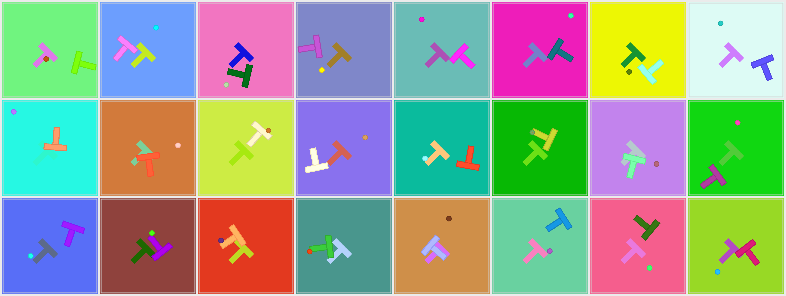
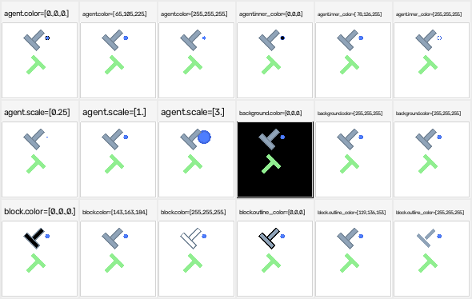

# Variation collapses (measurement record)

User-facing Variation is documented in [variation spaces](../concepts/variation-spaces.md).
This page keeps the forensic record of three shipped defects that made a declared knob
look wired when it was not per-environment. The conformance checks that close them are
listed at the end.

## Defaults are the reference appearance, exactly

`scale = 1.0` and the stock palette reproduce `gym_pusht` bit-for-bit, and the parity test
asserts that identity. Scales are multipliers on the reference geometry rather than
absolute sizes for this reason: an absolute default would make "matches the official
renderer" depend on a magic number that nobody re-checks when the geometry changes.

The concrete payoff is that the parity claim and the variation machinery are the same code
path. There is no "reference mode" that bypasses the knobs, so a knob cannot drift away
from the reference without the parity test noticing.

## The API is `stable_worldmodel.spaces`

Same class names, same `init_value` / `value` / `reset` / `sample` / `set_value` / `check`
surface, same `reset_variation_space` entry point. An env written against one works
against the other, and `stable_worldmodel` envs move here without a rewrite. The module is
vendored rather than imported so that `stable_envs` stays installable on its own: the
compatibility is the point, the dependency is not.

What differs is what the values are *for*. In `stable_worldmodel` a variation is read once
at reset and baked into a CPU renderer. Here the values flow into a `Scene2D` as
per-environment tensors, which is why `Box.batch_sample(B)` exists — it draws `B`
independent values for a leaf and returns them stacked, the form the scene builder
consumes. It uses a plain uniform rather than `B` calls to gymnasium's `sample`, because
at 4096 environments the per-call overhead dominates and a per-env appearance draw is
exactly the thing this repo is trying to make free.

The compiled layout used internally is a `StyleTensor` (`stable_envs._style`): one
`(B, variation_dim)` float32 tensor plus the column map. `Env.resolve_style` /
`style_dim` / `style_names` / `default_style` / `get_style` / `set_style` /
`sample_style` wrap the public `variation_*` surface for env implementations and tests.
They are not v0 user APIs.

## What actually varies per environment

The `Scene2D` layout allows every primitive's colour and geometry to differ per
environment. Whether an env *delivers* that is a separate question, and it is one to
answer by measurement rather than by reading the space: batch of 8, one fixed state
repeated, each leaf given 8 distinct values, counting how many of the 8 rendered frames
come out distinct.

| variation leaf | distinct frames out of 8 | |
|---|---|---|
| `agent.color`, `agent.inner_color`, `agent.scale` | 8 | |
| `block.color`, `block.outline_color`, `block.scale` | 8 | |
| `background.color`, `walls.color` | 8 | inside the static prefix |
| `goal.color`, `goal.position`, `goal.scale` | 8 | inside the static prefix |
| `goal.angle` | 7 | the ramp's endpoints are −π and π, which draw the same T |
| `rendering.render_goal`, `walls.visible` | 2 | `Discrete(2)` — two values exist |

Every continuous leaf is per-environment. The same measurement on `SimplePointMaze` gives
8/8 for `agent.color`, `agent.radius`, `background.color`, `walls.color`,
`walls.positions` and `walls.shape`, and 3 for `walls.number`, which is `Discrete` over
three slot counts.

That is a recent state of affairs and the history is the useful part of this section:

**Scalar knobs used to be read `[:1].expand(B)`.** `agent.scale`, `block.scale`,
`goal.scale` and `goal.angle` each collapsed to environment 0's value, so passing 8
different scales silently used the first. That is the first of the three collapses
recorded in `stable_envs/_style.py`; the fix was to give style its own per-environment
tensor and index it, and `test_per_env_variation_is_per_env` is the check that keeps it
fixed.

**Static-prefix knobs used to be read per batch.** The goal T, the walls and the
background sit in the prefix the rasterizer bakes into one shared base image, and the bake
was taken from batch element 0, so per-environment goal colours painted *every*
environment with environment 0's goal — the second collapse. It is now impossible rather
than discouraged: the rasterizer compares the prefix against its own first row and simply
does not bake when the rows differ, so `static_prefix` is a request that costs speed when
it cannot be honoured and never pixels. See
[baking the static prefix](../concepts/scene-ir.md#baking-the-static-prefix) for what that
costs and what it buys.

The third collapse in that list is not a variation at all and is recorded here for
completeness: `Env.resolve_style` fell back to `self._style.values[:1]` whenever the
render batch differed from the env's, so `render(states[:3])` under a per-environment
appearance drew three copies of environment 0. All three had the same shape — "make this
style fit that batch" open-coded per call site — which is why there is now exactly one
operation allowed to do it, `StyleTensor.for_batch`.

The reason this section is a table of measurements rather than a list of features is that
all three passed every conformance check of their day. A knob that is declared, wired, and
read from environment 0 looks exactly like a knob that works, right up until someone
counts the distinct frames.

### The tile family reads variation per call, not per environment

`examples/gallery.py` runs the same measurement on every registered env before it draws
the batched variation sheet, and on the tile-atlas envs (MiniGrid, BabyAI) **no leaf
varies per environment** — the sheet is skipped rather than faked. That is a consequence
of how those envs render: a variation selects a palette, the palette is baked into an
atlas, and the frame is a gather from that atlas. One atlas per call, so one appearance
per call.

It is not a bug, it is a different point on the same trade: the tile path buys
byte-exactness by construction and per-call appearance, the `Scene2D` path buys
per-environment appearance and pays for it with a rasterizer that has to be checked
against the reference. Which one an env wants depends on whether the reference draws
shapes or composes cached images.

The gallery's variation sheet is one kernel launch with 32 different agent and block
colours:

The same knobs swept across separate renders, which is how a per-call sweep reads:

## Conformance covers the declaration *and* the plumbing, in two checks

`check_variations_do_something` moves every declared leaf to the far end of its range and
asserts the frame changes. It catches a knob that is in the space but not wired into
`scene()` — advertised support that does not exist. PushT passes with zero inert
variations.

On its own it would miss both collapses above, because in each of them the knob does
change the picture; it just changes it for the whole batch. `check_per_env_variation` is
the second check and the one that would not: it splits the batch into two groups with
different values for a leaf and asserts the frames come out in more than one version. Two
groups, not a B-wide ramp — two already falsify a collapse to environment 0, and a ramp
costs the plate-baking families one MuJoCo bake per distinct value.

API details: [`stable_envs.spaces`](../api/spaces.md). Internal compiled layout:
[`stable_envs._style`](../api/style.md).
