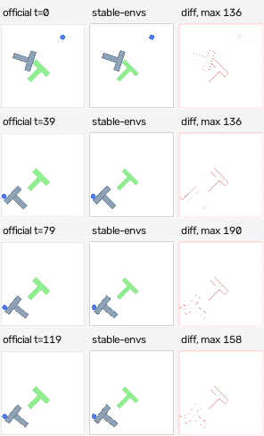

# Testing and conformance

Test simulator, task and renderer claims separately. Start with the
[contributor guides](adding/index.md), which distinguish fast development checks
from final acceptance. Registry-wide renderer tests do not prove a new task or
exhaustive State: add independent semantic/restoration witnesses for each registration.
A skipped required gate leaves the registration incomplete.

The renderer-focused checks below do not replace full-State restoration and
independent source gates.

## Shared source contracts

Shared profiles in `tests/contracts/` cover all 38 non-Craftax registrations:
`native` (5), `fetch` (12), `dmc` (12), `navigation` (3), `ogbench` (3),
`pusht` (2), and `rocket` (1). Each uses an independent source bridge
and separate State, simulation, task and online checks. These are small regression
profiles; the native profile also includes its specialized lifecycle, terminal,
action-boundary, physical Variation, rejected dtype-control and source-pixel witnesses
(128 required cases). Other family acceptance gates still cover their stronger contact,
Variation, rendering and process obligations. Passing a profile does not promote
its siblings or replace those gates. Source helpers live in
`tests/helpers/reference/`; benchmark drivers import them, never the reverse.

From the repository root, in the matching pinned family interpreter:

```bash
python -m pytest tests/contracts --contract-profile native \
  --contract-source /path/to/pinned/stable-worldmodel \
  --contract-output /path/to/new-run
```

Choose the family profile and optionally `--contract-device cuda` on a CUDA host.
Source pins are explicit in
`tests/helpers/reference/profiles.py`. The source checkout must be clean at
`176d54532b3c0a251a4f509b74f2fdacc143a63d`. Source environment code is loaded unchanged;
unrelated learning-stack package initializers are omitted. Profiles compare CPU
physics with CPU or CUDA State/output delivery. All 38 non-Craftax registrations
also have maintained independent source-pixel checks, using the declared family
backends below. Profiles do not measure throughput. DMC and Maze constructors
require a working GL context even when frames are omitted; use Oscar EGL when local GL is unavailable. Cube/Scene retain
the accepted controlled-entropy source scope. PushT and Rocket compare independent
native-engine fields in addition to public replay-State restoration.

Required coverage is computed before execution. Missing dependencies, skipped or
deselected cases, duplicate results and wrong source versions cannot pass. In a
required profile, `-k` is useful for development but a partial result exits nonzero.
Run profiles in one interpreter without xdist. An exported checkout can provide `--contract-candidate-manifest`: its `commit`,
`tracked_dirty`, and `files` (path to SHA256) identify the candidate; every required
candidate/oracle file must match before execution.
A crashed profile requires a full
rerun into a new output directory; automatic segment resumption does not satisfy
its required-case accounting. Existing release gates retain their supervisor.
`--contract-output` must name a new directory. It contains the plan, candidate
hashes, per-case progress, source/runtime identity and a final `SHA256SUMS` seal.
A crash can leave progress without a seal; that is incomplete evidence. Failures
retain the action plan, current numeric State, assertion and replay command.

Fast checks without the upstream package:

```bash
python -m pytest tests/unit/test_testing_evidence.py tests/unit/test_testing_corpus.py tests/unit/test_contract_inventory.py
python -m pytest tests/contracts/test_saved_native.py tests/contracts/test_saved_trajectory.py -m "not gpu"
python -m pytest tests/regression/test_testing_migration.py
python -m scripts.testing.inventory
```

With MuJoCo 3.12.0 and the DMC dependencies, the read-only frozen-oracle selection
checks all 12 DMC domains without importing stable-worldmodel:

```bash
python -m pytest tests/unit/test_dmc_*oracle.py tests/unit/test_reacher_oracle.py tests/unit/test_reference_oracle.py
```

It restores reached source States at steps 0, 7 and 24 and checks immediate State
and exact continuation. It does not render or replace live-source acceptance.
Saved-trajectory capture equality uses our own renderer; source pixel parity
still requires the independent family render gates.

The inventory covers all **38 non-Craftax registrations** using their accepted
matrix scopes and existing gate paths. It records `NOT_RUN` for the current
checkout; inventory presence is not an acceptance result. Craftax is explicitly
excluded. Repository navigation checks use Git-index membership (or files in an
exported artifact), so unrelated ignored/untracked work is not a product failure.
Stage new product files before running those checks.

## Sealed State/task trajectories

`stable_envs.testing.corpus` supplies a numeric disk format and read-only loader.
Each directory contains a manifest, an NPZ and a hash seal for one registration.
The manifest records source and generator identity, seed, batch, action plan and
all array shapes/dtypes. States include reset and every reached endpoint; integer
RNG fields are never converted to floats. The loader rejects missing, corrupted,
wrong-registration and structurally invalid inputs before constructing an owned
TensorDict. No pickle, simulator handles or live source package is required.

Generate the five classic-control trajectories with the pinned native runtime:

```bash
python -m scripts.testing.freeze_native --source /path/to/pinned/stable-worldmodel \
  --output /path/to/new-corpus
```

Generation only calls the independent source bridges. It refuses to overwrite an
existing directory. The checked-in `tests/fixtures/semantics/shared_native` corpus
uses the historical action plans (seed 17, batch 3, 32 steps); migration tests
require byte-for-byte equality with the preserved old arrays. Further tests
restore checkpoints into different histories and compare eight-step continuations
against disk, including every State leaf and task output. Chunk tests cover T=1
and T=8, terminal lane freezing, padded task outputs, validity and frame capture.
CPU and CUDA cases use the same corpus; CUDA checks run on Oscar. Frame comparisons
here are chunk-versus-direct rendering of source-derived states, **not source
pixel parity**. The historical scalar corpus includes post-terminal calls;
chunk expectations stop each lane at its first done flag, as the public API requires.

This first format covers State/task trajectories only. Source pixels, camera and
fidelity metadata, renderer benchmark consumers, and other families remain to be
migrated. Existing rendering and family acceptance gates remain authoritative.
Cross-machine frozen trajectories allow absolute error up to `1e-12` only for
float64 continuations and task values (`rtol=0`). An independent Linux-versus-Mac
source audit measured at most `8e-15` across these 32-step corpora. Float32,
integers, RNG and flags remain exact. Immediate get/set restoration and same-runtime
live source profiles also remain exact. Old/new corpus migration still compares
array bytes exactly. The tolerance belongs to this frozen regression policy, not
to the corpus loader or registration acceptance gates.

A valid hash seal proves artifact integrity, not source authority or acceptance;
retain the seal in trusted version control and use the pinned source generator.

## Online source pixels

`tests/helpers/reference/pixels.py` checks a `PixelTrace`: initial State,
reached States, task outputs, raw source frames, active-lane masks and actions.
An adapter owns source construction and family-specific witnesses; the shared
checker owns restore, capture order, independent State/frame slices, device
placement, snapshot ownership and per-frame MSE. No production API is added.
The test-only `PixelEnv` protocol names the three methods and device attribute
the checker needs; adapters do not inherit from it. Array hints specify uint8
source pixels and float64 MSE, while action dtypes remain family-specific.

The first adapter, `rocket_pixels.py`, preserves the research gate's flight,
contact, success and horizon cases, float32/64 actions, horizons 1/8 and all four
capture selectors. It also checks frames without State capture. Its source lanes
only advance forward. Candidate-shaped State comes from a separate reference
instance whose native-engine diagnostics are checked against those source lanes;
pixels always come directly from the source renderer.

In the pinned Rocket interpreter (see `tests/helpers/reference/profiles.py`):

```bash
python -m pytest tests/integration/test_rocket_source_pixels.py -m "not gpu"
# On a CUDA host, run the complete CPU/CUDA selection:
python -m pytest tests/integration/test_rocket_source_pixels.py
```

The complete selection requires 32 passing parameter cases with no skips. Each
case runs five capture selections. Both candidate devices compare to source CPU
TinyRenderer; this does not claim a source GPU renderer exists. Per-frame
normalized MSE must be at most 0.001, including held terminal frames. Failures save
sealed raw source/candidate frames, actions, expected States and selection details
under the failing test's pytest temporary directory. A partial run or missing
source dependency is not acceptance. Existing family promotion gates remain.

To add another family, supply a source adapter returning `PixelTrace` and a small
parameterized test supplying its candidate constructor and explicit threshold.
Use source-owned State where available; otherwise add independent native-engine
diagnostics as Rocket does. Do not fabricate expected pixels from the candidate,
silently rescale source images, or relax tolerances to make a new adapter pass.
Keep family contact/Variation/lifecycle cases in the adapter's test parameters.

The initial migration passed all 32 CPU/CUDA cases on Oscar: 256 frame comparisons
per device, CPU MSE zero, CUDA maximum normalized MSE 0.000373915. The scenario
configurations and parameter set match the historical gate. The
[validation record](https://github.com/galilai-group/stable-envs/blob/sami-dev/tests/fixtures/testing/source-pixels-validation.json)
records job outcomes, hardware, versions and tested code hashes. Other families
retain their existing pixel gates; this is the first adapter, not a 38-family
source-pixel migration or a throughput benchmark.

The native profile also uses this checker for all five classic-control
registrations. Run `tests/contracts --contract-profile=native` with the pinned
`--contract-source` checkout and `--contract-device=cpu` or `cuda`, as described
above. This profile now requires **128 passing cases**, including **56 source-pixel
cases**; pygame 2.6.1 is part of its source pins. Selecting only the pixel test is
useful for diagnosis but cannot pass the complete profile.

`native_pixels.py` supplies full States directly from the independent source
serializer, without constructing a candidate. Source lanes advance from reset to
ordinary reached states or different remaining time limits. Tests cover seeds 17
and 42, each registration's action dtypes, one/eight-action chunks, omitted/empty/
final/all/reversed frame selections, independent State selection, and held
terminal lanes. Source rendering must leave State unchanged. CPU and CUDA
candidate images both compare against native-resolution CPU pygame images with
the same per-frame 0.001 limit; pygame has no source GPU renderer.

That checkpoint extended the maintained shared source-pixel checks to **6/38 registrations**,
including Rocket. It does not replace the classic-control performance benchmarks,
large-batch/process gates, or appearance-Variation tests. Those retain their
separate obligations and historical evidence.

The [native validation record](https://github.com/galilai-group/stable-envs/blob/sami-dev/tests/fixtures/testing/native-source-pixels-validation.json)
records 128/128 passing required cases on each device, with no skips, on Oscar
job 7072387 (RTX A5500). All 896 source-frame comparisons per device have MSE zero.
Its hashed evidence archive preserves sealed reports, case identities, source/code
hashes, runtime versions, logs and terminal scheduler status. These measurements
apply to the tested cases and configurations.

The Navigation/DMC/Fetch extension initially passed Native and Navigation's complete
CPU/CUDA profiles. Seven DMC registrations passed every required case on both
devices; five failed the pixel gate at that checkpoint. Fetch's explicit OpenGL
profile passes all 336 required cases on each device. The original
[pending cohort record](https://github.com/galilai-group/stable-envs/blob/sami-dev/tests/fixtures/testing/parallel-source-pixels-validation.json)
remains unchanged; it records the earlier checkpoint, not current acceptance.

The [Oscar validation record](https://github.com/galilai-group/stable-envs/blob/sami-dev/tests/fixtures/testing/parallel-source-pixels-oscar-validation.json)
records that checkpoint and links a hashed archive of code snapshots, sealed
reports, raw failed witnesses, JUnit results, dependencies and terminal job status.
That checkpoint established shared source-pixel coverage for **25/38 non-Craftax registrations**: Rocket,
five native controls, three Navigation, seven DMC and nine Fetch registrations.
Each counted registration passed its own required CPU/CUDA cases. This is test
migration, not a new promotion matrix or a claim about every rendering backend.
The subsequent DMC correction established **30/38**; the final cohort below completes **38/38**.
That left Fetch PickAndPlace (three), OGBench (three), and PushT (two), now covered
by the final cohort below.

Native's 896 frame comparisons per device have MSE zero. Navigation's 768 have
maximum MSE 0.0000217513; Fetch's 2,304 have maximum MSE 0.000252860 on CPU and
0.000248120 on CUDA. Counts include repeated capture-selector comparisons.
The nine Fetch registrations use the explicit OpenGL backend. Initially, its
source-sized raster cost about 1.5 times the render time in a warm B64 probe
repeating two States on CPU and an A40 GPU. GPU resizing and batched readback now
recover performance while retaining that raster and MSAA. Across four Fetch
scenes, paired RTX A5500 measurements show 1.95–1.99× throughput at B64 and
1.98–2.05× at B256 versus the previous high-fidelity implementation. Software-GL
CPU throughput improves 2–3% at B64; single-frame results include a 0.6% regression.
These are before/after library measurements, not speedups over the source
simulator. The [CSV](https://github.com/galilai-group/stable-envs/blob/sami-dev/tests/fixtures/testing/fetch-readback-performance.csv)
includes latency mean and SD; the
[validation report](https://github.com/galilai-group/stable-envs/blob/sami-dev/tests/fixtures/testing/fetch-readback-oscar-validation.json)
links the raw evidence. The default MJWarp renderer is unchanged.
That optimization checkpoint passed all 336 Fetch source-profile cases per device;
maximum source MSE was 0.000253508 on CPU and 0.000248164 on CUDA. PickAndPlace
was excluded from that source-pixel gate; the independent-branch protocol below
closes the exclusion. Its readback regression compares against the previous
high-fidelity implementation.

| Profile | Required cases/device | Source-pixel cases/device | Source renderer |
| --- | ---: | ---: | --- |
| Native | 128 | 56 | CPU pygame |
| Navigation | 96 | 48 | CPU Torch/Matplotlib |
| DMC | 288 | 96 | Software GL for CPU; NVIDIA EGL for CUDA |
| Fetch | 396 | 192 | Software GL for CPU; NVIDIA EGL for CUDA |
| OGBench | 72 | 24 | Software GL for CPU; NVIDIA EGL for CUDA |
| PushT | 60 | 36 | CPU pygame |

DMC, Fetch and OGBench tests verify the actual GL vendor/renderer. On Oscar, CPU checks use
Xvfb/GLFW with `LIBGL_ALWAYS_SOFTWARE=1`, `GALLIUM_DRIVER=llvmpipe`, and
`PYOPENGL_PLATFORM=glx`; CUDA checks use `MUJOCO_GL=egl` and
`PYOPENGL_PLATFORM=egl` in a separate process. Source physics remains CPU. The
Fetch cohort tests the explicit `opengl` candidate backend and preserves upstream
480-to-64 rendering; it does not certify other backends. Its source adapter uses a
fresh subprocess because upstream `close()` calls `glfw.terminate()`, invalidating
other GLFW windows in that process. It binds each source lane's context before
rendering and returns owned State/task/frame data. PickAndPlace uses the disposable
source branches described below because its source rendering changes controller
caches and future transitions. All State regression cases remain required.

Fetch OpenGL readback has a separate regression test in
`tests/integration/test_fetch_opengl.py`. Run it in the same explicit software-GL
or NVIDIA EGL environment as the source profile. It compares against MuJoCo's
480px readback plus OpenCV resize, checks odd and enlarged output sizes, output
ownership, context switching, and a partial readback chunk. Hardware interpolation
can differ from OpenCV by two channel levels; the test bounds both channel error
and RMS error. The independent source-pixel limit remains 0.001.

For a paired renderer benchmark, export the previous high-fidelity implementation
and run on a compute node with the Fetch dependencies and GL environment above:

```bash
git show a2f8f820:stable_envs/envs/fetch_opengl.py > /tmp/fetch-before-readback.py
python -m scripts.benchmarks.fetch_readback --device cuda \
  --baseline-file /tmp/fetch-before-readback.py --output /tmp/fetch-readback-results
```

The benchmark saves and reloads 1,024 rollout States per scene. State generation,
disk loading and initial device transfer are outside timing; public `env.render`
and output synchronization are inside. It alternates implementation order and
records twelve paired measurements after warmup. Its MSE compares the two library
implementations, not the source simulator; use the source profile for that claim.

Navigation includes reached and mixed-terminal scenarios. DMC uses ordinary
reached states; existing lifecycle/process/Variation gates remain required. DMC's
documented `success=NaN` sentinel is allowed only on that declared output in the
seven affected domains. Other task fields retain exact comparison and reject NaNs.
The original family gates and accepted evidence remain untouched.

The five default body-tracking DMC renderers now pass the unchanged per-frame
normalized MSE limit of 0.001 on CPU and CUDA. Both complete profiles pass
**288/288 required cases**, including 96 source-pixel cases and 1,536 frame
comparisons per device. CPU renderer regressions pass 57 tests; the separate
Apple MPS check is skipped on Linux. The source profiles have no required skips.
That checkpoint established shared source-pixel coverage for **30/38 non-Craftax registrations**.

| DMC registration | CPU max MSE | CUDA max MSE |
| --- | ---: | ---: |
| Cheetah | 0.00034661 | 0.00033259 |
| Hopper | 0.00035924 | 0.00039328 |
| Humanoid | 0.00061119 | 0.00077615 |
| Quadruped | 0.00048780 | 0.00053922 |
| Walker | 0.00070605 | 0.00073589 |

Corrections include version-aware plane texture coordinates, mip filtering,
additive floor reflections, shadow intensity, and source-mesh vertex lighting.
The fixed-orientation camera permits a cached source-filtered sky. Rendering
stays at the requested resolution with the same default CPU/MJWarp backends.
Analytic geometry and body shading retain small differences from OpenGL.
These checks cover default appearance at 64px; separate Variation and lifecycle
gates remain required. Historical `visual_fidelity` dictionaries still describe
the older MuJoCo 3.11 measurement, not these fresh MuJoCo 3.12 results.

The [validation report](https://github.com/galilai-group/stable-envs/blob/sami-dev/tests/fixtures/testing/dmc-render-oscar-validation.json)
links sealed source reports, runtime/code hashes, diagnostic failures, saved
States and terminal scheduler evidence. The
[paired timing CSV](https://github.com/galilai-group/stable-envs/blob/sami-dev/tests/fixtures/testing/dmc-render-performance.csv)
records the fidelity correction's cost, including latency and MSE mean/SD.
CPU B64 throughput is 0.60–0.68× the previous renderer.
CUDA B256 throughput is 0.70–0.90× the previous renderer.
These are same-device before/after library measurements, not speedups over the source simulator.

The follow-up optimization compares against that accepted high-fidelity checkpoint
(`d5947b65`), retaining bit-for-bit identical images on the 32-State paired corpus.
CPU shadow rays avoid padding and unused normal calculations, with larger chunks
only where the measured resolution benefits. GPU batches use up to 256 worlds at
sizes through 84px, retain the 64-world bound above that, and skip an overwritten sky pass.

| DMC registration | CPU B64 speedup | RTX 3090 B256 speedup |
| --- | ---: | ---: |
| Walker | 1.20× | 1.70× |
| Hopper | 1.45× | 1.87× |
| Cheetah | 1.61× | 1.83× |
| Humanoid | 1.97× | 1.57× |
| Quadruped | 1.03× | 1.55× |

GPU B64 throughput is approximately unchanged (0.985–1.011×); B1 improves
1.09–1.25×. CPU B1 improves 1.02–1.08×. These are same-device before/after
comparisons, not speedups over the source. The CPU run uses one Torch thread;
GPU timing uses an RTX 3090. Both complete source profiles pass 288/288 cases
with the unchanged per-frame 0.001 limit. The final CPU regression bundle passes
242 tests with only the Linux-unavailable MPS check skipped. Eight GPU tests check
exact images across batch capacities, row order, per-row style and the 84/85px boundary.

The [optimization report](https://github.com/galilai-group/stable-envs/blob/sami-dev/tests/fixtures/testing/dmc-render-opt-oscar-validation.json)
and [timing CSV](https://github.com/galilai-group/stable-envs/blob/sami-dev/tests/fixtures/testing/dmc-render-opt-performance.csv)
retain raw timing samples, latency and MSE mean/SD, code hashes, source gates,
batch regressions and rejected experiments. The earlier correction evidence remains unchanged.

For paired timing of the five body-tracking DMC renderers, use the same pinned
DMC dependencies and GL configuration as the source profile:

```bash
python -m scripts.benchmarks.dmc_render --device cuda \
  --baseline-root /path/to/baseline-checkout \
  --source-root /path/to/pinned-stable-worldmodel \
  --output /path/to/new-dmc-benchmark
```

This saves 32 independently reached source States per domain (two seeds, two
lanes, eight transitions) and reloads them in separate baseline/candidate workers.
Larger batches repeat that corpus. Timing includes public rendering and output
synchronization, but excludes rollout, disk loading, initial transfer, and batch
indexing. The report preserves twelve latency samples after warmup, mean/SD,
code and corpus hashes, and source-image MSE. Throughput compares our two
implementations on the same device; it does not measure source-renderer FPS.

## Scene default CUDA renderer acceptance

Scene's CUDA default uses the two-pass fidelity renderer with four samples per
pixel. Their positions match NVIDIA OpenGL's four-sample pattern, and the cached
static background uses those same positions. Fixed and moving glass both blend
with the opaque pass. This replaces the missing shadows/transparency and coarse
single-sample edges of its previous default. CPU software OpenGL is unchanged.

Complete OGBench profiles pass **72/72 on CPU and 72/72 on CUDA**, with `auto`
now tested independently for Cube, Scene and Maze. A separate NVIDIA A40 job
passes **5/5 without skips**: Cube/Scene batch, chunk, style and nonmutation checks
followed by the three immutable explicit-backend golden-image tests. The source
profiles retain their existing State, simulation, task and controlled-entropy
scope; these results do not certify every Variation or reachable scene.

The paired RTX 3090 probe measures mean normalized MSE **0.000768 ± 0.000106**,
worst **0.000950**, across 32 independently reached States at 64×64. At B256,
ours renders **4,769 FPS** versus source's **1,476 FPS** (3.23×). The older default
reached 19,811 FPS but had mean MSE 0.006595 and worst 0.007631. B1 remains slower
than source. Larger batches repeat the 32 States; no new all-38 or online benchmark
is implied. [Timing protocol](api/mjwarp.md#scene-default-checkpoint).

[Acceptance report](https://github.com/galilai-group/stable-envs/blob/sami-dev/tests/fixtures/testing/scene-default-oscar-validation.json),
[CSV with mean and SD](https://github.com/galilai-group/stable-envs/blob/sami-dev/tests/fixtures/testing/scene-default-cuda-performance.csv),
and [matched-state images](https://github.com/galilai-group/stable-envs/blob/sami-dev/tests/fixtures/testing/scene-default-comparison.png)
preserve raw frames, source/code hashes, scheduler records and rejected experiments.
Mesh-normal interpolation worsened agreement and was rejected; changing sampling
without aligning the static background also missed the threshold.

## Cube default CUDA renderer acceptance

Cube's CUDA `backend="auto"` now uses the two-pass fidelity renderer with 2×
supersampling. Explicit backends and supplied RenderState sampling remain
unchanged; the CPU default remains software OpenGL. At this Cube checkpoint, its
maintained source profile switched to `auto`; Scene still used explicit OpenGL.

The complete OGBench source profiles pass **72/72 cases on each output device**,
including eight independent source-pixel cases per registration. CPU job `7092268`
and CUDA job `7095709` both terminate successfully. These profiles also check
State restoration, simulation, tasks and online capture within their declared
controlled-entropy scope. They do not extend acceptance to arbitrary Variations.

On an actual NVIDIA A40, job `7095719` passes **4/4 with no skips**: three exact
frozen-image checks for Cube/Scene explicit GPU backends and Cube's batch, chunk,
style and nonmutation check. The fixtures are unchanged. Golden equality protects
existing paths; the independent source profile establishes the new default's MSE.

The paired RTX 3090 saved-state probe measures normalized MSE **0.0006046 ±
0.0000364**, with worst frame **0.000691**, over 32 independently reached States
at 64×64. At B256, ours renders **5,812 FPS** versus source NVIDIA OpenGL's
**1,787 FPS** (3.25×). B1 remains slower. Larger batches repeat those 32 States;
this is neither an online measurement nor a refreshed 38-registration table.
See [timing scope and tradeoffs](api/mjwarp.md#cube-default-checkpoint).

[Acceptance report](https://github.com/galilai-group/stable-envs/blob/sami-dev/tests/fixtures/testing/cube-default-oscar-validation.json)
links sealed source results, hardware, scheduler terminal records and the immutable
pending archive. The earlier benchmark job's later collection failure remains
recorded; acceptance uses separate complete source and golden-test runs.
[CSV with mean and SD](https://github.com/galilai-group/stable-envs/blob/sami-dev/tests/fixtures/testing/cube-default-cuda-performance.csv).

## Completed source-pixel adapter coverage

Maintained independent source-pixel checks cover **38/38 non-Craftax registrations**.
The original final-cohort checkpoint added both PushT registrations, Maze/Cube/Scene
and all three Fetch PickAndPlace variants. Both output-device profiles passed
their complete required cases, without missing, duplicated or skipped cases:

| Profile | CPU cases | CUDA-output cases | Renderer scope |
| --- | ---: | ---: | --- |
| PushT | 60/60 | 60/60 | CPU raster on both output devices |
| OGBench | 72/72 | 72/72 | Cube/Scene explicit OpenGL; Maze default |
| Fetch | 396/396 | 396/396 | Explicit OpenGL, all 12 registrations |

This is test-coverage completion within the recorded scope, not a claim that every
backend, Variation or lifecycle is certified. The then-default Cube CUDA MJWarp
path measured about 0.0019 MSE in a retained rejected probe. Those OpenGL results
did not promote that path; the separately gated Cube default above replaces it.
CPU OpenGL is verified software GL; CUDA OpenGL is verified NVIDIA EGL. PushT's CUDA profile
checks State/output placement and does not claim native GPU rasterization.

The per-frame normalized MSE limit stays at 0.001. New-registration worst errors:

| Registration | CPU max MSE | CUDA-output max MSE |
| --- | ---: | ---: |
| `swm/FetchPickAndPlace-v3` | 0.00032087268 | 0.00031219588 |
| `swm/FetchPickAndPlaceDense-v3` | 0.00032087268 | 0.00031219588 |
| `swm/FetchPickAndPlaceDict-v3` | 0.00032087268 | 0.00031219588 |
| `swm/OGBCube-v0` | 7.7658182e-05 | 4.5252527e-05 |
| `swm/OGBMaze-v0` | 0.00074431759 | 0.00070212253 |
| `swm/OGBScene-v0` | 0 | 0 |
| `swm/PushT-Discrete-v1` | 0 | 0 |
| `swm/PushT-v1` | 0 | 0 |

The shared checker validates restored and final State, exact task outputs, captured
intermediate States, validity masks, selected source frames and output ownership.
Family adapters supply independent source traces; PushT adds first-step collision
and mixed-terminal cases. Replay-history comparisons permit only validated zero
padding, while preserving exact history values, dtypes and lengths.

Cube/Scene checkpoints retain the accepted controlled-entropy scope and are
independently witnessed against source engine fields, RNG, task and model state.
Their source spotlight cutoff of 100 leaves a known GL error; the shared identity
helper records that exact condition and rejects other errors without changing lighting.

PickAndPlace source rendering mutates controller caches and future transitions.
Each reference image therefore comes from a disposable source branch independently
reset and replayed to the matching pre-render State; rendering never touches the
physics trajectory. Twelve required rejected controls retain the continuous-render
source mutation witness. This proves matched-State pixels and pure candidate
rendering, not equivalence to the source's render-mutated continuation.

The [final cohort report](https://github.com/galilai-group/stable-envs/blob/sami-dev/tests/fixtures/testing/final-source-pixels-oscar-validation.json)
records registration-specific results, backend scope, sealed evidence, dependency/code
hashes and terminal scheduler status. Historical acceptance files remain unchanged.

## Saved rendering evidence

Saved Rocket frame verification is read-only and does not need CUDA:

```bash
python -m scripts.testing.verify_saved --input /path/to/public-cpu-or-cuda \
  --revision ebf82e6eeed8b2b9c7560e4dff6f9a6b5c95e95b \
  --output /path/to/new-verification
```

Choose `--revision COMMIT` for the historical code snapshot, or `--current` to
require the recorded file hashes to match today's worktree. One is mandatory.
Historical mode reads Git objects without checkout or executing old code. A
missing revision/file or hash mismatch fails; there is no fallback to current
files. The result records the resolved commit and verified hashes. Neither mode
is fresh acceptance: that requires rerunning the live gates against current code.
The saved Rocket report uses its frozen visual criteria, independently of changes
to current class declarations. Original reports and hashes are never rewritten.

It checks the full historical case set, source/candidate identity, every frame's
normalized MSE and the original visual group criteria. Shared measurements use
uint8 RGB with widened integer arithmetic; reports label population SD (`ddof=0`)
and retain the historical sample SD (`ddof=1`) separately. The per-frame 0.001
limit is unchanged. Saved GPU pixels are historical GPU evidence, not a fresh
CUDA run. New verification output never overwrites the original corpus.

Markers: `unit`, `integration`, `gpu`, `regression`, `slow`. The extra markers
`reference`, `smoke` and `selftest` stay. Directory markers are applied automatically, so a
file that forgot `pytestmark` is still selected by its folder.

```bash
pytest -m unit                                 # CPU-only family/unit contracts
pytest -m integration                          # multi-component (safety net)
pytest -m "regression and not gpu"             # frozen corpora, digests, support matrix
pytest -m "regression and gpu"                 # GPU regression (needs CUDA)
pytest                                         # full suite
sbatch scripts/run_gpu_tests.sbatch            # full suite, crash-isolated
sbatch scripts/run_smoke_tests.sbatch          # one env per family              ~3.4 min
sbatch scripts/run_smoke_tests.sbatch --fast   # one env per render backend      ~0.9 min
sbatch scripts/run_unit_tests.sbatch           # CPU contracts + CPU regression
```

`tests/unit/` includes CPU rendering and contract checks: the style batching rule, the dataset indexing and episode
boundaries, the policy and rollout API, the corrector's refusals, the benchmark scripts' guards,
and the repository's own citations, docs nav and launcher agreement. `tests/regression/` is
the frozen regression oracle (corpora, digests, declarations, provenance). Green on
`-m unit` says the contracts hold and says nothing about the frames;
`scripts/run_gpu_tests.sbatch` is still the release gate.

The full suite's wall time tracks the registry, so it is quoted with the size it was measured at rather
than as a property of the suite: **45.5 min for 2,580 passed / 648 skipped / 0 failed over a registry of
64**, 3,228 collected, one segment, 133 EGL contexts created and 0 released, on one H200
(gb-west-a1-gpu-021). `scripts/run_unit_tests.sbatch` is the CPU-only subset of that at 2.9 min.

The full suite and `-m gpu` require a CUDA device by design and skip loudly rather than passing
without one. The product is a GPU renderer; a suite that goes green on CPU-only CI proves nothing
about the frames. `-m unit` is the CPU-only contract layer and does not need CUDA.

## Running it so that it cannot take itself down

The suite has aborted its own interpreter four times in a week while being green, and a suite that can
do that is defective whatever its exit code says: `SIGABRT` out of MuJoCo, EGL or the CUDA driver is not
an exception, so pytest writes no report for the test that died and never runs the ones after it.

The sbatch scripts therefore go through `tests._runner.supervisor` rather than calling pytest
directly. It writes one breadcrumb per test, and when the interpreter dies it names the test that killed
it, records it as **CRASHED**, and resumes the run past it — a crash costs one test instead of the run.
On a clean run it costs one extra process and nothing else. (`pytest --forked` is the obvious
alternative and cannot be used: torch refuses to initialise CUDA in a forked child even when the parent
never touched it, so every GPU test errors. Measured, not assumed; see the module docstring.)

Three more things run alongside it, each answering an incident rather than a hypothesis:

* **A resource guard.** EGL context creations and releases are counted per test. Releasing a context
  corrupts rendering in every other live one *silently*, and it has surfaced three times as pixel
  differences in an unrelated env twenty minutes later. It is now an immediate failure named
  `EGL_CONTEXT_RELEASED` on the test that did it, with the traceback of the release site. Creating
  contexts in proportion to the batch is `EGL_CONTEXTS_SCALE_WITH_BATCH`. A healthy full run creates one
  per plate-baking env and releases **0** — 133 created, 0 released on the run above — and that line is
  printed at the end of every run.
* **A node gate**, before the first test: what does SLURM think of this host, and does the *official*
  renderer return the same pixels twice? One of the four "incidents" was a node the cluster had
  condemned 41 minutes before the job started (`NHC: auto-reboot`), and the suite was correctly
  reporting that the official renderer was broken — but nothing in the output named the host, so it
  cost hours. An unfit node now ends the run with exit code **78**, the hostname and the `sinfo` reason.
* **A per-test timeout** (900 s, ~16× the slowest measured test) plus a watchdog in the supervisor, which
  kills a segment that has gone quiet. The timeout is the fast path; nothing in-process can interrupt a
  thread blocked inside a driver call, which is what a hung EGL or CUDA operation is.

`tests/integration/test_safety_net.py` tests all of that by crashing real processes, and
`tests/gpu/test_crash_isolation.py` does it on the GPU with live EGL contexts (opt-in:
`SE_SELFTEST_CRASH=1`, since those tests abort the interpreter on purpose).

Test order is not load-bearing: with `pytest-randomly` installed, `-p randomly --randomly-seed=N`
reorders collection and gives the same results as the default order. It is off by default (`-p
no:randomly` in `addopts`) because shuffling the full run would rebuild module-scoped env fixtures —
a MuJoCo plate bake apiece.

## The checks

### Render parity against the official renderer

`test_render_parity_with_official_renderer` renders 64 states from the env's own reset distribution
through both our kernel and the official env, and reports agreement split two ways.

**Interior pixels must be 100% exact.** An interior pixel is one whose 3×3 neighbourhood in the reference
is a single flat colour, so there is no coverage ambiguity there: a disagreement means a wrong colour, a
wrong shape, or a wrong place. The default floor is `INTERIOR_EXACT_MIN = 1.0`.

An env may declare a lower floor in `parity_interior_min`, but only together with a `parity_note` saying
what the mechanism is — the test asserts the note exists and prints it in the report. That is the
difference between a limitation and a loosened threshold: the note keeps the exception attached to the
one env that needs it, visible in the output, instead of lowering the bar for everything. The case it
exists for is MuJoCo's Gouraud shading of tessellated geometry, which no per-pixel analytic shader
reproduces exactly.

**All-pixel agreement is held to a much looser bar** (`ALL_EXACT_MIN = 0.90`, `MEAN_ABS_MAX = 4.0`). Edge
pixels are the two rasterizers' anti-aliasing rules landing on different sides of a rounding. gym_pusht
draws at 512 and `cv2.resize`s down, so its edges are its own resampling filter rather than true
coverage; demanding exactness there would force us to reimplement pygame's coverage rules instead of
rendering the scene correctly.

Folding the two together is the thing to avoid. A real geometry error is small in aggregate — the block
outline being mitred instead of round costs 2.2% of interior pixels, which is invisible in an all-pixel
average but is exactly 0 versus 1.0 in the interior column.

Measured, PushT vs `gym_pusht/PushT-v0`, 64 sampled states:

| | interior exact | all exact | mean abs. diff | interior share of frame |
|---|---|---|---|---|
| 96px, ss=1 | **100.00%** | 90.70% | 2.47 / 255 | 78.8% |
| 96px, ss=2 | **100.00%** | 93.79% | 1.35 / 255 | 78.8% |
| 224px, ss=1 | 99.9985% | 95.60% | 1.19 / 255 | 86.4% |
| 224px, ss=2 | 99.9985% | 97.04% | 0.57 / 255 | 86.4% |

The 224px row is 41 disagreeing pixels out of 2.75 M interior pixels across 64 frames. The likely
explanation is the mask rather than the render: interior-ness is defined by a flat 3×3 neighbourhood *in
the reference*, and the reference's 512→224 downsample can leave a patch flat while the pixel itself is
a blend, which classifies a few edge pixels as interior. The default resolution, which is where the
parity claim is stated, is exact.

Visually, on frames from a real `gym_pusht` rollout:



The red in the third column is the anti-aliased outline of the T and the agent, and nothing else.

**This test is not relaxed for the visual tier.** An env that declares `fidelity_tier = "visual"` is
*skipped* here and asserted separately, below. The floor above stays `INTERIOR_EXACT_MIN = 1.0` for
everyone it applies to. See [Fidelity tiers](concepts/fidelity-tiers.md) for why the two claims are kept
mechanically apart rather than merged behind one per-env threshold.

### Visual-tier fidelity against the official renderer

`test_visual_tier_matches_its_declared_fidelity` runs for visual-tier envs *only* — the ones whose frame
is a different render of the same scene rather than the official frame — and asserts the numbers that
env declared in `visual_fidelity`. Three quantities, because they fail for different reasons:

| assertion | catches |
|---|---|
| `mean_abs <= mean_abs_max` | a global shift: a light, a material, a colour-resolution rule |
| `within8_frac >= within8_min` | a REGION going wrong while the mean stays small |
| `ssim >= ssim_min` | structure — a surface losing its texture moves SSIM and can leave both others put |

Measured, `RoboCasaCounterToSink` vs MuJoCo's own raster of the same compiled kitchen, 64 states × 4
independent draws at 256 px:

| env | mean abs | within 8/255 | SSIM | interior exact |
|---|---|---|---|---|
| `RoboCasaCounterToSink` | 6.58 | 82.9% | 0.907 | 12.9% |
| `RoboCasaCounterToSinkRight` | 5.79 | 84.3% | 0.921 | 7.9% |
| `RoboCasaCounterToSinkWrist` | 9.89 | 82.1% | 0.857 | 15.8% |
| `RoboCasaCounterToSinkL45S33` | 32.10 | 36.7% | 0.821 | 4.8% |

The interior-exact column is reported and **not asserted**. It is the honest measure of what the tier
gave up — every parity env in the registry declares 1.0 there — and asserting a low floor on it would
turn a number reported for honesty into a target.

A visual env must set `parity_interior_min = None`; `register()` refuses it otherwise, so the parity gate
cannot be applied to it, loosened for it, or passed by it. `test_fidelity_tier_is_fully_declared` runs for
every env and re-asserts that enforcement, so an under-declared tier fails loudly rather than falling
between the two tests.

### A learned decoder: two more assertions, and neither is an aggregate

A visual-tier class may draw its frame through a fixed neural checkpoint
([the learned decoder](concepts/fidelity-tiers.md#the-learned-decoder)). Such a class declares
`render_decoder = "learned"` and is asserted by everything above *plus* two tests that exist only
because a network is in the path:

| test | asserts |
|---|---|
| `test_a_learned_decoder_beats_the_render_it_replaces` | on the same states, against this machine's official renderer, the learned frame is better than the plain class's on **mean_abs, within8_frac AND ssim** — separately |
| `test_a_learned_decoder_holds_up_under_its_declared_variation` | the same three, re-measured with a per-state appearance drawn from `variation_space`, against the class's `variation_fidelity` |

The three comparisons are separate and never combined, and that is the whole design. A corrector
applied off its training distribution **lowers a frame's average error while making more of its pixels
wrong**: on a kitchen it was not fitted for, the mean ties (33.19 against 32.85 for a plain resize) and
SSIM falls (0.763 against 0.792) because it paints marble-like speckle onto plain cabinet fronts. A
single aggregate would have passed that.

The second test exists because for a *renderer* it would be redundant and for a *network* it is the
whole risk: a rasterizer that agrees with the official one at one camera agrees at another, while a
corrector fitted at one camera pose scores 3.25/255 there and 9.06 under the env's own declared ±8° of
pan — worse than not correcting at all. `register()` refuses a learned decoder that does not declare
`variation_fidelity`, so the measurement cannot be skipped by omission.

`tests/gpu/test_rendernet.py` covers what is left: that the delivered frame is exactly the cheap render
put through the corrector, that the corrector was actually applied (a checkpoint that failed to load
still produces a perfectly reasonable picture), that a caller's batch size cannot reach the autotuner's
decision, and that a checkpoint keyed to one cell refuses every other. `tests/unit/test_rendernet_identity.py`
asserts the refusals on synthetic checkpoints, with no GPU and no cache.

### Legacy render-projection round-trip

`check_render_state_roundtrip()` measures the private legacy render-row
set/get path. The historical `check_state_roundtrip()` name remains a compatibility
alias; it never proved public simulator-State restoration. Full-State tests above
check typed leaves, ownership, different histories and future source behavior.

Rules out: a state representation that quietly normalises, clips or reorders, which makes every stored
state a slightly different state when it comes back.

### Every declared visual dimension reaches the render

This check applies to the RenderState projection. Full State may legitimately
contain invisible RNG, task and lifecycle fields.

Each dimension is overwritten with the value that dimension takes in another sampled state, and the frame
must change; a dimension is declared dead only if several donors and then a set of additive nudges all
leave the frame bit-identical. Measured for PushT: **no dead dimensions**.

Rules out two different failures at once. A dimension the renderer ignores means either the state is not
minimal — you are storing something that does not matter — or the renderer is wrong and is drawing
something at a fixed pose. Both are silent, and the second is exactly what the missing
`reindex_shapes_for_body` produced in the reference.

Substitution rather than a fixed nudge, because the probe has to land somewhere the env actually reaches.
The check used to add `+25.0`, which is invisible to any integer dimension whose renderer wraps it modulo
a period dividing 25: on a 25×25 MiniGrid it reported `agent_x` and `agent_y` dead while they were
demonstrably live, and on a 22×22 grid of the same family it reported nothing. The verdict depended on
the grid width — a property of the probe, not of the env. A donor value respects integer alphabets,
bounded ranges and wrap-around without knowing anything about them.

### Batch invariance

Frame *i* of a batch must equal the frame rendered on its own. Measured for PushT: max difference
**0/255**.

Rules out: the entire performance story being a lie. Every throughput number in this repo assumes
batching is semantically free, so a batch-dependent render would mean the fast path and the correct path
are different paths.

### Backend agreement

The fused Triton kernel must agree with the readable torch reference implementation. Measured for PushT:
**100.00%** of pixels exact, max difference **0**.

Rules out: a fast kernel nobody can check. The torch path is short enough to read as a definition of what
the picture should be; keeping it and diffing against it is what makes the kernel trustworthy rather than
merely tested against itself.

### Variation coverage

Every declared variation leaf is moved to the far end of its range; the frame must change. Measured for
PushT: **no inert variations** out of 14 leaves.

Rules out: a knob wired into the space but not into `scene()` — advertised support that does not exist.

It does *not* rule out a knob that changes the picture for the whole batch when it was supposed to change
it per environment.

### Determinism

The same states must render identically twice. Measured for PushT: identical.

Rules out: any dependence on allocation order, cache state, or a stale static-prefix bake.

### State sufficiency

This one is not about our renderer at all, and it is the most important check in the suite.

Two instances of the **official** env are driven to the same states through different histories (one in
order, one reversed) and their frames must match exactly. If the compact state really determines the
frame, they will. If they do not, the state does not determine the frame for that env, and no GPU
renderer can fix that — the thesis is false there and the correct response is to not add the env.

It is also the check that pays for itself before any porting work happens: it runs against the reference
alone, so it can be answered for a candidate env in an afternoon.

For PushT it caught two real bugs in how the reference is *driven*, both of which affect anyone restoring
PushT from a stored state:

- `gym_pusht._set_state` sets `position` then `angle`. Chipmunk rotates about the body's centre of
  gravity, `(0, 45)` for the T, so the position read back is not the one written — up to **70 px** of
  error, and the error depends on the block's *previous* angle. Reversing the order round-trips to
  2.8e-14.
- A manually moved body keeps drawing at its old pose until `space.reindex_shapes_for_body`, so the
  reference frames silently stopped being a function of the agent's coordinates.

Neither is a rendering bug and neither would have been found by comparing pixels.

## Thresholds, and why they are where they are

| constant | value | reasoning |
|---|---|---|
| `INTERIOR_EXACT_MIN` | 1.0 | interior pixels have no anti-aliasing ambiguity; anything below 1.0 is a real error |
| `ALL_EXACT_MIN` | 0.90 | edges are two rasterizers' coverage rules disagreeing; the reference is not ground truth there |
| `MEAN_ABS_MAX` | 4.0 / 255 | catches a systematic colour shift that leaves the interior fraction intact only if the shift is small |
| `Env.parity_interior_min` | 1.0 | per-env override of the interior floor; requires `parity_note` |
| `Env.visual_fidelity` | — | the visual tier's own thresholds, set from the SPREAD over independent state draws; required in full, or `register()` refuses the class |

If a new env cannot reach interior 1.0, the right move is to find the constant that is wrong — see the
[measured-constants table](adding/renderer.md#identify-authority) for the five that
were wrong in PushT — not to lower the bar. The [visual tier](concepts/fidelity-tiers.md) is not an
escape from that: it is for an env whose *renderer* provably cannot be the official one, it makes a
weaker and separately-stated claim, and it disqualifies the env from the use the strong claim licenses.

## Using the checks outside pytest

They are plain functions returning dicts of numbers, so they can drive a report or a benchmark:

```python
from stable_envs.testing import conformance as C

C.check_render_state_roundtrip(env) # legacy projection only: {'max_abs_err': 0.0}
C.check_state_dims_matter(env)      # {'dead_dims': []}
C.check_backend_agreement(env)      # {'exact_frac': 1.0, 'max_abs': 0, ...}
C.pixel_agreement(ours, official)   # all-pixel and interior-pixel agreement
```

API details: [`stable_envs.testing`](api/testing.md).
