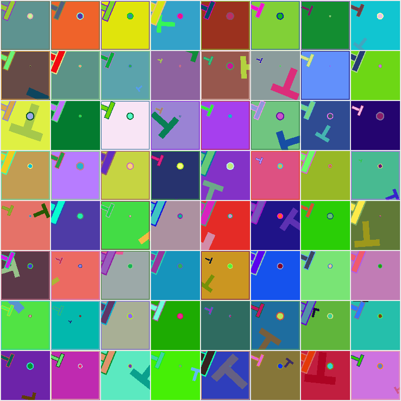
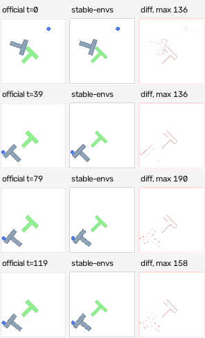
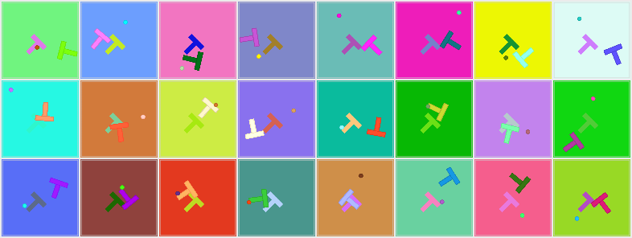
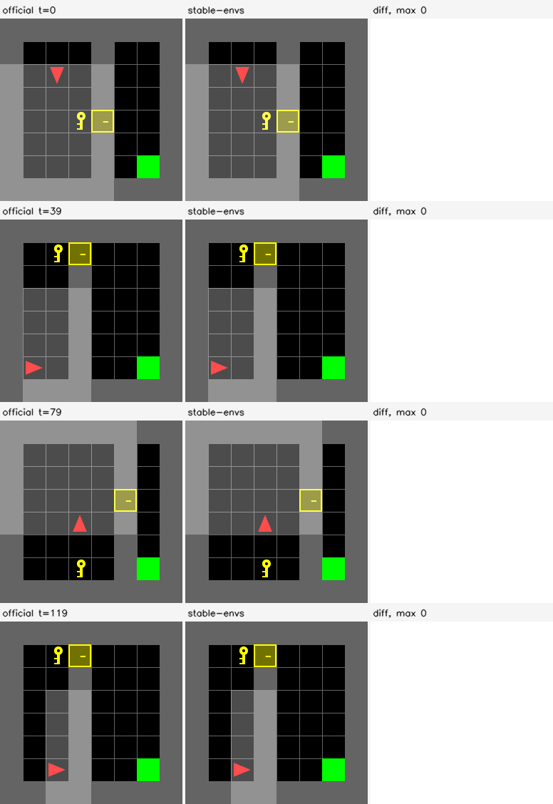

# Examples

Fifteen scripts. Five are the training-facing surface — states in the dataset, frames in the forward
pass — nine are the measurement harnesses, driven from `stable_envs.REGISTRY` so a newly registered env
is covered without editing them, and one draws the media.

Five subdirectories carry longer studies rather than scripts:
[`lewm_pusht/`](lewm_pusht/) swaps our pixels into an official pretrained world model's own evaluation
and reports the paired test, [`downstream_step5/`](downstream_step5/) generalises that swap into the
Step 5 semantic gate — PushT with LeWM and Reacher with DINO-WM, both against the frozen Step 2
equivalence rule and both with a blank-frame control, [`swm_compat/`](swm_compat/) runs a real
`stable_worldmodel` workflow on a stable-envs renderer through `stable_envs.compat.worldmodel`,
[`robocasa_visual/`](robocasa_visual/) puts the official RoboCasa renderer and the batched one side
by side so the [visual tier](../docs/concepts/fidelity-tiers.md)'s quality can be judged rather than
asserted, and [`paper/`](paper/) builds the write-up and its figures.

| script | what it produces |
|---|---|
| [`train_from_states.py`](train_from_states.py) | a real training loop: state dataset, `DataLoader`, `env.set_state(batch).render()` in the forward pass. Throughput, the render's share of a step, and convergence as held-out R². |
| [`ddp_train_from_states.py`](ddp_train_from_states.py) | the same loop under `DistributedDataParallel`, launched with `torchrun`: per-rank throughput, render share and peak memory, and the three things that differ from a stored-image pipeline. `results/ddp_train_from_states.json`. |
| [`rollout_with_policy.py`](rollout_with_policy.py) | `env.sample(steps=100, batch=256, policy=...)` on PushT's native GPU simulator with `RandomPolicy` and a `ScriptedPolicy`: the returned dict, the batch-scaling table, the measured divergence from pymunk, and the storage comparison. Also prints, verbatim, what `sample` raises on the envs that ship no simulator. |
| [`hf_roundtrip.py`](hf_roundtrip.py) | save to HuggingFace, reload, re-render, and assert the frames are bit-identical. The assertion is the deliverable. |
| [`domain_randomization.py`](domain_randomization.py) | `env.sample_style(B)`: B appearances in one launch, a grid image, a distinctness check, and the timing against the loop it replaces. |
| [`bench_gpu_vs_cpu.py`](bench_gpu_vs_cpu.py) | GPU vs the official CPU renderer: frames/s, µs/frame, GB/s, speedup, across batch sizes and resolutions, plus a `scene()` / rasterize split. Markdown + JSON. |
| [`dino_agreement.py`](dino_agreement.py) | do our frames and the official ones look the same to a *frozen* encoder? Embeds both renders of the same state with DINOv2 ViT-B/14 and reports the distance against three controls: a JPEG-q95 round-trip of the official frame (what a stored corpus would have held), two *different* states through the same renderer (the scale of a real difference), and a blank frame (the broken-renderer floor). Split by fidelity tier, because the visual tier is a different render by design. `results/dino/dino_agreement.json`. |
| [`bench_vs_decode.py`](bench_vs_decode.py) | one GPU regenerating frames against one CPU core decoding a JPEG of *that env's own* frame, from memory and from a warm local file. The ratio is CPU cores of decode replaced by one GPU. `results/bench_vs_decode<tag>.{json,md}`; the merged pass is [`results/decode/`](results/decode/). |
| [`bench_step3.py`](bench_step3.py) | the Step 3 sweep: the same renderer on **either device**, over the frozen batch list, against the official renderer and one core of decode on the same host. One shard per interpreter, because no single one imports every family; `scratch/step3/certify.py` merges them and applies the frozen Step 2 bars. `results/step3/{cpu,gpu}/*.json`. |
| [`bench_step3_pipeline.py`](bench_step3_pipeline.py) | Step 3 product C: `states -> sampler -> collate -> transfer -> renderer`, comparing per-item `default_collate`, a `BatchSampler`, `collate_batched` and the no-loader ceiling. Deliberately **not** a renderer certification number. `results/step3/pipeline/*.json`. |
| [`fidelity_step4.py`](fidelity_step4.py) | the Step 4 baseline: every applicable conformance check plus the parity/visual measurement, per render-distinct configuration, on a **frozen state corpus** that is written once and thereafter read. Freezes the digests a Step 6 rewrite is replayed against; applies no threshold itself. `results/step4/{states,conformance,comparisons}/`. |
| [`bench_storage.py`](bench_storage.py) | the same question pinned to one operating point — 256 px, batch 1,024, `--frames` *distinct* JPEGs read back through the page cache from node-local disk and from the shared filesystem — so the column is like-for-like across envs. `results/storage/storage<tag>.json`. |
| [`dump_frames.py`](dump_frames.py) | phase 1 of that comparison, run inside each env's own interpreter: renders real frames and encodes them the way a corpus does (JPEG quality 95), one `.npz` of blobs plus metadata per env, written to `--out`. |
| [`bench_lance.py`](bench_lance.py) | phase 2: the strongest disk baseline in use today — those JPEG blobs in a LanceDB table, fetched a chunk of rows at a time and batch-decoded with `torchvision.io.decode_jpeg` — read local and shared, one process and `--workers`, CPU and nvJPEG. `results/storage/lance.json`. |
| [`gallery.py`](gallery.py) | per env: a state grid, a CPU-vs-GPU side-by-side H.264 video and GIF on identical states, a per-frame difference panel, and a variation showcase. |

```bash
pip install -e ".[pusht,hf]"   # gym_pusht for the rollout, datasets for the HF round trip
export PYTHONPATH=.            # only if the package itself is not installed
export SDL_VIDEODRIVER=dummy   # gym_pusht imports pygame; only rollout_with_policy needs it

python examples/train_from_states.py
torchrun --nproc_per_node=2 examples/ddp_train_from_states.py
python examples/rollout_with_policy.py
python examples/hf_roundtrip.py --corpus examples/results/pusht_rollout.npz
python examples/domain_randomization.py

python examples/bench_gpu_vs_cpu.py --out examples/results --envs PushT --sizes 96,224
python examples/bench_gpu_vs_cpu.py --out examples/results --sizes native   # whole registry
python examples/dino_agreement.py --out examples/results/dino
python examples/bench_vs_decode.py --out examples/results --tag se-envs
python examples/fidelity_step4.py --shard raster --out examples/results/step4/conformance/raster.json
python examples/bench_storage.py --out examples/results/storage --tag se-envs
python examples/dump_frames.py                # renders + encodes, in the env's interpreter
python examples/bench_lance.py --workers 8    # reads them back, in the one with lancedb
python examples/gallery.py --out docs/assets/media
```

Every number below came out of one of those commands on one NVIDIA H200 (Intel Xeon Platinum 8558, 16
cores visible, torch 2.11.0+cu130, triton 3.6.0, datasets 4.0.0); nothing here is estimated. The
1-minute load average is captured around each sweep and written into its own JSON — 0.57 at the start
and 0.61 at the end of the bench pass quoted below. It is recorded because the CPU baselines do not
travel: the same sweep on a busier host of this cluster measured MiniGridKeyCorridor's official
renderer at 37 frames/s against 425 here, and elsewhere in this repo one official renderer has gone
from 422 frames/s idle to 3 with three other jobs resident. The GPU column does not travel
unconditionally either, which is a retraction of what this page used to say — the detail is
[below](#measured-gpu-vs-the-official-cpu-renderer). The JSON each script writes is in
[`results/`](results/) next to the figures.

The measurement harnesses are written for a registry that changes under them. Results merge per env
rather than replacing the file, so a sweep can be split across allocations; the bench writes after
every env, so a reference env that aborts the process costs one env rather than the run; and every
measurement is wrapped, so an env mid-port leaves a row saying what it raised instead of ending the
sweep. Envs without a reference renderer get the GPU columns and no speedup column, rather than a
fabricated baseline.

## Training with no image dataset

[`train_from_states.py`](train_from_states.py) is the loop the repo exists for, run for real:

```python
from torch.utils.data import DataLoader, TensorDataset

ds = TensorDataset(torch.as_tensor(states))                  # your states, torch's dataset
loader = DataLoader(ds, batch_size=256, shuffle=True)        # your loader, torch's collate

for (batch,) in loader:
    frames = env.set_state(batch).render()                   # (256, 96, 96, 3) uint8, one launch
    loss = ((net(frames) - targets(env.get_state())) ** 2).mean()
```

Nothing from `stable_envs` appears until the render. `drop_last` is left at its default of `False` —
the short final batch is rendered, not dropped (measured: 3.371 ms for 4,095 PushT states against
3.341 ms for 4,096) — and `env.get_state()` is used for the target rather than the loop variable,
because it is already on the device and already trimmed to the rows that were drawn.

The task is the inverse of the renderer — recover the 5-number PushT state from the 96 px frame — chosen
because it is trivial *and* checks something: if the frame is a function of the state, the state should
be recoverable from the frame. 32,768 training states (**640 kB**, standing in for **906 MB** of frames),
4,096 held out, a 1.42 M-parameter conv net, 2,000 steps, 11.9 s end to end.

| | before | after 2,000 steps |
|---|---|---|
| held-out MSE (normalised targets) | 0.2923 | **0.00252** |
| R² `agent_x` / `agent_y` | −0.152 / −0.006 | **+0.9885 / +0.9879** |
| R² `block_x` / `block_y` | −0.624 / −0.027 | **+0.9965 / +0.9966** |
| R² `cos angle` / `sin angle` | −0.020 / −0.010 | **+0.9901 / +0.9909** |
| agent position error | 158.2 | **14.4** board units (2.7 output px) |
| block position error | 128.0 | **6.2** board units (1.2 output px) |
| block angle error | 90.9° | **3.2°** |

The board is 512 units rendered at 96 px, so one output pixel is 5.33 board units: the block is
recovered to about one pixel. The angle is regressed as `(cos, sin)` — regressing it directly puts a
discontinuity at ±π inside the target, and the network then averages across the wrap.

### Throughput, and how much of it is rendering

Every step is split with an explicit `cuda.synchronize` into render and forward/backward.

| batch | render ms | fwd+bwd ms | step ms | render share | frames/s |
|---|---|---|---|---|---|
| 64 | 2.52 | 2.33 | 4.93 | 52.0% | 12,982 |
| 128 | 2.50 | 2.35 | 4.93 | 51.5% | 25,949 |
| 256 | 2.56 | 2.99 | 5.64 | 46.1% | 45,365 |
| 512 | 2.72 | 4.58 | 7.39 | 37.2% | 69,286 |
| 1,024 | 2.92 | 8.33 | 11.36 | 26.0% | 90,121 |

The training run itself (batch 256, 2,000 steps) measured **43,082 frames/s end to end**, 5.94 ms/step,
of which rendering is **2.59 ms — 45.0%**.

Read the render column as almost flat: 2.52 ms at batch 64 and 2.92 ms at batch 1,024 for 16× the
pixels. That is `scene()`, ~2.2 ms of Python-issued small torch ops that does not shrink with batch size
(the same effect the [`scene()` / rasterize split](#where-the-time-goes) below isolates), so the render's
share of a step falls as the model gets bigger or the batch gets wider. Rendering is not the thing to
optimise here; it is the thing that stopped mattering.

### The control: what generating the pixels actually costs

The same optimisation, same net, same states, with the frames already resident in device memory — no
renderer, no I/O, the fastest data path that can exist:

| data path | ms/step (batch 256) | frames/s | resident bytes |
|---|---|---|---|
| frames already in VRAM | 3.09 | 82,895 | 226 MB of pixels |
| rendered every step | 5.63 | 45,477 | **164 kB of state** |

Generating the pixels costs **2.54 ms/step, 82% over a data path with no data path**, and buys back a
1,382× reduction in what has to exist. A stored-frame pipeline does not get the VRAM row — it gets
decode and disk on top of it.

## Rollouts under a policy, native and otherwise

[`rollout_with_policy.py`](rollout_with_policy.py). PushT ships a batched GPU simulator, so the primary
path is one device-resident call:

```python
out = env.sample(steps=100, batch=256, policy=se.RandomPolicy(), style=style)
#   states   (256, 101, 5)   float32  cuda:0
#   actions  (256, 100, 2)   float32  cuda:0
#   style    (256, 29)       float32  cuda:0      <- appearance is state; without it the rollout
#                                                    does not determine its own frames
```

`RandomPolicy()` needs no arguments because the env declares `action_dim`, `action_low` and
`action_high` — gym_pusht's action is an absolute target position in the 512-unit board.

The script prints how many registry envs implement `step` at run time rather than asserting it in prose,
because the answer changes as envs land — it was 18 of 77 when this page was last regenerated. The rest
raise, with the reason and the alternative, printed verbatim from whichever renderer-only env the script
finds first:

```
AntmazeGiantNavigate ships a renderer but no batched GPU simulator, so it cannot generate
trajectories. That is a deliberate split: rendering and simulation are separable, and an env earns a
step() only where its dynamics can be ported AND checked. Either supply states you already have
(stable_envs.render_states / StateDataset), or roll out the official CPU env and render the states it
produces.
```

`ReferencePushT` stays in the script as the worked example of the alternative: it adds `step` by driving
256 copies of the official `gym_pusht` env (0.16 s to build, 0.6 ms each), and `sample` runs unchanged.
It is also the baseline the native path is timed against.

| 256 × 100 steps | wall | env-steps/s | µs / env-step |
|---|---|---|---|
| native GPU (`PushT.step`) | **0.82 s** | 31,090 | 32.2 |
| 256 official CPU envs (`ReferencePushT`) | 10.8 s | 2,363 | 423 |
| | **13.2× faster** | | |

13.2× understates it, because the two scale differently: the CPU path costs one pymunk step per
environment and is linear in B, while the GPU step is ~2,000 tiny kernels captured into a single CUDA
graph and is nearly batch-independent until the arithmetic finally bites.

| batch | ms / step | env-steps/s | µs per env-step | uncaptured ms | graph speedup |
|---|---|---|---|---|---|
| 256 | 7.86 | 32,590 | 30.684 | 49.2 | 6.3× |
| 1,024 | 7.91 | 129,494 | 7.722 | 49.5 | 6.3× |
| 4,096 | 8.96 | 457,248 | 2.187 | 49.3 | 5.5× |
| 16,384 | 15.15 | **1,081,521** | **0.925** | 49.2 | 3.2× |

At batch 16,384 that is **457× the CPU's per-env-step cost**. The `uncaptured` column is why the CUDA
graph exists and is the cleanest diagnostic in the file: **49.2–49.5 ms whether the batch is 256 or
16,384**, a 64× range with no change in cost. That is not arithmetic, it is 10 substeps × 10 solver
iterations of kernel launches. Capturing them removes the launches and the step finally starts
responding to how much work it is doing — which is also why the graph's advantage shrinks from 6.3× to
3.2× as the arithmetic grows.

### Does the solver track pymunk? Measured, with a control

Renderer parity is an exactness claim; simulator parity cannot be one. Contact is chaotic, so two
solvers that disagree by a micron at first touch disagree by centimetres later — true of MJX, Brax,
Jax2D and this one alike. `check_step_matches_reference` runs 16 episodes × 100 steps from identical
states under identical actions and the script **asserts** the result:

| | measured | tolerance |
|---|---|---|
| agent position error (kinematic — the integrator check) | max **9.5e-05 px**, mean 2.9e-05 | < 1e-3 |
| block position error after 100 steps | **median 0.68 px**, mean 20.7, p90 33.6 | median < 2.0 |
| block position error after 25 steps | median 0.05 px | — |
| block angle error after 100 steps | median 0.017 rad | — |

The agent row is the control: no contact acts on it, so a disagreement there would be an integration
bug rather than a solver difference, and it would otherwise hide inside the block numbers. The mean is
30× the median *and reported*: a minority of the touched episodes diverge outright, which is what the
p90 column exists to show, and quoting the median alone would hide it. Episodes where the block was
never touched are excluded and counted (13/16 touched) — an untouched block agrees trivially and is
evidence of nothing.

An independent end-to-end check falls out of keeping the CPU path: the same scripted policy from the
same 256 starts leaves the block 130.1 px from the goal on the GPU and 131.9 px on pymunk, with tracking
errors of 33.3 px and 31.4 px. The two solvers agree in distribution while diverging per episode, which
is exactly the claim.

### Policies, honestly

| policy | wall | command tracking error | block distance to goal, median change | closer at the end |
|---|---|---|---|---|
| `RandomPolicy` | 0.79 s | 153.4 px | **+81.9 px** | 2% |
| `ScriptedPolicy` | 0.82 s | **33.3 px** | **+4.7 px** | 34% |

Neither solves PushT, and the table says so: positive means the block ended up *further* from the goal.
The scripted controller follows its own commands to 33 px and leaves the block roughly where it found
it; random actions scatter it 82 px away. That is a policy argument being load-bearing, measured — it is
not a control result, and a hand-written T-pusher is a research problem rather than an example.

Frames are off by default. The rollout with `render=True` is 1.54 s against 0.82 s without; re-rendering
all 25,856 frames afterwards from the stored states takes **39 ms (661 k frames/s)**. The frames
rendered during collection and the frames re-rendered later are **bit-identical** — asserted in the
script, because if that failed, "store states, regenerate frames" would be false for this env.

### Storage: 256 × 101 steps

| what | bytes |
|---|---|
| states (256 × 101 × 5 × f32) | 517,120 |
| actions (256 × 100 × 2 × f32) | 204,800 |
| style (256 × 29 × f32) | 29,696 |
| **stored total** | **752 kB** |
| the frames it replaces, 96×96×3 | 715 MB — **951×** |
| the same states at 224×224×3 | 3,892 MB — **5,178×** |
| the same states at 512×512×3 | 20,334 MB — **27,054×** |

The last two rows are the part a frame dataset cannot do: the states do not change, and the resolution
is chosen at render time.

## The HuggingFace round-trip

[`hf_roundtrip.py`](hf_roundtrip.py) exists for one assertion, on the 256 × 101 corpus the rollout wrote:

```
FRAMES BIT-IDENTICAL: True  (max abs pixel difference 0 over 714,866,688 bytes)
```

Save, reload, re-render all 25,856 frames, compare with `torch.equal` — not a tolerance, because a
corpus that comes back as float64, or with its style dropped, still renders *something* and the
difference is invisible in every plot anyone would draw.

| path | on disk | frames identical | env recovered |
|---|---|---|---|
| `save_to_disk` / `load_from_disk` (Arrow) | 770,858 B | **True**, max diff 0 | `PushT`, from the stored metadata |
| `to_parquet` / `from_parquet` (what `push_to_hub` uploads) | 645,007 B | **True** | `PushT`, from the `stable_envs` column |
| no `datasets` installed | — | — | a message naming the extra and the three arrays to `np.savez` instead |

One measured finding changed the schema. `DatasetInfo._INCLUDED_INFO_IN_YAML` (datasets 4.0.0) is
`[config_name, download_size, dataset_size, features, splits]` — `description` is not in it — so
metadata written there survives `save_to_disk` and is **silently dropped by `push_to_hub`**. Measured:
after a parquet round trip `info.description` is empty. `to_hf` therefore also writes a constant
`stable_envs` column, and that is the copy that survives; without it a corpus pulled off the hub no
longer knows which renderer its numbers belong to, and the failure mode is a wrong picture rather than
an error.

`push_to_hub` itself is a passthrough and is deliberately not exercised: pushing creates a repository
under someone's account, which is not a side effect an example gets to have. The parquet arm covers the
serialisation; what is left untested is the HTTP.

### Windows, and the boundary that must hold

```python
ds = se.TrajectoryDataset(env, states, style=style, window=8, stride=4)
# TrajectoryDataset(PushT, 256 traj x ~101 steps, window=8, stride=4, 6144 clips)
ds[[0, 1, 2, 3]]
# {'states': (4, 8, 5), 'traj': (4,), 'start': (4,), 'style': (4, 29)}   frames on request
```

The clip index is built per trajectory and the constructor re-derives the last row each clip touches to
check it is inside that trajectory — 6,144 clips, none straddling a boundary, rows consecutive at
`frameskip 1`, checked in the example too. A window that crosses an episode boundary teaches a
transition that never happened and is invisible in a loss curve.

Compression on this corpus is **1,307×** (546,816 B of states + style against 714,866,688 B of frames) —
lower than PushT's headline 1,382× because style is 29 floats per *trajectory*, which amortises over
however long the trajectory is. `.all_frames()` regenerates the entire image dataset — 715 MB of pixels
from 547 kB of state — at **194 k frames/s**.

## Domain randomisation is a tensor, not a loop

[`domain_randomization.py`](domain_randomization.py): `env.sample_style(B)` gives B independent
appearances, and `render(states, style=...)` draws all of them in one launch.



64 environments, one shared state, 64 sampled styles, **one kernel launch**, and 64/64 frames pairwise
distinct. The distinctness count is not decoration: a renderer that collapses the batch to environment
0's appearance is faster and wrong, and no throughput number would show it.

| batch | batched (ms) | loop of B renders (ms) | one env per style (ms) | speedup vs the loop | frames/s | distinct |
|---|---|---|---|---|---|---|
| 64 | 2.56 | 126.7 | 220 | 50× | 25,031 | 64/64 |
| 256 | 2.59 | 511.0 | — | 197× | 98,767 | 256/256 |
| 1,024 | 2.85 | 2,040.6 | — | 716× | 359,102 | 1,024/1,024 |
| 4,096 | 4.09 | 8,122.7 | — | 1,986× | 1,001,293 | — |

The loop column is flat at 501–505 frames/s regardless of B, which is the honest shape of the comparison:
looping gives up the launch, so per-frame cost stops depending on how many frames you wanted. The
"one env per style" column is measured only up to 64 because constructing 4,096 envs takes longer than
every other measurement in the file put together.

`sample_style(paths=[...])` restricts randomisation to named leaves and leaves everything else at the
official default, which is what makes "vary only the background" an experiment rather than a re-render
of everything — the script writes that sheet too.

One thing the rollout script does *not* do: randomise geometry. PushT's style space also carries
`goal.position`, `goal.angle` and the scales, and once a simulator is attached, changing those makes the
frame advertise a target the dynamics do not share. Appearance is free to vary; geometry is not.

## Loaders: read this before writing your own loop

The recommended idiom needs nothing from this package's data module — your dataset over states, your
`DataLoader`, torch's default collate, and `env.set_state(batch).render()` in the step. Two measured
notes about the loop, both about torch rather than about stable-envs.

**Index a batch at a time above about B=1,024.** A `DataLoader` indexes a map-style dataset one row at
a time, at roughly 3.4 µs of Python per row. Fetching one PushT batch of states, no render, on one
H200:

| | B=64 | B=256 | B=1,024 | B=4,096 |
|---|---|---|---|---|
| `DataLoader` over `TensorDataset` | 0.193 ms | 0.785 | 3.006 | 14.890 |
| the same with `num_workers=8` | 0.319 | 0.380 | 0.969 | 3.813 |
| `BatchSampler`, `batch_size=None` | **0.041** | **0.080** | **0.229** | **0.794** |

At B=4,096 that is 14.9 ms against a 3.4 ms render. The fix needs no custom collate:

```python
from torch.utils.data import BatchSampler, DataLoader, RandomSampler
sampler = BatchSampler(RandomSampler(range(len(ds))), batch_size=4096, drop_last=False)
loader = DataLoader(ds, batch_size=None, sampler=sampler)      # ds[list] -> (B, state_dim)
```

**`StateDataset` and `TrajectoryDataset` need one argument.** They render inside `__getitems__` — the
batched hook `DataLoader` prefers — and return the already-assembled batch, because one launch for the
whole batch is the entire point. `default_collate` then receives something already collated and raises:

```
TypeError: stack(): argument 'tensors' (position 1) must be tuple of Tensors, not Tensor
```

so pass `collate_fn=stable_envs.collate_batched` and `num_workers=0` (the frames are already on this
process's GPU; a worker would duplicate the CUDA context to ship them back). There is no `ds.loader()`
any more: it wired that one argument and hid two decisions that are the caller's. The alternative —
returning per-item samples so `default_collate` re-stacks them — is correct and was measured at
8.741 ms/batch against 0.202 for `TrajectoryDataset` at B=1,024, a 43× tax to undo a gather that had
already happened.

## Measured: GPU vs the official CPU renderer

One NVIDIA H200, Intel Xeon Platinum 8558 (16 cores visible), torch 2.11.0+cu130, triton 3.6.0,
supersample 1. Full output in [`results/bench_gpu_vs_cpu.md`](results/bench_gpu_vs_cpu.md) and
[`results/bench_gpu_vs_cpu.json`](results/bench_gpu_vs_cpu.json).

Supersample 1 was forced, and re-running the sweep today does not reproduce that picture: `--ss` now
defaults to `native`, which is whatever the class declares. Forty-four registered classes declare
`default_supersample = 2` — 25 OGBench mazes, 11 DM Control domains, 4 D4RL mazes, 4 MuJoCo locomotion
envs — because their reference is MSAA'd, so forcing 1 measured a different picture, four times cheaper
in rays, than `se.make(name)` returns. `make_env`'s docstring in
[`bench_gpu_vs_cpu.py`](bench_gpu_vs_cpu.py) records the A/B in one process on an idle node,
`supersample=1` against the class's own value: DMCBallInCupCatch at 84 px batch 4,096 is 4,272 against
3,683 frames/s (1.16×), AntmazeLargeNavigate at 224 px 70,598 against 55,947 (1.26×), MujocoPusher at
240 px 14,938 against 4,475 (3.3×); on a busy node the same ball-in-cup A/B measured 1,149 against 356.
PushT is not one of the forty-four, so the table below is the picture `se.make("PushT")` returns.

The GPU column was described on this page as repeating across nodes to 0.4%, and that is retracted as
stated. It holds where the render is one fused 2-D rasterizer kernel — highway-env measured twice on
different nodes gave 21,342/21,300, 27,618/27,537, 1,716/1,717 and 2,473/2,475 frames/s, which is where
the 0.4% comes from ([`docs/research/highway.md`](../docs/research/highway.md)). It does not hold where
the render is host-bound: the ray-cast families spend 100–206% of their wall time on CPU inside a
per-chunk Python loop, and `DMCBallInCupCatch` at 84 px measured 3,664 frames/s on an idle node against
271–978 on contended ones, a 13× spread. Every GPU row therefore carries a `cpu_frac` and the load
average next to its throughput; read a row near 0 as the device and a row at or above 100% as a
measurement of the node's processor under its load.

Both sides do the same job — take a state, produce a uint8 frame — on the same states, drawn from the
env's own reset distribution.

### PushT @ 96×96, and where the time goes

The tables that used to be transcribed here are no longer transcribed here. They were a copy of
[`results/bench_gpu_vs_cpu.md`](results/bench_gpu_vs_cpu.md), which the script regenerates on every
run, and a copy is what goes stale — the version on this page disagreed with its own JSON on every row
for a week, and its 224 px section described a measurement the JSON did not contain. Read the generated
file; it carries the resolved supersample, the `cpu%` for each row, and the load average the sweep was
taken under, none of which a hand-copied table preserves.

What the numbers show, and what has not changed across re-measurements: at batch 1 the GPU path is the
same order as the reference, because most of that call is `scene()` building a few dozen small torch
ops from Python and there is nothing to amortise it over. The per-frame cost falls by three orders of
magnitude as the batch grows and then turns back up once the output no longer fits comfortably in
memory, so the best cell is an interior one rather than the largest. And the scene build, not the
rasterizer, is what is left to optimise at 96 px: it is roughly 2.1 ms almost independently of batch
size, against a rasterize step that scales with output pixels.

### Storage

| resolution | raw frame | state | ratio |
|---|---|---|---|
| 96×96×3 | 27,648 B | 20 B (5 × float32) | **1,382×** |
| 224×224×3 | 150,528 B | 20 B | **7,526×** |

The 120-frame side-by-side video below is driven by a `states.npy` of **2,528 bytes**; the same 120
frames as raw 96px pixels would be 3.3 MB.

### The rest of the registry

The sweep also runs every other registered env at its native resolution. The pass in
[`results/bench_gpu_vs_cpu.json`](results/bench_gpu_vs_cpu.json) covered **63 envs, 65 (env, resolution)
cells, and a GPU number in every one of them**; the `registry_size` it recorded for itself is 65,
`skipped_envs` is empty, and its `import_errors` name the two families that interpreter could not
import at all, `dmcontrol` and `fetch`. What did fail is written down rather than dropped: 13 envs
carry an error where their CPU baseline would be, and 3 carry one for the scene/rasterize split.
Per-env tables, with the load average the run was taken under, are in
[`results/bench_gpu_vs_cpu.md`](results/bench_gpu_vs_cpu.md); the family-level summary and the reason no
speedup column is derived from that pass are in [Throughput](../docs/benchmarks.md#the-rest-of-the-registry).

The registry has outgrown that pass, and `LunarLander` and `Sokoban` — which this page used to name as
the two envs that could not be constructed — both ship and are both measured now. The current whole is
196 envs across 24 families, measured across 14 interpreters because no single one can import every
family, in [`results/decode/ALL.md`](results/decode/ALL.md). There `default` is the env's own official
renderer one frame at a time, `ours` is the GPU path at its best batch, `stored` is one CPU core
decoding *that env's own* frame from memory at JPEG q90, and **cores replaced** is `ours / stored`:

| family | envs | frame | default f/s | ours f/s | stored f/s/core | **cores replaced** |
|---|---|---|---|---|---|---|
| Griddly | 7 | 144x120… | 99–145 | 2,307,114–9,438,816 | 851–5,276 | **1,789.0–3,647.9x** |
| Sokoban | 1 | 160x160 | 253 | 9,571,978 | 3,983 | **2,403.2x** |
| Overcooked | 5 | 192x224… | 41–1,595 | 3,615,605–8,145,368 | 2,914–4,399 | **1,241.0–1,860.7x** |
| MiniGrid / BabyAI | 7 | 224x224… | 117–942 | 711,991–4,479,313 | 608–4,011 | **329.7–1,225.8x** |
| MiniHack | 1 | 336x1264 | — | 244,456 | 698 | **350.0x** |
| Jumanji | 8 | 200x200 | 3–88 | 409,277–1,286,366 | 3,086–4,387 | **105.2–340.4x** |
| Procgen | 4 | 64x64 | 899–975 | 313,372–1,588,402 | 8,344–11,055 | **28.3–190.4x** |
| PushT | 1 | 96x96 | 472 | 1,256,557 | 10,259 | **122.5x** |
| OGBench | 25 | 224x224 | 82–491 | 48,978–206,740 | 1,893–4,249 | **11.9–93.6x** |
| swm nav | 5 | 224x224… | 52–772 | 71,140–187,629 | 1,083–4,985 | **15.3–86.7x** |
| Crafter | 1 | 64x64 | — | 665,836 | 8,186 | **81.3x** |
| Craftax | 1 | 112x144 | — | 569,934 | 7,039 | **81.0x** |
| PGX | 4 | 240x240… | 21–108 | 78,322–109,484 | 2,055–3,160 | **25.0–45.7x** |
| classic control | 5 | 400x600… | 249–541 | 33,216–39,843 | 1,120–1,626 | **22.3–35.6x** |
| D4RL PointMaze | 4 | 224x224 | 1,846–2,238 | 88,303–88,935 | 2,919–4,403 | **20.1–30.3x** |
| DM Control | 16 | 84x84 | 272–370 | 3,813–140,391 | 6,110–10,430 | **0.4–23.0x** |
| LunarLander | 1 | 400x600 | 336 | 18,786 | 1,165 | **16.1x** |
| highway-env | 6 | 150x600… | — | 1,520–20,389 | 660–3,205 | **2.3–7.2x** |
| Fetch | 12 | 480x480 | 323–404 | 6,008–6,164 | 896–1,399 | **4.3–6.9x** |
| HumanoidBench | 17 | 256x256 | 31–59 | 9,330–16,835 | 2,347–4,424 | **2.3–6.8x** |
| MuJoCo locomotion | 10 | 240x240 | 329–2,591 | 4,404–10,931 | 2,390–4,834 | **1.6–4.2x** |
| Meta-World | 50 | 480x480 | 8–219 | 1,039–2,554 | 655–1,066 | **1.2–3.8x** |
| RoboCasa | 4 | 256x256 | 87–560 | 5,122–11,687 | 2,511–3,718 | **1.7–3.1x** |
| CarRacing | 1 | 96x96 | 133 | 179 | 9,884 | **0.0x** |


> **The `ours` column of that sweep predates two kernel changes and understates the 2-D families
> badly.** It was taken at 05:58 on 2026-08-11; the fused 2-D rasterizer and the fused ray-cast path
> landed after it. Re-measured at 256 px / batch 1,024 the same day, `CarRacing` goes from 179 to
> **21,943** frames/s and `Roundabout` from 1,520 to **88,471** — 123x and 58x — while the ray-cast
> families move by less at that resolution. The current per-family ratios, against the eight-worker
> JPEG-in-Lance bar rather than against one core, are regenerated from the storage sweep in
> [`examples/paper/tables/family.tex`](paper/tables/family.tex). Re-run
> `examples/bench_vs_decode.py` per tag and `scratch/census/merge_bench.py` to refresh the table below.

Not a like-for-like comparison — different resolutions, different state widths, and three different
rendering paths (tile gather, 2-D rasterizer, 3-D ray-cast). The spread tracks how the frame is produced
rather than how big it is, and the envs whose reference package is absent leave the `default` column
blank — 9 of them — rather than getting a filled-in number. That is an absence, not a zero.

## Media

Written to `docs/assets/media/<EnvName>/`, with a `manifest.json` recording parity numbers, file sizes,
frame shapes and the probed video codec.

| artifact | PushT |
|---|---|
| side-by-side video, H.264 | [`sidebyside.mp4`](../docs/assets/media/PushT/sidebyside.mp4) (55,853 B, 120 frames) |
| side-by-side, GIF fallback | [`sidebyside.gif`](../docs/assets/media/PushT/sidebyside.gif) (285,481 B, every 2nd frame) |
| per-frame difference panel | [`parity.png`](../docs/assets/media/PushT/parity.png) |
| states from the reset distribution | [`grid.png`](../docs/assets/media/PushT/grid.png) |
| per-environment colour variation | [`variation_batch.png`](../docs/assets/media/PushT/variation_batch.png) |
| per-call scale and toggle sweep | [`variation_sweep.png`](../docs/assets/media/PushT/variation_sweep.png) |
| the states that drive the video | [`states.npy`](../docs/assets/media/PushT/states.npy) (2,528 B) |



Over the 120 rollout frames: **100.00%** of interior pixels exact, 90.61% of all pixels exact, mean
absolute difference 2.56/255. The residual is anti-aliasing on the outlines, which the difference column
isolates.



32 environments, one state, four colour leaves sampled independently per environment — one kernel launch.

The same artifacts exist for every other env with media; the tile-atlas family
(MiniGrid, BabyAI) reaches **100% of all pixels exact, max difference 0**, and its parity panels have an
empty difference column:



## The video codec, and why it is called out

`cv2.VideoWriter` with the `mp4v` fourcc writes MPEG-4 Part 2. Desktop players open it; no browser plays
it in an HTML5 `<video>` element, so an otherwise correct docs page renders as a blank box with controls
and reads as a broken build. `gallery.py` encodes through `imageio_ffmpeg.get_ffmpeg_exe()` with
`-c:v libx264 -pix_fmt yuv420p -profile:v baseline -movflags +faststart`, then probes the result and
records it in the manifest:

```
Stream #0:0(und): Video: h264 (Constrained Baseline) (avc1 / 0x31637661), yuv420p, 580x314, 15 fps
```

## Notes on what is and is not measured

* PushT is nine primitives with four polygon vertices, and both are compile-time constants in the kernel,
  so its numbers do not predict how a heavier scene scales.
* The CPU baseline is single-process — the reference envs have no batched entry point, so there was
  nothing fairer to time. A process pool over the 16 visible cores would recover something under 16×.
* Disk bandwidth is not measured, so "faster than reading it back" is left as the two numbers (0.34 µs
  per 96px frame against 27,648 bytes) rather than asserted as a verdict.
* Figures are one allocation, internally consistent. The same sweep on a different node moved the CPU
  baseline about 25% and the GPU column under 10%, so ratios travel better than absolute values.
* Timed cells stop early after a second of wall clock, with a floor of 3 repetitions: noise here is a
  fixed absolute quantity, so a cell taking tens of milliseconds does not need 25 of them.
* Video frames are upscaled with nearest-neighbour only. Any smoothing would put detail on screen that
  the renderer did not produce, in a figure whose whole purpose is a pixel-level comparison.
* The training numbers are one architecture at one resolution. A 1.42 M-parameter conv net at 96 px is
  small enough that rendering is 45% of a step; the same renderer under a ViT-B at 224 px would be a few
  per cent, and the batch sweep above is the shape of that trend, not a bound.
* The training split is timed with two `cuda.synchronize` calls per step. That costs a little of both
  columns and is the only way to attribute the time rather than guess; the un-split wall clock
  (5.94 ms/step at batch 256) is the number to compare against anything else.
* The CPU rollout's 423 µs per env-step is `gym_pusht` on one core, including its shapely coverage
  computation. It is a property of the reference simulator, not of this repo, and like every CPU number
  here it is a property of the host it ran on. A process pool would recover something under the core
  count, which does not change the shape of the comparison.
* The GPU solver is validated against pymunk on the *reset* distribution with actions held 8 steps.
  A different action regime (every-step resampling keeps the agent in transit and rarely sustains
  contact) exercises the solver less, so it would report a smaller divergence for the same code.
* `PushT.step` is float32 throughout, and the compact state is converted to the solver's
  centre-of-gravity coordinate and back once per control step. That round trip is exact to ~3e-5 px,
  three orders of magnitude below the divergence it sits inside.
* `push_to_hub` is not exercised — it would create a repository under someone's account. The parquet
  round trip covers the serialisation it uploads; the HTTP is untested.
* The HuggingFace round trip is asserted with `torch.equal` over every rendered byte, so it is a claim
  about this corpus and this env. It is a property of float32 surviving Arrow, which holds generally,
  but "generally" is not what was measured.
